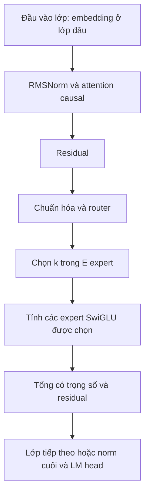
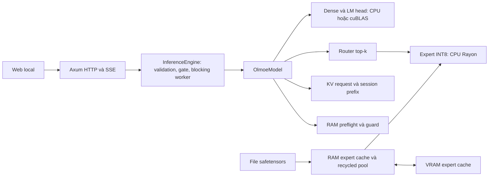
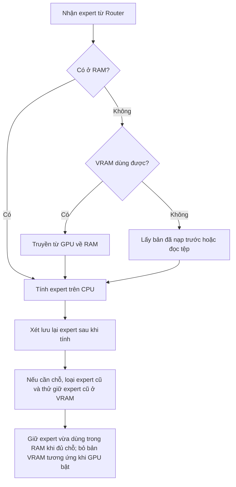
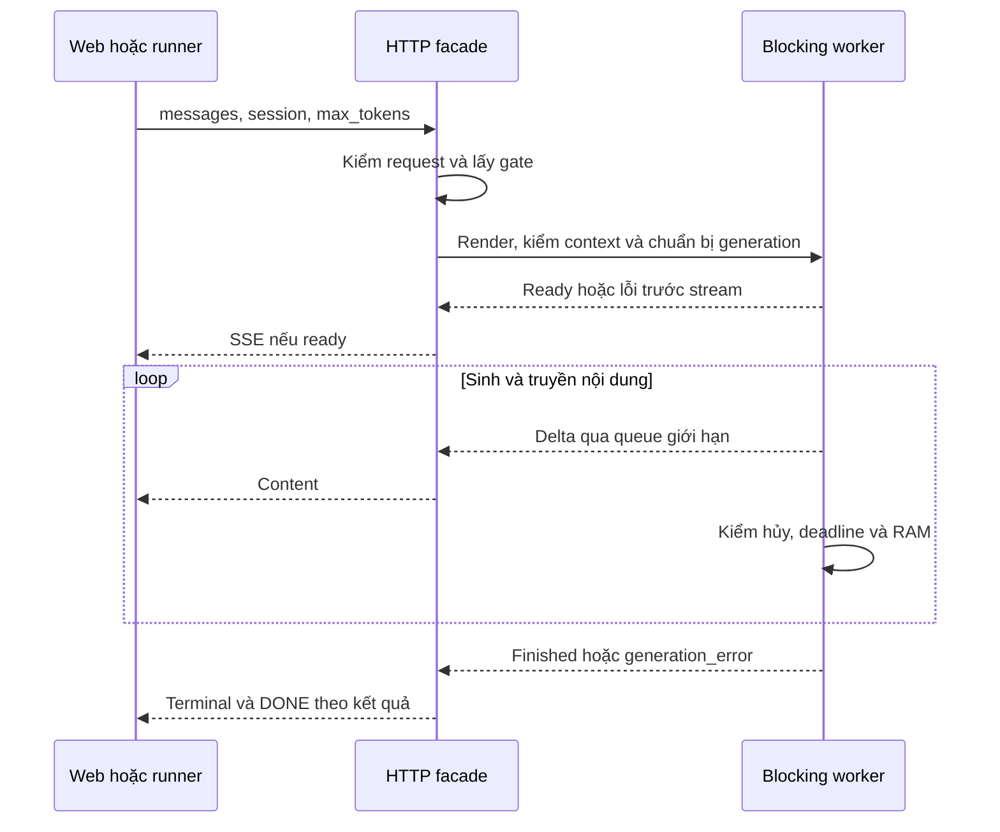

<!--
HƯỚNG DẪN BIÊN TẬP — KHÔNG ĐƯA KHỐI NÀY VÀO BẢN IN
Bản nội dung Markdown để chuyển sang LaTeX; không phải bản đã duyệt hoặc đã dàn trang.
Theo Phụ lục 3 kèm QĐ 449/QĐ-HV ngày 09/03/2026:
A4; lề trái 3cm, trên/dưới/phải 2cm; header/footer 1cm; Times New Roman 12 hoặc 13;
căn đều; trước/sau đoạn 3pt; giãn dòng 1,1–1,2; tiêu đề chương đậm/in hoa 13–15pt.
Header trái: Đồ án tốt nghiệp Đại học; phải: Chương và tên chương.
Footer trái: Họ tên sinh viên, lớp; phải: số trang.
Phần Lời cảm ơn đến Danh mục hình: i, ii,...; từ Mở đầu đến phần cuối: 1, 2,...
Đây là lựa chọn theo hướng dẫn chính mục II.5; mẫu 9 có mô tả bắt đầu từ chương 1 khác với mục này.
Mục lục/danh mục/số trang sinh tự động khi dàn LaTeX, không dùng số trang giả trong Markdown.
Công thức dùng tag(chương.thứ tự); bảng/hình đánh số theo chương, ghi nguồn.
Mermaid là mã sơ đồ: xuất SVG/PDF hoặc dựng TikZ trước khi dàn LaTeX.
Ngắt trang giữa các phần đầu và mỗi chương; chuẩn hóa dấu thập phân theo quy định của khoa nếu có.
Thông tin [CẦN XÁC NHẬN] phải được nhóm xác nhận. Không ký thay người duyệt/sinh viên.
Phụ lục gốc quy định quyển ĐATN cuối; nhãn “định kỳ lần 1” là điều chỉnh theo mục đích báo cáo này.
-->

# BỘ KHOA HỌC VÀ CÔNG NGHỆ
# HỌC VIỆN CÔNG NGHỆ BƯU CHÍNH VIỄN THÔNG

**CƠ SỞ TẠI THÀNH PHỐ HỒ CHÍ MINH**

**BÁO CÁO ĐỊNH KỲ LẦN 1**

**ĐỒ ÁN TỐT NGHIỆP ĐẠI HỌC**

**ĐỀ TÀI: XÂY DỰNG HỆ THỐNG SUY LUẬN MoE VỚI PHÂN TẦNG BỘ NHỚ**


| Thông tin | Nội dung |
| --- | --- |
| Giáo viên hướng dẫn | ThS. Huỳnh Trung Trụ |
| Sinh viên thực hiện thứ nhất | N22DCCN170 — Trần Thái Sơn |
| Sinh viên thực hiện thứ hai | N22DCCN134 — Nguyễn Lê Nhật Huy |
| Nhóm sinh viên thực hiện | C51 |
| Khóa / Ngành | 2022 / Công nghệ thông tin |
| Ngày lập bản thảo | 23/10/2026 |
| Mốc dữ liệu thực nghiệm | Các artifact ngày 22–23/10/2026 được dẫn trong báo cáo |

**TP. HỒ CHÍ MINH, NĂM 2026**


# LỜI CẢM ƠN

Nhóm sinh viên xin cảm ơn quý thầy cô Học viện Công nghệ Bưu chính Viễn thông đã trang bị kiến thức nền tảng về lập trình, kiến trúc máy tính và phương pháp nghiên cứu. Nhóm xin cảm ơn giảng viên hướng dẫn **ThS. Huỳnh Trung Trụ** đã hướng dẫn thực hiện đề tài.

Trong kỳ báo cáo đầu tiên, nhóm tập trung tìm hiểu mô hình ngôn ngữ có kiến trúc hỗn hợp chuyên gia và những khó khăn khi triển khai trên máy tính cá nhân hạn chế bộ nhớ. Quá trình xây dựng nguyên mẫu, ghi nhận các phương án không hiệu quả và phân tích dữ liệu thực nghiệm giúp nhóm liên hệ kiến thức lý thuyết với hoạt động thực tế của hệ thống.

Báo cáo tập trung vào nền tảng lý thuyết và thực nghiệm sơ bộ; phạm vi đánh giá chất lượng và độ ổn định dài hạn sẽ được mở rộng ở kỳ tiếp theo. Nhóm mong nhận được góp ý để hoàn thiện phương pháp và triển khai các công việc tiếp theo.

TP. Hồ Chí Minh, năm 2026

**ĐẠI DIỆN NHÓM SINH VIÊN**

**Trần Thái Sơn**

# LỜI CAM ĐOAN

Chúng em cam đoan báo cáo phản ánh trung thực nội dung đã tìm hiểu, hệ thống đã triển khai và các kết quả thực nghiệm được lưu trong hồ sơ của đề tài. Những kiến thức, mô hình, thư viện và tài liệu kế thừa được ghi nguồn. Nhóm không nhận việc huấn luyện OLMoE, phát minh Transformer hoặc xây dựng CUDA/cuBLAS là đóng góp của mình.

Các kết quả đo được phân biệt với tính toán lý thuyết và nhận định. Số liệu mỗi cấu hình được lấy từ hồ sơ thực nghiệm riêng; thông tin chưa xác minh được nêu rõ, không suy diễn từ cấu hình còn lại. Công cụ hỗ trợ lập trình và soạn thảo, bao gồm trợ lý AI, được sử dụng trong quá trình thực hiện; nhóm chịu trách nhiệm kiểm tra mã nguồn, số liệu, trích dẫn và nội dung cuối cùng theo quy định của Học viện.

TP. Hồ Chí Minh, năm 2026

**ĐẠI DIỆN NHÓM SINH VIÊN**

**Trần Thái Sơn**

# MỤC LỤC

<!-- Sinh mục lục tự động khi chuyển sang LaTeX; không điền số trang dự đoán. -->

- MỞ ĐẦU
- BẢNG PHÂN CÔNG NHIỆM VỤ NHÓM THỰC HIỆN
- CHƯƠNG 1. TỔNG QUAN ĐỀ TÀI VÀ BÀI TOÁN NGHIÊN CỨU
- CHƯƠNG 2. CƠ SỞ LÝ THUYẾT VÀ CÔNG NGHỆ LIÊN QUAN
- CHƯƠNG 3. PHÂN TÍCH VÀ THIẾT KẾ HỆ THỐNG
- CHƯƠNG 4. THUẬT TOÁN VÀ CÁC GIẢI PHÁP KHẢO SÁT
- CHƯƠNG 5. THIẾT KẾ THỰC NGHIỆM VÀ KẾT QUẢ BƯỚC ĐẦU
- KẾT LUẬN, KIẾN NGHỊ
- TÀI LIỆU THAM KHẢO

# DANH MỤC CÁC KÝ HIỆU VÀ CHỮ VIẾT TẮT

| Viết tắt | Tiếng Anh | Nghĩa sử dụng trong báo cáo |
| --- | --- | --- |
| API | Application Programming Interface | Giao diện lập trình ứng dụng |
| CPU | Central Processing Unit | Bộ xử lý trung tâm |
| CUDA | Compute Unified Device Architecture | Nền tảng lập trình tính toán GPU của NVIDIA |
| D2H | Device to Host | Truyền dữ liệu từ thiết bị về bộ nhớ máy chủ |
| EOS | End of Sequence | Token kết thúc chuỗi |
| FFI | Foreign Function Interface | Giao tiếp giữa các ngôn ngữ lập trình |
| FP32 | 32-bit Floating Point | Số thực dấu phẩy động 32 bit |
| GPU | Graphics Processing Unit | Bộ xử lý đồ họa |
| H2D | Host to Device | Truyền dữ liệu từ máy chủ lên thiết bị |
| HTTP | Hypertext Transfer Protocol | Giao thức trao đổi giữa giao diện và máy chủ |
| HWM | High Water Mark | Mức sử dụng bộ nhớ cao nhất do hệ điều hành ghi nhận cho tiến trình |
| INT8 | 8-bit Integer | Số nguyên 8 bit dùng lưu trọng số expert |
| KV | Key–Value | Khóa và giá trị được lưu cho attention |
| LLM | Large Language Model | Mô hình ngôn ngữ lớn |
| MoE | Mixture-of-Experts | Kiến trúc hỗn hợp chuyên gia |
| NVMe | Non-Volatile Memory Express | Giao thức truy cập thiết bị lưu trữ; không đồng nhất với bộ đếm file của ứng dụng |
| OOM | Out of Memory | Tình trạng thiếu bộ nhớ |
| RAM | Random Access Memory | Bộ nhớ chính của máy tính |
| RMSNorm | Root Mean Square Layer Normalization | Chuẩn hóa dựa trên căn trung bình bình phương |
| RoPE | Rotary Position Embedding | Biểu diễn vị trí bằng phép quay |
| RSS | Resident Set Size | Lượng bộ nhớ vật lý đang thường trú của tiến trình |
| SSE | Server-Sent Events | Cơ chế truyền sự kiện một chiều qua HTTP |
| TTFT | Time to First Token | Thời gian đến token đầu theo phạm vi đo được xác định |
| VRAM | Video Random Access Memory | Bộ nhớ trên GPU |

Báo cáo dùng $L$ cho số lớp, $d$ cho chiều ẩn, $m$ cho chiều trung gian expert, $E$ cho số expert mỗi lớp, $k$ cho số expert được chọn/token, $T$ cho chiều dài ngữ cảnh, $h_{kv}$ cho số đầu KV và $d_h$ cho chiều mỗi đầu. GB bằng $10^9$ byte; GiB bằng $2^{30}$ byte; MiB bằng $2^{20}$ byte. Hai hệ đơn vị được ghi riêng để tránh nhầm dung lượng.

# DANH MỤC CÁC BẢNG, SƠ ĐỒ, HÌNH VẼ

<!-- Sinh số trang tự động sau khi dàn trang. -->

- Bảng phân công nhiệm vụ nhóm thực hiện.
- Bảng 1.1. Câu hỏi nghiên cứu và cách khảo sát trong kỳ 1.
- Bảng 2.1. Thông số cấu hình checkpoint sử dụng.
- Bảng 2.2. Tính toán dung lượng phục vụ thiết kế.
- Bảng 2.3. Ý nghĩa các chỉ số thời gian và tốc độ.
- Bảng 2.4. Phân biệt bộ nhớ cấu hình và bộ nhớ quan sát.
- Bảng 2.5. Đối chiếu đại lượng và tên trường kỹ thuật.
- Bảng 3.1. Phân công trách nhiệm các thành phần.
- Bảng 3.2. Các vùng bộ nhớ cần phân biệt.
- Bảng 4.1. So sánh nguyên tắc inclusive và victim.
- Bảng 5.1. Phân loại và ý nghĩa của các nhóm thực nghiệm.
- Bảng 5.2. Môi trường và cấu hình bộ i5 phase1-v1.
- Bảng 5.3. Từng mẫu của bộ i5 phase1-v1.
- Bảng 5.4. Tổng hợp hiệu năng i5.
- Bảng 5.5. Chi phí expert, attention và file payload.
- Bảng 5.6. Quan sát bộ nhớ trong bộ đo chính.
- Bảng 5.7. Thí nghiệm inclusive/victim.
- Bảng 5.8. Thí nghiệm KV prefix reuse.
- Bảng 5.9. Thí nghiệm dispatch prefill theo nhóm.
- Bảng 5.10. Hai lượt kiểm RAM có giám sát.
- Bảng 5.11. Môi trường và cấu hình i7.
- Bảng 5.12. Từng mẫu đo i7.
- Bảng 5.13. Tổng hợp hiệu năng i7.
- Bảng 5.14. Chi phí expert, attention và file payload i7.
- Bảng 5.15. Quan sát bộ nhớ i7.
- Bảng 5.16. Kế hoạch kỳ tiếp theo.
- Hình 2.1. Khối suy luận Transformer–MoE minh họa.
- Hình 3.1. Kiến trúc tổng thể hệ thống.
- Hình 3.2. Luồng lưu trữ expert theo policy victim.
- Hình 3.3. Vòng đời một yêu cầu streaming.

# MỞ ĐẦU

Các mô hình ngôn ngữ mở tạo điều kiện nghiên cứu và triển khai ứng dụng trên máy tính cá nhân. Khi dung lượng trọng số lớn so với tài nguyên phần cứng, hệ thống phải giải quyết đồng thời nhu cầu lưu trữ, bộ nhớ trung gian và chi phí trao đổi dữ liệu. Việc nạp được mô hình chưa bảo đảm suy luận tương tác có độ trễ và mức sử dụng bộ nhớ phù hợp.

Kiến trúc hỗn hợp chuyên gia (Mixture-of-Experts, MoE) chỉ kích hoạt một tập expert ở mỗi token. Đặc điểm này cho phép nạp expert theo nhu cầu thay vì giữ toàn bộ expert thường trú trong bộ nhớ truy cập nhanh. Tuy nhiên, tập expert được Router lựa chọn thay đổi theo dữ liệu đầu vào, đặt ra bài toán lưu đệm, di chuyển giữa các tầng và tải trước dữ liệu.

Đề tài “Xây dựng hệ thống suy luận MoE với phân tầng bộ nhớ” nghiên cứu các vấn đề trên thông qua nguyên mẫu OLMoE sử dụng trọng số expert INT8. Engine được triển khai bằng Rust, tính expert trên CPU và hỗ trợ một số phép toán dense bằng CUDA/cuBLAS. RAM, VRAM và file trọng số được phối hợp để cung cấp dữ liệu theo nhu cầu suy luận.

Báo cáo định kỳ lần 1 tập trung vào cơ sở Transformer, MoE và Router; lượng tử hóa; phân tầng bộ nhớ; caching, offloading và prefetching. Phương pháp thực hiện kết hợp nghiên cứu tài liệu, thiết kế nguyên mẫu, kiểm thử số học và thực nghiệm mô hình thật. Hai bộ thực nghiệm trên i5 và i7 được trình bày riêng theo phiên bản model và điều kiện vận hành, nhằm ghi nhận độ trễ, tốc độ sinh và mức sử dụng tài nguyên. Các phép đối chứng thuật toán có thiết kế và phạm vi kết luận riêng, bao gồm cả phương án không mang lại cải thiện.

Báo cáo gồm năm chương: tổng quan bài toán; cơ sở lý thuyết; phân tích và thiết kế hệ thống; thuật toán và giải pháp khảo sát; thực nghiệm và kết quả bước đầu. Phần kết luận tổng hợp nội dung đã thực hiện và hướng phát triển. Kết quả kỳ 1 phục vụ đánh giá nguyên mẫu, chưa thay thế bộ đánh giá chất lượng chuẩn hóa hoặc nghiệm thu toàn bộ hệ thống.

# BẢNG PHÂN CÔNG NHIỆM VỤ NHÓM THỰC HIỆN

Trần Thái Sơn và Nguyễn Lê Nhật Huy cùng thực hiện các nội dung nghiên cứu, thiết kế, triển khai và tổng hợp báo cáo. Phần thực nghiệm được phân công theo thiết bị: Trần Thái Sơn phụ trách cấu hình i5, Nguyễn Lê Nhật Huy phụ trách cấu hình i7. Hai thành viên phối hợp rà soát kết quả và chịu trách nhiệm chung về nội dung báo cáo.

| Nhóm nhiệm vụ | Thành viên phụ trách | Kết quả thực hiện |
| --- | --- | --- |
| Nghiên cứu Transformer, MoE, Router và phân tầng bộ nhớ | Trần Thái Sơn và Nguyễn Lê Nhật Huy | Cơ sở lý thuyết và mô tả bài toán |
| Phân tích, thiết kế và triển khai nguyên mẫu suy luận | Trần Thái Sơn và Nguyễn Lê Nhật Huy | Kiến trúc và các thành phần hệ thống |
| Khảo sát cache, offloading và prefetching | Trần Thái Sơn và Nguyễn Lê Nhật Huy | Mô tả thuật toán và cơ chế quản lý expert |
| Thực nghiệm và đánh giá vận hành mô hình trên cấu hình i5 | Trần Thái Sơn | Kết quả hiệu năng, bộ nhớ và nhận xét cấu hình i5 |
| Thực nghiệm và đánh giá vận hành mô hình trên cấu hình i7 | Nguyễn Lê Nhật Huy | Kết quả hiệu năng, bộ nhớ và nhận xét cấu hình i7 |
| Tổng hợp kết quả, biên soạn và rà soát báo cáo | Trần Thái Sơn và Nguyễn Lê Nhật Huy | Báo cáo định kỳ lần 1 |

# CHƯƠNG 1. TỔNG QUAN ĐỀ TÀI VÀ BÀI TOÁN NGHIÊN CỨU

## 1.1. Bối cảnh và động cơ nghiên cứu

Mô hình ngôn ngữ lớn cần nhiều bộ nhớ để lưu các trọng số phục vụ tính toán. Với mô hình hỗn hợp chuyên gia (Mixture-of-Experts, MoE), các lớp MoE có nhiều mạng chuyên gia, gọi là expert. Khi xử lý một token, tức một đơn vị văn bản mà mô hình sử dụng, bộ định tuyến Router chỉ chọn một số expert để tính. Vì vậy, số tham số tham gia xử lý mỗi token có thể nhỏ hơn tổng số tham số của mô hình.

OLMoE-1B-7B là một mô hình ngôn ngữ mở sử dụng kiến trúc MoE. Mô hình có phiên bản cơ sở và các phiên bản Instruct được huấn luyện bổ sung để thực hiện chỉ dẫn [3]. Đề tài sử dụng OLMoE để nghiên cứu cách giữ những expert cần thiết trong bộ nhớ và nạp các expert còn thiếu khi chúng được lựa chọn. Cách tổ chức này khai thác đặc điểm chỉ kích hoạt một phần expert của mô hình.

Phần cứng hạn chế được xét theo lượng tài nguyên có thể dành cho mô hình. RAM còn phải phục vụ hệ điều hành và các ứng dụng khác; VRAM là bộ nhớ trên GPU, cũng có thể được dùng cho hiển thị và các tác vụ khác. Ngoài dung lượng, tốc độ tính toán và chi phí chuyển trọng số giữa SSD, RAM và VRAM đều ảnh hưởng thời gian phản hồi. Do đó, bài toán cần xem xét cả nơi lưu dữ liệu và cách phối hợp CPU với GPU.

## 1.2. Phát biểu bài toán

Bài toán của đề tài là tổ chức suy luận MoE trong lượng bộ nhớ được phép sử dụng. Hệ thống chỉ giữ một phần trọng số expert trong RAM và VRAM; các expert chưa có sẵn được nạp từ file khi cần. Việc lưu trữ, di chuyển dữ liệu và tính toán phải được phối hợp để sinh văn bản theo mô hình đã chọn.

Đầu vào gồm các tệp trọng số đã chuyển đổi sang định dạng được hỗ trợ, cấu hình mô hình, bộ mã hóa văn bản thành token (tokenizer), câu hỏi và lịch sử hội thoại. Hệ thống còn nhận các giới hạn như dung lượng bộ đệm, độ dài ngữ cảnh và số token được phép sinh. Đầu ra gồm văn bản phản hồi, trạng thái kết thúc và số liệu về thời gian, truy xuất dữ liệu, bộ nhớ. Ba yêu cầu chính là:

1. **Thực hiện đúng quá trình suy luận của mô hình.** Bộ đệm (cache) và cơ chế chuyển dữ liệu phải cung cấp đúng trọng số cho expert được Router chọn, giữ đúng vị trí token và kết hợp đúng các đầu ra expert. Ví dụ, lấy một expert từ RAM thay vì từ file phải giữ nguyên nội dung trọng số dùng cho phép tính. Yêu cầu này được kiểm tra bằng các trường hợp đối chiếu với kết quả tham chiếu trong sai số cho phép. Tính đúng của triển khai, chất lượng câu trả lời và ảnh hưởng của lượng tử hóa là những nội dung được đánh giá riêng.
2. **Quản lý bộ nhớ và xử lý yêu cầu có kiểm soát.** Hệ thống cần chọn expert để giữ lại hoặc chuyển tầng, đồng thời tính cả bộ nhớ cho những thành phần ngoài expert và dữ liệu trung gian. Bộ đệm key/value (KV cache), dùng để tái sử dụng một phần tính toán của các token đã xử lý, cũng chiếm bộ nhớ. Vì vậy, cache expert được cấp 1 GiB không có nghĩa toàn bộ tiến trình chỉ dùng 1 GiB RAM. Khi phát hiện yêu cầu vượt giới hạn ngữ cảnh hoặc áp lực bộ nhớ vượt ngưỡng kiểm tra, hệ thống cần phản hồi lỗi phù hợp. Khi người dùng dừng phản hồi, tác vụ cần kết thúc có kiểm soát để hệ thống tiếp nhận yêu cầu tiếp theo. Cơ chế kiểm tra của nguyên mẫu được thực hiện tại các thời điểm trong quá trình xử lý; mức độ kiểm soát thực tế được đánh giá ở chương 5.
3. **Đánh giá hiệu năng bằng đầu vào và chỉ số xác định rõ.** Mỗi phép thử cần ghi câu hỏi, lịch sử, số token được phép sinh và trạng thái cache. Các chỉ số gồm thời gian đến token đầu, tốc độ sinh tiếp, thời gian cung cấp expert và mức sử dụng bộ nhớ. Ví dụ, tỷ lệ tìm thấy expert trong cache tăng có thể giảm nhu cầu đọc file nhưng vẫn phát sinh chuyển dữ liệu từ VRAM về RAM. Do đó, hiệu quả của một cách triển khai cần được xem cùng độ trễ và thời gian sinh của cả yêu cầu, thay vì chỉ dựa vào một chỉ số thành phần.

Các yêu cầu trên định hướng thiết kế và kiểm thử. Chương 5 trình bày mức độ đáp ứng của nguyên mẫu trong các điều kiện đã thực nghiệm.

## 1.3. Mục tiêu và câu hỏi nghiên cứu

Mục tiêu của đề tài là thiết kế và xây dựng hệ thống suy luận cho các mô hình MoE được lựa chọn trên phần cứng hạn chế. Hướng tiếp cận gồm phân tầng bộ nhớ, nạp expert theo nhu cầu và khảo sát cách giảm chi phí truy xuất dữ liệu.

Trong kỳ 1, nhóm triển khai nguyên mẫu cho kiến trúc OLMoE và ghi nhận vận hành với hai phiên bản bộ trọng số, còn gọi là checkpoint, trên hai cấu hình phần cứng. Hai bộ kết quả phục vụ mô tả hệ thống trong từng điều kiện; việc xếp hạng tốc độ giữa hai máy hoặc hai phiên bản mô hình không thuộc mục tiêu của kỳ báo cáo này.

**Bảng 1.1. Câu hỏi nghiên cứu và cách khảo sát trong kỳ 1**

| Câu hỏi | Cách khảo sát |
| --- | --- |
| Hệ thống có thể suy luận khi chỉ giữ một phần expert trong bộ nhớ không? | Chạy mô hình thật, ghi kết quả đầu ra và theo dõi bộ nhớ |
| Những công việc nào chiếm nhiều thời gian? | Đo riêng xử lý đầu vào, sinh token, tải expert và các phần tính toán |
| Cache RAM và VRAM nên phối hợp như thế nào? | Thử hai chính sách: cho phép lưu bản sao trên hai tầng hoặc ưu tiên dùng VRAM cho expert bị loại khỏi RAM |
| Tái sử dụng kết quả của phần đầu hội thoại có giúp giảm tính toán không? | Thử các đầu vào có tiền tố token chung, đo thời gian và đối chiếu kết quả |
| Tăng mức xử lý song song có làm suy luận nhanh hơn không? | Đối chứng xử lý tuần tự và xử lý song song các token đầu vào dùng chung expert |
| Làm thế nào để kiểm soát nhu cầu bộ nhớ khi suy luận? | Đặt giới hạn bộ đệm, kiểm tra trước khi nạp mô hình và theo dõi bộ nhớ khi chạy |

## 1.4. Phạm vi kỳ báo cáo lần 1

Nguyên mẫu chạy trên máy tính cục bộ và xử lý một yêu cầu OLMoE tại một thời điểm. Khi sinh văn bản, hệ thống chọn token có điểm dự đoán cao nhất ở mỗi bước, gọi là giải mã tham lam (greedy decoding). Độ dài ngữ cảnh và số token đầu ra được giới hạn bằng cấu hình.

Trọng số expert được lưu dưới dạng số nguyên 8 bit (INT8); các phép tính với dữ liệu trung gian dùng số thực dấu phẩy động 32 bit (FP32). GPU hỗ trợ một số phép toán và lưu expert khi thiết bị đáp ứng yêu cầu. Giao diện web cho phép gửi hội thoại, nhận nội dung từng phần và dừng phản hồi.

Phạm vi kỳ 1 gồm tìm hiểu lý thuyết, xây dựng nguyên mẫu và thực nghiệm sơ bộ. Nhóm sử dụng các bộ trọng số có sẵn, không huấn luyện hoặc tinh chỉnh mô hình. Triển khai expert INT4 cho OLMoE, phục vụ nhiều người dùng đồng thời và đánh giá chất lượng quy mô lớn nằm ngoài phạm vi thực hiện của kỳ này.

## 1.5. Phương pháp nghiên cứu

Nhóm kết hợp nghiên cứu tài liệu, xây dựng nguyên mẫu và thực nghiệm. Các trường hợp nhỏ có kết quả tham chiếu được dùng để kiểm tra tính toán. Mô hình thật được dùng để quan sát thời gian phản hồi, tốc độ sinh và mức sử dụng bộ nhớ.

Các thay đổi như chính sách cache hoặc tái sử dụng KV được khảo sát bằng phép đối chứng riêng. Phiên bản hệ thống tích hợp được ghi nhận trên i5 và i7; mỗi bộ có bốn nhóm kết quả, năm mẫu mỗi nhóm, theo checkpoint và cấu hình của máy tương ứng.

Dung lượng lý thuyết được dùng để giải thích thiết kế, còn số liệu đo mô tả hành vi thực tế. Mỗi kết quả đi kèm điều kiện và phạm vi áp dụng. Do số mẫu và câu hỏi còn hạn chế, các kết quả là khảo sát ban đầu, chưa đại diện cho mọi cách sử dụng mô hình.

# CHƯƠNG 2. CƠ SỞ LÝ THUYẾT VÀ CÔNG NGHỆ LIÊN QUAN

Chương này trình bày các kiến thức cần để hiểu luồng suy luận và cách quản lý bộ nhớ của nguyên mẫu. Các khái niệm được giới thiệu theo thứ tự: sinh token, Transformer, MoE, lượng tử hóa, bộ đệm KV, phân tầng bộ nhớ và chỉ số đánh giá. Công thức lý thuyết được phân biệt với lựa chọn triển khai và số liệu thực nghiệm của nhóm.

## 2.1. Mô hình sinh tự hồi quy

Mô hình sinh tự hồi quy dự đoán token tiếp theo từ các token đã có, rồi dùng token vừa sinh làm một phần đầu vào cho bước kế tiếp [6]. Token là đơn vị do bộ mã hóa văn bản (tokenizer) xác định, có thể là một từ, một phần từ, dấu câu hoặc đơn vị văn bản khác. Vì vậy, số token không đồng nhất với số từ mà người đọc nhìn thấy.

Với chuỗi $x_1,\ldots,x_n$, xác suất của cả chuỗi được phân tích thành tích các xác suất có điều kiện:

$$
p(x_1,\ldots,x_n)=\prod_{t=1}^{n}p(x_t\mid x_1,\ldots,x_{t-1}). \tag{2.1}
$$

Ở đây $x_t$ là token tại vị trí $t$; $p(x_t\mid x_1,\ldots,x_{t-1})$ là xác suất của token đó khi đã biết phần trước. Tại vị trí đầu, điều kiện là tiền tố khởi tạo của mô hình hoặc chuỗi rỗng theo quy ước biểu diễn. Công thức mô tả nguyên lý sinh tuần tự, không quy định bắt buộc phải chọn token bằng phương pháp nào.

Trong nguyên mẫu, khuôn mẫu hội thoại (chat template) sắp xếp vai trò và nội dung các thông điệp thành văn bản đầu vào. Bộ mã hóa chuyển văn bản thành các mã token; phép nhúng (embedding) ánh xạ mỗi mã sang một vector số. Sau các lớp tính toán, mô hình tạo các điểm dự đoán, gọi là logits, cho những token có thể xuất hiện tiếp theo. Giải mã tham lam chọn token có điểm lớn nhất. Quá trình lặp đến khi gặp token kết thúc chuỗi (EOS) hoặc đạt giới hạn số token sinh [9]. Giới hạn 128 token chỉ là cấu hình của một phép thử, không bảo đảm câu trả lời luôn kết thúc trọn ý tại đó.

## 2.2. Transformer và attention

Transformer sử dụng attention để kết hợp thông tin giữa các vị trí trong chuỗi [6]. Với một đầu attention, gọi $X$ là ma trận biểu diễn các token; các phép chiếu tuyến tính tạo $Q=XW_Q$, $K=XW_K$ và $V=XW_V$. Query $Q$ dùng để tính mức liên hệ với key $K$, còn value $V$ chứa dữ liệu được kết hợp theo các mức liên hệ đó.

Attention có dạng:

$$
\operatorname{Attention}(Q,K,V)=\operatorname{softmax}\left(\frac{QK^\mathsf{T}}{\sqrt{d_h}}+M\right)V. \tag{2.2}
$$

Trong công thức, $d_h$ là chiều của query/key trong một đầu; $K^\mathsf{T}$ là ma trận chuyển vị của $K$. Tích $QK^\mathsf{T}$ tạo điểm liên hệ giữa các vị trí. Softmax chuyển các điểm thành trọng số không âm có tổng bằng 1 trên từng hàng. Kết quả cuối là tổng có trọng số của các vector value [6, mục 3.2.1].

Mặt nạ nhân quả (causal mask) $M$ bảo đảm token hiện tại chỉ sử dụng chính nó và các token đứng trước. Với dạng cộng trong công thức (2.2), các vị trí được phép có giá trị 0, còn vị trí tương lai bị đặt thành âm vô cùng trước softmax. Cơ chế chú ý đa đầu (multi-head attention) thực hiện nhiều đầu chú ý, ghép các kết quả rồi chiếu về chiều biểu diễn của mô hình [6, mục 3.2.2].

Ngoài attention, một lớp Transformer có khối biến đổi theo từng token, thường gọi là feed-forward. Kết nối tắt (residual connection) cộng đầu vào của một khối với đầu ra của khối đó, tạo đường truyền trực tiếp cho biểu diễn. Kiến trúc OLMoE sử dụng các phép chuẩn hóa và khối MoE theo cấu hình của mô hình; sơ đồ khối không thay thế các chi tiết tính toán này [3].

### 2.2.1. RMSNorm và biểu diễn vị trí

Phép chuẩn hóa RMSNorm điều chỉnh độ lớn của vector theo căn trung bình bình phương các phần tử [7]. Dạng dùng trong nguyên mẫu là:

$$
\operatorname{RMSNorm}(x)_i=\gamma_i\frac{x_i}{\sqrt{\frac{1}{d}\sum_{j=1}^{d}x_j^2+\epsilon}}. \tag{2.3}
$$

$x_i$ là phần tử thứ $i$ của vector có chiều $d$; $\gamma_i$ là hệ số đã học. Giá trị nhỏ $\epsilon$ giúp ổn định phép chia trong triển khai [9]. Phép chuẩn hóa này dùng trung bình bình phương, không trừ trung bình các phần tử như bước định tâm của LayerNorm.

Attention còn cần thông tin thứ tự token. Rotary Position Embedding (RoPE) đưa thông tin vị trí vào query và key bằng phép quay các cặp tọa độ [5, mục 3.2]. Với một cặp $(a,b)$ tại vị trí $t$, nguyên lý có thể viết:

$$
\begin{bmatrix}q'_a\\q'_b\end{bmatrix}
=\begin{bmatrix}\cos(t\theta_j)&-\sin(t\theta_j)\\\sin(t\theta_j)&\cos(t\theta_j)\end{bmatrix}
\begin{bmatrix}q_a\\q_b\end{bmatrix}. \tag{2.4}
$$

$\theta_j$ là tần số quay của cặp thứ $j$; $q_a,q_b$ là hai tọa độ trước phép quay và dấu phẩy trên biểu thị kết quả sau quay. Cách ghép tọa độ phụ thuộc quy ước mô hình, không mặc định luôn là hai phần tử kề nhau trong bộ nhớ. Cùng nguyên lý được áp dụng cho key. Nhờ góc quay phụ thuộc vị trí, tích vô hướng query-key mang thông tin về khoảng cách vị trí [5]. Khi tái sử dụng KV, nguyên mẫu giữ đúng vị trí của các token trong tiền tố còn hợp lệ [9].

## 2.3. Kiến trúc Mixture-of-Experts

Một lớp MoE gồm tập các mạng chuyên gia (expert) và bộ định tuyến (Router). Mỗi expert là một mạng con có trọng số riêng. Thay vì cho mọi token đi qua toàn bộ expert, Router chọn một tập con rồi kết hợp đầu ra. Switch Transformer là ví dụ định tuyến một expert cho mỗi token ở lớp MoE [2]; OLMoE sử dụng 64 expert mỗi lớp và kích hoạt 8 expert cho mỗi token [3, mục 1]. Do đó, dùng chung khái niệm MoE không có nghĩa các mô hình dùng cùng thuật toán hoặc số expert được chọn.

Trong các công thức MoE dưới đây, $x$ là vector cột biểu diễn token; $E$ là số expert trong lớp và $k$ là số expert được chọn. Router tính $r=W_rx$, trong đó $W_r$ là ma trận trọng số định tuyến. Xác suất và đầu ra MoE là:

$$
p_e=\frac{\exp(r_e)}{\sum_{j=1}^{E}\exp(r_j)},\quad S=\operatorname{TopK}(p,k),\quad y=\sum_{e\in S}\alpha_e f_e(x). \tag{2.5}
$$

$p_e$ là xác suất của expert $e$; $S$ chứa chỉ số $k$ expert có xác suất lớn nhất; $f_e(x)$ là đầu ra expert đó; $\alpha_e$ là trọng số kết hợp. Nếu chuẩn hóa lại top-k thì $\alpha_e=p_e/\sum_{j\in S}p_j$; nếu không thì $\alpha_e=p_e$. Hai cấu hình OLMoE sử dụng trong đề tài không chuẩn hóa lại xác suất sau khi chọn top-k, nên nguyên mẫu dùng trường hợp thứ hai [23], [24].

Ví dụ minh họa, một lớp có bốn expert với xác suất 0,5; 0,3; 0,15; 0,05 và chọn hai expert. Nếu không chuẩn hóa lại, đầu ra là $0,5f_1(x)+0,3f_2(x)$. Đây là ví dụ số nhỏ để giải thích phép chọn và tổng hợp, không phải cấu hình OLMoE thực nghiệm.

Expert trong OLMoE dùng khối SwiGLU [3], [4]. Với quy ước vector cột, phép tính không có hệ số dịch (bias) được viết:

$$
f_e(x)=W_{d,e}\left[\operatorname{SiLU}(W_{g,e}x)\odot(W_{u,e}x)\right],\quad \operatorname{SiLU}(z)=\frac{z}{1+e^{-z}}. \tag{2.6}
$$

$W_g$ và $W_u$ có kích thước $m\times d$, biến đổi vector chiều $d$ sang chiều trung gian $m$. Ký hiệu $\odot$ là nhân từng phần tử; nhánh qua SiLU đóng vai trò cổng điều chỉnh nhánh còn lại. $W_d$ có kích thước $d\times m$, đưa kết quả trở về chiều $d$. Đây là dạng SwiGLU với Swish có hệ số bằng 1, được viết lại theo quy ước vector cột [4, mục 2]. Router lựa chọn expert từ biểu diễn số của token, không dựa trên danh sách chủ đề do nhóm gán thủ công.



*Hình 2.1. Khối suy luận Transformer-MoE minh họa, do nhóm tổng hợp từ kiến trúc Transformer và OLMoE [3], [6]. Hình lược bỏ các norm phụ của Q/K và chi tiết tensor; INT8 chỉ định dạng trọng số expert.*

### 2.3.1. Cấu hình OLMoE sử dụng

**Bảng 2.1. Các thông số kiến trúc chung của hai phiên bản OLMoE sử dụng**

| Thông số | Giá trị |
| --- | ---: |
| Số lớp $L$ | 16 |
| Chiều ẩn $d$ | 2048 |
| Chiều trung gian expert $m$ | 1024 |
| Expert mỗi lớp $E$ | 64 |
| Expert được chọn/token/lớp $k$ | 8 |
| Đầu attention / đầu KV | 16 /16 |
| Chiều mỗi đầu $d_h$ | 128 |
| Kích thước từ vựng | 50304 |
| Vị trí tối đa trong cấu hình gốc | 4096 |
| Cửa sổ ngữ cảnh dùng trong thực nghiệm | 512 |
| Chuẩn hóa lại xác suất top-k | Không |

Các kích thước mô hình được đối chiếu với cấu hình công bố của OLMoE-1B-7B-0924-Instruct và OLMoE-1B-7B-0125-Instruct [23], [24]. Chiều mỗi đầu bằng 2048 / 16 = 128. Cửa sổ ngữ cảnh 512 token là lựa chọn của nguyên mẫu trong bộ thực nghiệm [10], [18], tách biệt với giới hạn vị trí 4096 của cấu hình gốc. Hai phiên bản có các kích thước trên giống nhau, nhưng khác bộ trọng số đã huấn luyện (checkpoint) và cấu hình xử lý văn bản.

## 2.4. Lượng tử hóa trọng số expert INT8

Lượng tử hóa biểu diễn các giá trị bằng một tập số rời rạc có ít bit hơn, nhằm giảm dung lượng lưu và chi phí truyền dữ liệu, đổi lại phát sinh sai số xấp xỉ [19]. Số lượng trọng số được giữ nguyên; INT8 không có nghĩa gom tám trọng số thành một. Ví dụ, một triệu trọng số cần khoảng 4 MB ở FP32, 2 MB ở BF16/FP16 và 1 MB ở INT8, chưa tính hệ số và dữ liệu phụ.

Hai cấu hình OLMoE gốc công bố kiểu BF16 [23], [24]. Trong bước chuẩn bị của đề tài, trọng số expert được chuyển sang INT8 với hệ số tỉ lệ riêng cho mỗi hàng. Cách chọn hệ số tỉ lệ và chặn giá trị ở công thức (2.7) mô tả quy tắc của bộ chuyển đổi được dùng trong dự án [9]; tài liệu [19] cung cấp cơ sở lượng tử hóa, không phải nguồn cho từng hằng số của triển khai này.

Với hàng $i$ của ma trận $W$:

$$
s_i=\frac{\max(\max_j|W_{ij}|,10^{-12})}{127},\quad q_{ij}=\operatorname{clip}\left(\operatorname{round}(W_{ij}/s_i),-128,127\right). \tag{2.7}
$$

$s_i$ là hệ số tỉ lệ (scale); $q_{ij}$ là số nguyên 8 bit. Hàm round làm tròn, còn hàm clip giới hạn kết quả trong khoảng chỉ định. Ngưỡng $10^{-12}$ tránh hệ số tỉ lệ bằng 0 ở hàng có độ lớn quá nhỏ. Trọng số xấp xỉ là $\widehat W_{ij}=s_iq_{ij}$. Ví dụ minh họa, nếu hệ số tỉ lệ bằng 0,01 thì giá trị 0,1234 được làm tròn thành 12 và khôi phục xấp xỉ thành 0,12.

Khi nhân với vector đầu vào $x$ dùng FP32, mỗi hàng kết quả có dạng:

$$
y_i=s_i\sum_jq_{ij}x_j. \tag{2.8}
$$

Nguyên mẫu lưu trọng số expert bằng INT8, lưu hệ số tỉ lệ bằng FP32 và áp dụng hệ số này khi tính trên CPU. Nó không cần tạo một bản sao FP32 đầy đủ của ma trận expert trước mỗi phép tính [9]. Attention và KV vẫn dùng FP32. Dung lượng và tốc độ được đánh giá riêng với chất lượng đầu ra; giảm số bit không tự chứng minh câu trả lời giữ nguyên chất lượng.

## 2.5. Prefill, decode và KV cache

Quá trình suy luận gồm hai giai đoạn. Giai đoạn xử lý đầu vào (prefill) tính các token trong chuỗi đầu vào và chuẩn bị trạng thái để dự đoán token đầu tiên. Giai đoạn sinh tiếp (decode) đưa token vừa chọn qua mô hình để tính điểm dự đoán cho bước tiếp theo. Cách lưu KV giúp tránh tính lại key/value của toàn bộ tiền tố ở mỗi bước [20].

Bộ đệm khóa và giá trị (KV cache) lưu key và value của từng lớp cho các vị trí đã xử lý. Nó chứa dữ liệu phụ thuộc nội dung hội thoại, khác expert cache vốn giữ trọng số của mô hình. Nếu chỉ thêm token vào cuối một tiền tố không đổi với cơ chế chú ý nhân quả, key/value của các token cũ có thể được dùng lại [20]. Nếu sửa lịch sử hoặc khuôn mẫu hội thoại làm thay đổi chuỗi token, nguyên mẫu chỉ giữ phần tiền tố còn khớp và đúng vị trí [9].

Với một chuỗi, $L$ lớp, $T$ vị trí đã lưu, $h_{kv}$ đầu KV, chiều đầu $d_h$ và $b$ byte mỗi phần tử, dung lượng tensor KV là:

$$
B_{KV}=2LTh_{kv}d_hb,\quad b=4\ \text{byte với FP32}. \tag{2.9}
$$

Hệ số 2 tương ứng với cả key và value. Công thức được nhóm tính từ kích thước tensor KV theo lớp [20] và cấu hình của mô hình. Nó giả sử chiều key/value mỗi đầu bằng nhau như OLMoE đang dùng. Với $L=16$, $T=512$, $h_{kv}=16$, $d_h=128$, dung lượng dữ liệu bằng 134.217.728 byte, tức 128 MiB. Đây là dung lượng tensor, chưa gồm phần dung lượng cấp phát dư, dữ liệu quản lý và trạng thái phiên hội thoại.

Lịch sử trên trình duyệt là văn bản, còn bộ đệm KV phía bộ máy suy luận là các mảng số nhiều chiều (tensor). Phía giao diện vẫn gửi lại lịch sử để hệ thống dựng đúng đầu vào. Hai yêu cầu thuộc cùng phiên hội thoại không bảo đảm dùng lại toàn bộ KV, vì tiền tố token phải còn khớp. Nguyên mẫu không lưu điểm dự đoán của mọi vị trí trong phiên, nên vẫn phải tính lại ít nhất token cuối của chuỗi đầu vào để tạo điểm dự đoán mới [9].

## 2.6. Phân tầng bộ nhớ và vai trò GPU

Phân tầng tổ chức dữ liệu ở những nơi có dung lượng, tốc độ truy cập và vai trò khác nhau. Với GPU rời trong các cấu hình của đề tài, RAM là bộ nhớ chính phục vụ CPU (host), VRAM là bộ nhớ thiết bị phục vụ GPU, còn SSD lưu các tệp trọng số lâu dài. Dữ liệu có thể phải được chuyển giữa RAM và VRAM trước khi tính [21]. Có bản sao trong VRAM không đồng nghĩa dữ liệu đó sẵn cho CPU truy cập theo cách nguyên mẫu đang dùng.

cuBLAS cung cấp các phép đại số tuyến tính trên GPU [8]. Trong nguyên mẫu, các phép chiếu dùng trọng số chung của mô hình và lớp chiếu đầu ra (LM head) có thể dùng CUDA/cuBLAS; expert SwiGLU vẫn tính trên CPU. VRAM còn giữ một phần expert làm cache. Khi CPU cần expert chỉ có ở VRAM, nguyên mẫu phải truyền dữ liệu về RAM [9]. Đó là lựa chọn triển khai của đề tài, không phải yêu cầu chung rằng mọi hệ thống MoE đều phải tính expert trên CPU.

### 2.6.1. Tính toán dung lượng cho thiết kế

Theo quy ước ở mục 2.3, hai ma trận cổng và mở rộng (gate/up) có $m$ hàng, còn ma trận chiếu về chiều ẩn (down) có $d$ hàng. Tổng cộng có $3dm$ trọng số INT8 và $2m+d$ hệ số tỉ lệ FP32. Với một byte cho INT8 và bốn byte cho FP32, dung lượng trọng số và hệ số tỉ lệ của một expert là:

$$
B_e=3dm+4(2m+d)=6\,307\,840\ \text{byte}=6.015625\ \text{MiB}. \tag{2.10}
$$

**Bảng 2.2. Tính toán dung lượng phục vụ thiết kế**

| Đại lượng | Phép tính | Giá trị lý thuyết |
| --- | --- | ---: |
| Trọng số và hệ số tỉ lệ của toàn bộ expert | $LEB_e$ | 6.015625 GiB |
| Dữ liệu của 8 expert được chọn ở mỗi lớp, trên 16 lớp | $LkB_e$ | 770 MiB |
| Cache RAM cấu hình 64 MiB/lớp | $16\times64$ | 1024 MiB |
| Số expert nguyên vẹn vừa ngân sách 64 MiB của một lớp | $\lfloor64/6.015625\rfloor$ | 10 expert |
| KV FP32 đủ 512 vị trí | $2\times16\times512\times16\times128\times4$ | 128 MiB |

*Nguồn: nhóm tính từ kích thước mô hình [23], [24], cách bố trí dữ liệu expert trong nguyên mẫu [9] và công thức (2.9). Đây là dung lượng dữ liệu lý thuyết, không phải RSS hoặc tổng cấp phát VRAM.*

Con số 770 MiB là tổng dung lượng dữ liệu của các expert được chọn ở mọi lớp; nó không yêu cầu tất cả cùng nằm trong RAM, vì mô hình có thể xử lý lần lượt từng lớp. Giá trị 10 expert giả sử chỉ xét trọng số và hệ số tỉ lệ, chưa tính phần quản lý và dung lượng cấp phát thực tế. Tương tự, ngân sách cache 1 GiB chỉ dành cho một phần tiến trình; tổng bộ nhớ còn có trọng số chung của mô hình, KV, bộ đệm tính toán, bộ mã hóa văn bản và môi trường thực thi.

### 2.6.2. Lưu đệm, chuyển tải và nạp trước

Ba cơ chế giải quyết những quyết định khác nhau trong đường cung cấp expert:

- **Lưu đệm (caching):** giữ expert đã nạp để có thể dùng lại, tránh lặp việc đọc hoặc truyền dữ liệu. Khi cache đầy, chính sách thay thế chọn expert bị loại. Nguyên lý tận dụng lịch sử truy cập được dùng rộng rãi trong quản lý bộ nhớ [25].
- **Chuyển tải dữ liệu (offloading):** bố trí một phần dữ liệu ngoài bộ nhớ tính toán chính và chuyển vào khi cần. Nghiên cứu suy luận MoE có thể đặt expert ở RAM rồi đưa lên GPU [26]. Nguyên mẫu của nhóm dùng hướng lưu trữ riêng: expert được cung cấp từ RAM, VRAM hoặc tệp trọng số để tính trên CPU [9].
- **Nạp trước (prefetching):** bắt đầu nạp trước thời điểm phép tính cần dữ liệu để giảm thời gian chờ. Có thể nạp khi đã biết expert được chọn, hoặc dự đoán expert của bước/lớp sau. Nạp dự đoán có thể sai, làm tăng lượng dữ liệu truyền và chiếm cache; nghiên cứu [26] khảo sát cơ chế dự đoán expert trong bối cảnh offloading.

Có thể thực hiện đồng thời một phần truyền dữ liệu và tính toán nếu triển khai, thiết bị và quan hệ phụ thuộc cho phép. Lợi ích thực tế còn phụ thuộc việc dự đoán đúng, băng thông và thời điểm cần expert; không thể kết luận rằng có cơ chế nạp trước thì toàn bộ thời gian tải đã được loại bỏ.

### 2.6.3. Các hướng quản lý expert

LRU và chính sách dựa trên tần suất sử dụng thông tin lịch sử để quyết định dữ liệu nào nên được giữ. Hai nguyên lý này được mô tả trong lý thuyết thay thế bộ nhớ [25]; khi áp dụng vào expert, đơn vị được quản lý là một expert thay vì một trang nhớ:

- **LRU (Least Recently Used):** ưu tiên loại expert lâu nhất chưa được sử dụng. Cách này dựa trên giả định dữ liệu vừa dùng có khả năng được dùng lại trong thời gian gần.
- **Quản lý theo tần suất (frequency-based):** ưu tiên giữ expert được dùng thường xuyên; một trường hợp đơn giản là LFU, loại dữ liệu có số lần truy cập thấp nhất. Cần cân nhắc cửa sổ thống kê hoặc giảm trọng số lịch sử để các expert từng phổ biến không chiếm cache quá lâu.
- **Nạp trước có dự đoán (predictive prefetch):** dùng thông tin hiện có để dự đoán expert sắp cần và nạp sớm. Đây là quyết định nạp dữ liệu, có thể kết hợp với LRU hoặc frequency-based, thay vì thay thế hoàn toàn chính sách giữ hoặc loại expert [26].
- **Bộ đệm thích ứng (adaptive cache):** điều chỉnh ngân sách hoặc cách quản lý theo trạng thái quan sát, như áp lực RAM hoặc sự thay đổi tập expert được dùng. Trong báo cáo, đây là hướng thiết kế thích ứng được khảo sát, không chỉ một thuật toán chuẩn duy nhất.

Hai chính sách phối hợp tầng nhớ trong nguyên mẫu là inclusive và victim. Chính sách inclusive cho phép giữ bản sao expert trên cả RAM và VRAM; chính sách victim ưu tiên dùng VRAM cho expert bị loại khỏi RAM [9]. Lựa chọn này quyết định nơi giữ dữ liệu giữa hai tầng, khác với việc chọn expert dựa trên lần truy cập gần nhất hoặc tần suất sử dụng. Báo cáo lần 1 có thực nghiệm đối chứng hai chính sách này; chưa có bộ đối chứng đầy đủ cho tất cả các hướng quản lý nêu trên.

## 2.7. Chỉ số và mô hình phân tích hiệu năng

Các chỉ số dưới đây được xác định theo cách ghi nhận của bộ máy suy luận và công cụ thực nghiệm [9], [10]. Mỗi phép đo gắn với một yêu cầu cụ thể: bộ trọng số, bộ mã hóa văn bản, nội dung hội thoại, trạng thái bộ đệm, cửa sổ ngữ cảnh và giới hạn số token sinh. Kết quả gồm văn bản trả lời, số token thực tế, lý do kết thúc, thời gian xử lý, lượng dữ liệu truy xuất và bộ nhớ sử dụng. Khi đầu vào hoặc trạng thái bộ đệm thay đổi, kết quả có thể thay đổi dù mã nguồn giữ nguyên.

Bảng 2.5 cung cấp tên trường tương ứng để tra cứu khi đọc tệp kết quả.

### 2.7.1. Đầu vào, token và mốc đo

Đầu vào của mô hình không chỉ gồm câu hỏi người dùng nhập trên giao diện. Với hội thoại, hệ thống sắp xếp các thông điệp của hệ thống, người dùng và trợ lý theo khuôn mẫu hội thoại, sau đó mã hóa thành chuỗi token. Số token đầu vào bao gồm cả câu hỏi, lịch sử và các thành phần của khuôn mẫu này.

Giới hạn số token sinh quy định độ dài tối đa của phần trả lời, còn số token đầu ra là lượng thực tế mô hình đã sinh. Mô hình có thể kết thúc sớm khi gặp token kết thúc chuỗi (EOS). Nếu dừng vì đạt giới hạn độ dài, câu trả lời có thể chưa hoàn chỉnh. Lý do dừng được lưu cùng kết quả để phân biệt hai trường hợp này.

Với cửa sổ ngữ cảnh 512 token và giới hạn sinh 128 token, số token đầu vào cộng giới hạn sinh phải không vượt 512. Chẳng hạn, câu hỏi về Mars trên i5 có 19 token đầu vào, nên tổng ngân sách là 19 + 128 = 147 token. Lượt hỏi về Love chứa cả lịch sử và có 166 token đầu vào, tương ứng ngân sách 294 token. Phép cộng này dùng để kiểm tra yêu cầu có nằm trong cửa sổ ngữ cảnh, không dùng để tính thời gian chạy.

Cần phân biệt hai phạm vi đo thời gian. Phạm vi bên trong bộ máy suy luận bắt đầu trong hàm sinh văn bản, sau khi đã dựng chuỗi đầu vào, và kết thúc ở mốc tổng hợp thời gian sinh. Phạm vi phía ứng dụng gửi yêu cầu bao gồm việc gửi yêu cầu HTTP và nhận luồng phản hồi. Các bảng kết quả chính sử dụng số đo bên trong bộ máy suy luận; thời gian tải mô hình khi khởi động máy chủ không nằm trong các giá trị này.

### 2.7.2. Độ trễ và tốc độ sinh

**Bảng 2.3. Ý nghĩa các chỉ số thời gian và tốc độ**

| Chỉ số | Khoảng công việc được đo | Cách đọc |
| --- | --- | --- |
| Thời gian đến token đầu tiên (TTFT) | Từ mốc bắt đầu sinh đến khi xử lý đầu vào xong, ngay trước khi chọn token đầu | Phản ánh thời gian chuẩn bị để bắt đầu trả lời |
| Thời gian xử lý đầu vào (prefill) | Xử lý các token đầu vào chưa có KV hợp lệ | Phụ thuộc số token cần tính lại và chi phí expert, attention |
| Thời gian sinh tiếp (decode) | Vòng sinh token sau giai đoạn xử lý đầu vào | Bao gồm các bước tính tiếp theo và xử lý, phát nội dung trong vòng sinh |
| Tốc độ sinh tiếp | Số bước tính của mô hình sau token đầu chia cho thời gian sinh tiếp | Giá trị cao hơn thể hiện vòng sinh nhanh hơn khi các điều kiện tương đương |
| Tổng thời gian sinh (WALL) | Khoảng thời gian sinh do bộ máy suy luận ghi nhận | Không bao gồm khởi động máy chủ hoặc toàn bộ quá trình giao tiếp HTTP |

Các trường thời gian trong tệp kết quả sử dụng đơn vị mili giây; khi trình bày bằng giây, nhóm chia giá trị cho 1000. Trong triển khai hiện tại, mốc TTFT được chốt sau khi xử lý đầu vào và trước khi chọn, phát token đầu. Vì vậy, số đo này không hoàn toàn trùng thời điểm người dùng nhìn thấy ký tự đầu tiên. Một token cũng có thể chưa tạo đủ dữ liệu để phát thành một ký tự UTF-8 hoàn chỉnh.

Phía ứng dụng gửi yêu cầu ghi nhận thêm tổng thời gian từ trước khi gửi HTTP đến khi nhận xong luồng phản hồi. Một chỉ số khác chỉ đo từ sau khi nhận phần đầu phản hồi HTTP đến khi nhận nội dung đầu tiên. Chỉ số thứ hai không phải TTFT đầy đủ tính từ lúc gửi yêu cầu. Hai số đo phía ứng dụng được giữ riêng, không dùng thay các số đo bên trong bộ máy suy luận ở bảng chính.

Tốc độ sinh tiếp được tính theo:

$$
R_{decode}=\frac{N_{steps}}{t_{decode}}, \tag{2.11}
$$

trong đó $t_{decode}$ là thời gian sinh tiếp tính bằng giây và $N_{steps}$ là số bước tính của mô hình sau giai đoạn xử lý đầu vào. Token đầu được chọn từ các điểm dự đoán đã có; nếu sinh đủ 128 token và không gặp EOS sớm thì có 127 bước tính tiếp theo. Giao diện hiển thị nhãn DECODE với đơn vị tok/s, còn báo cáo dùng steps/s để mô tả đúng bộ đếm hiện có. Số mảnh dữ liệu truyền qua luồng sự kiện SSE không được xem là số token, vì một mảnh có thể chỉ chứa một phần ký tự hoặc chứa nhiều ký tự.

Ví dụ, một yêu cầu có 127 bước tính tiếp theo và thời gian sinh tiếp khoảng 31,911 giây sẽ có tốc độ 127 / 31,911 = 3,980 steps/s. Nếu lấy số token đầu ra chia cho tổng thời gian sinh, kết quả sẽ là tốc độ trung bình của cả yêu cầu. Đây là một đại lượng khác, không dùng thay tốc độ sinh tiếp trong các bảng hiện tại.

### 2.7.3. Tỷ lệ tìm thấy expert và tái sử dụng KV

Bộ đệm expert lưu trọng số, còn bộ đệm KV lưu khóa và giá trị đã tính cho nội dung hội thoại. Hai loại bộ đệm phục vụ các mục đích khác nhau và có bộ đếm riêng.

Một lần truy cập được ghi nhận là tìm thấy (hit) khi expert cần dùng đã có trong bộ đệm theo quy ước của hệ thống; trường hợp không tìm thấy được ghi nhận là miss. Tỷ lệ tìm thấy expert được tính bằng:

$$
H=\frac{N_{hit}}{N_{hit}+N_{miss}}. \tag{2.12}
$$

Ở đây $N_{hit}$ và $N_{miss}$ lần lượt là số lần tìm thấy và không tìm thấy expert. Khi biểu diễn theo phần trăm, nhân $H$ với 100. Bộ đếm có tính đến việc nhiều token dùng chung expert, không phải tỷ lệ yêu cầu HTTP thành công. Expert được tìm thấy có thể nằm trong RAM hoặc VRAM. Trường hợp chỉ có trong VRAM vẫn cần truyền về RAM trước khi CPU tính, nên tỷ lệ tìm thấy cao chưa bảo đảm thời gian chờ thấp.

Mức tái sử dụng KV được thể hiện bằng số token đầu vào đã có trạng thái KV hợp lệ. Số token cần xử lý lại bằng số token đầu vào trừ số token được tái sử dụng. Ví dụ, lượt hỏi về Love trên i5 có 166 token và dùng lại 11 token, còn 155 token cần xử lý; trên i7 có 162 token và dùng lại 143 token, còn 19 token cần xử lý. Các con số mô tả hai đầu vào thực tế khác nhau, không phải đối chứng tốc độ giữa hai mô hình.

### 2.7.4. Thời gian tính toán và truyền dữ liệu

Hệ thống cộng dồn thời gian của các nhóm công việc trong cả giai đoạn xử lý đầu vào và sinh tiếp:

- **Thời gian cung cấp hoặc chờ expert (I/O WAIT):** ghi nhận tại đường cung cấp expert. Khoảng này có thể liên quan đến đọc tệp, lấy expert đã nạp trước, chờ tác vụ hoặc truyền từ VRAM về RAM; không chỉ đo thời gian thiết bị SSD bận.
- **Thời gian tính expert (EXPERT COMPUTE):** thời gian CPU tính đầu ra của expert, gồm các phép chiếu cổng và mở rộng, hàm kích hoạt và phép chiếu về chiều ẩn tại các đoạn được đo.
- **Thời gian attention (ATTENTION):** thời gian chuẩn bị và tính cơ chế chú ý theo các mốc đo trong hệ thống. Chỉ số không chỉ gồm phép nhân $QK^\mathsf{T}$ và không phản ánh phần trăm sử dụng GPU.
- **Thời gian chiếu đầu ra (LM HEAD):** thời gian biến đổi biểu diễn cuối thành điểm dự đoán trên tập từ vựng.

Để làm rõ đường cung cấp expert, hệ thống còn ghi riêng thời gian và lượng dữ liệu của ba thao tác: đọc tệp trọng số, truyền từ GPU về RAM và truyền từ RAM lên GPU. Thời gian dùng đơn vị mili giây; lượng dữ liệu dùng đơn vị byte. Tên trường tương ứng được liệt kê trong Bảng 2.5.

Lượng dữ liệu đọc tệp là số byte ứng dụng yêu cầu đọc từ tệp trọng số. Hệ điều hành có thể đáp ứng yêu cầu bằng bộ đệm tệp trong RAM (page cache), nên con số này không đồng nghĩa số byte SSD thực sự đọc. Nhóm còn sử dụng mức tăng của bộ đếm đọc thiết bị do hệ điều hành quy cho tiến trình trong khoảng trước và sau yêu cầu. Chỉ số bổ sung này cũng không mô tả toàn bộ hoạt động của thiết bị.

Các bộ đếm thời gian thành phần có phạm vi và mức chồng lấp khác nhau. Vì vậy, không cộng trực tiếp thời gian chờ expert, tính expert, attention và chiếu đầu ra để suy ra tổng thời gian sinh. Chúng giúp xác định khâu cần khảo sát; muốn kết luận riêng về SSD, CPU hoặc GPU cần phép đo phù hợp hơn.

### 2.7.5. Các chỉ số bộ nhớ

**Bảng 2.4. Phân biệt bộ nhớ cấu hình và bộ nhớ quan sát**

| Chỉ số | Nội dung phản ánh | Cách đọc |
| --- | --- | --- |
| Ngân sách bộ đệm expert | Dung lượng được cấu hình theo MiB mỗi lớp | Giới hạn một phần hệ thống, không phải tổng RAM tiến trình |
| Bộ nhớ thường trú (RSS) | Bộ nhớ tiến trình đang giữ trong RAM tại thời điểm lấy mẫu | Bao gồm nhiều vùng ngoài bộ đệm expert; cần theo dõi khi chạy lâu |
| Đỉnh bộ nhớ thường trú (HWM) | RSS cao nhất hệ điều hành đã ghi nhận cho tiến trình | Mỗi mẫu phản ánh đỉnh đã ghi nhận đến thời điểm đó |
| Bộ nhớ hoán đổi của tiến trình (VmSwap) | Phần bộ nhớ tiến trình được đưa sang vùng hoán đổi | Giá trị 0 nghĩa là không ghi nhận phần này tại mốc lấy mẫu |
| RAM có thể cấp phát (MemAvailable) | Ước lượng RAM hệ thống còn có thể cấp phát | Khác RAM trống thuần và dung lượng RAM vật lý tổng |
| Dung lượng VRAM được thống kê | Lượng VRAM do bộ máy suy luận báo cáo | Có thể chưa gồm toàn bộ cấp phát của trình điều khiển, thư viện và ứng dụng khác |

RSS, HWM, VmSwap và MemAvailable được hiểu theo thống kê Linux [22]. Bộ đếm VmSwap ghi phần hoán đổi của bộ nhớ ẩn danh riêng của tiến trình, không gồm toàn bộ vùng hoán đổi của hệ thống hoặc mọi dạng bộ nhớ chia sẻ.

Với 16 lớp và ngân sách bộ đệm 64 MiB mỗi lớp, dung lượng cấu hình là 1024 MiB, tức 1 GiB. RSS có thể lớn hơn vì còn trọng số chung của mô hình, KV, dữ liệu đang tính, bộ đệm tính toán và môi trường thực thi. Số expert nằm trong VRAM là số lượng đang được lưu, không phải số expert đang tính đồng thời; các expert của nguyên mẫu vẫn tính trên CPU.

Chuỗi quan sát RAM được lấy mẫu định kỳ 250 ms. Đỉnh báo cáo là HWM cao nhất trong các mẫu thu được; RAM có thể cấp phát thấp nhất là giá trị nhỏ nhất trong chuỗi lấy mẫu. Kết quả chỉ có ý nghĩa trong phạm vi tiến trình và thời gian đã quan sát. Báo cáo quy ước GB = $10^9$ byte, GiB = $2^{30}$ byte và MiB = $2^{20}$ byte; các đơn vị này không thay thế lẫn nhau.

### 2.7.6. Tổng hợp nhiều lượt và tính mức thay đổi

Mỗi nhóm thực nghiệm vận hành có năm mẫu. Trung vị là giá trị đứng giữa sau khi sắp xếp năm giá trị tăng dần. So với việc chọn riêng một mẫu, trung vị giảm ảnh hưởng của một lượt quá chậm hoặc quá nhanh. Khoảng từ nhỏ nhất đến lớn nhất chỉ mô tả dao động đã quan sát, không phải khoảng tin cậy thống kê. Trung vị của từng chỉ số được tính riêng nên các giá trị TTFT, tốc độ sinh tiếp và tổng thời gian sinh có thể đến từ các yêu cầu khác nhau.

Khi hai phương án được đo trong điều kiện đối chứng phù hợp, phần trăm giảm thời gian và hệ số tăng tốc được tính như sau:

$$
\Delta_t=100\frac{t_{before}-t_{after}}{t_{before}},\quad S=\frac{t_{before}}{t_{after}}. \tag{2.13}
$$

Trong đó $t_{before}$ và $t_{after}$ lần lượt là thời gian trước và sau thay đổi. Ví dụ, giảm từ 10 giây xuống 8 giây tương ứng giảm 20%, còn hệ số tăng tốc bằng 1,25 lần. Với thí nghiệm theo cặp, trung vị tỷ lệ thay đổi của từng cặp có thể khác tỷ lệ tính từ hai trung vị; báo cáo ghi rõ cách tính ở từng phép thử.

Mô hình gần đúng $t\approx B/\beta$ ước lượng thời gian truyền từ lượng dữ liệu $B$ và băng thông $\beta$. Chỉ sử dụng khi hai đại lượng thuộc cùng đường truyền và điều kiện đo; không lấy thời gian tổng hợp của bộ máy suy luận để suy băng thông NVMe thực tế.

### 2.7.7. Đối chiếu thuật ngữ với tệp kết quả

Bảng 2.5 đối chiếu các đại lượng đã trình bày với tên trường do công cụ ghi vào yêu cầu hoặc tệp kết quả JSON. Các trường thời gian có hậu tố ms dùng mili giây; các trường lượng dữ liệu có hậu tố bytes dùng byte. Bảng đối chiếu tập hợp các trường của yêu cầu và các phần kết quả tương ứng, không ngụ ý mọi trường nằm chung một cấp trong tệp JSON.

**Bảng 2.5. Đối chiếu đại lượng và tên trường kỹ thuật**

| Đại lượng hoặc thông tin | Tên trường trong yêu cầu hoặc kết quả |
| --- | --- |
| Số token đầu vào | `prompt_tokens` |
| Số token đầu ra thực tế | `completion_tokens` |
| Giới hạn số token sinh | `max_tokens` |
| Lý do kết thúc | `finish_reason` |
| Số token đầu vào được tái sử dụng KV | `cached_prompt_tokens` |
| Thời gian đến token đầu tiên | `time_to_first_token_ms` |
| Thời gian xử lý đầu vào | `prefill_ms` |
| Thời gian sinh tiếp | `decode_ms` |
| Tổng thời gian sinh bên trong bộ máy suy luận | `total_ms` |
| Tổng thời gian phía ứng dụng gửi yêu cầu | `client_wall_ms` |
| Thời gian từ khi nhận phần đầu HTTP đến nội dung đầu tiên | `client_first_content_after_headers_ms` |
| Số lần tìm thấy expert trong bộ đệm | `expert_cache_hits` |
| Số lần không tìm thấy expert trong bộ đệm | `expert_cache_misses` |
| Thời gian cung cấp hoặc chờ expert | `expert_io_ms` |
| Thời gian tính expert | `expert_compute_ms` |
| Thời gian attention | `attention_ms` |
| Thời gian chiếu đầu ra | `lm_head_ms` |
| Thời gian đọc tệp expert | `expert_file_read_ms` |
| Lượng dữ liệu đọc tệp expert | `expert_file_bytes_read` |
| Thời gian truyền expert từ GPU về RAM | `expert_vram_download_ms` |
| Lượng dữ liệu truyền expert từ GPU về RAM | `expert_vram_download_bytes` |
| Thời gian truyền expert từ RAM lên GPU | `expert_vram_upload_ms` |
| Lượng dữ liệu truyền expert từ RAM lên GPU | `expert_vram_upload_bytes` |
| Mức tăng bộ đếm đọc thiết bị được quy cho tiến trình | `process_read_bytes_delta` |

# CHƯƠNG 3. PHÂN TÍCH VÀ THIẾT KẾ HỆ THỐNG

## 3.1. Yêu cầu chức năng và yêu cầu tài nguyên

Về chức năng, hệ thống cần đọc được bộ trọng số theo định dạng hỗ trợ, dựng đầu vào từ lịch sử hội thoại và sinh câu trả lời. Giao diện nhận nội dung từng phần qua luồng phản hồi, cho phép dừng, xóa lịch sử và đặt lại bộ đệm. Hệ thống hỗ trợ phiên hội thoại để tái sử dụng KV khi tiền tố đầu vào còn phù hợp, đồng thời cung cấp trạng thái bộ nhớ và các chỉ số hiệu năng [9].

Yêu cầu không hợp lệ, vượt cửa sổ ngữ cảnh hoặc đến khi mô hình đang bận phải nhận thông báo rõ ràng. Với phản hồi dạng luồng, khi người dùng dừng hoặc mất kết nối, tác vụ suy luận kiểm tra tín hiệu hủy tại các điểm đã bố trí và kết thúc để mô hình có thể nhận yêu cầu tiếp theo. Việc hủy có tính hợp tác, không dừng tức thời một phép tính đang chạy. Đường trả lời không theo luồng hiện chưa có cơ chế hủy theo mất kết nối tương đương.

Về tài nguyên, hệ thống không yêu cầu toàn bộ expert phải thường trú trong RAM. Bộ đệm expert có ngân sách tường minh; bộ đệm tái sử dụng, expert đang tính hoặc đang nạp, KV và trọng số chung của mô hình cần được phân biệt khi tính nhu cầu bộ nhớ. Giới hạn bộ đệm expert chỉ kiểm soát một phần tiến trình; cơ chế kiểm tra và bảo vệ RAM được trình bày ở mục 3.7, không phải giới hạn cứng cho tổng bộ nhớ.

Nguyên mẫu chỉ cho một yêu cầu suy luận OLMoE hoạt động tại một thời điểm. Yêu cầu suy luận mới bị từ chối khi mô hình đang bận; các thao tác theo dõi trạng thái vẫn có thể được phục vụ. Lựa chọn này giúp kiểm soát trạng thái mô hình và phạm vi thực nghiệm, chưa phải thiết kế phục vụ nhiều phiên suy luận đồng thời.

## 3.2. Kiến trúc tổng thể

Luồng xử lý đi từ giao diện đến lớp HTTP, qua lớp điều phối yêu cầu rồi vào mô hình OLMoE. Lớp điều phối kiểm tra đầu vào, giới hạn số yêu cầu đang suy luận và chuyển công việc tính toán sang tác vụ riêng để tránh chiếm luồng xử lý bất đồng bộ. Mô hình tổ chức xử lý đầu vào, sinh token, định tuyến expert, quản lý KV và ghi nhận số liệu [9].

Các phép chiếu dùng trọng số chung và lớp chiếu đầu ra có thể chạy trên CPU hoặc GPU qua cuBLAS. Expert INT8 vẫn được tính trên CPU; trọng số dùng cho phép tính được lấy từ bộ đệm RAM hoặc được nạp về RAM từ VRAM, tệp trọng số. Vì vậy, bộ đệm expert trong VRAM và phần tính toán expert là hai thành phần có vai trò khác nhau.



*Hình 3.1. Kiến trúc tổng thể hệ thống. Phần trên thể hiện quan hệ điều phối; các liên kết tệp/RAM/VRAM thể hiện đường cung cấp trọng số. Tác vụ nạp có thể dùng bộ đệm tạm trước khi được giữ trong cache. Hình lược bỏ chi tiết nạp trước và đường trả kết quả; không biểu diễn lịch chạy song song. Nguồn: mã nguồn và ARCHITECTURE của dự án [9].*

**Bảng 3.1. Phân công trách nhiệm các thành phần**

| Thành phần | Trách nhiệm |
| --- | --- |
| HTTP và giao diện | Nhận hội thoại, truyền nội dung qua SSE, hiển thị kết quả và lỗi; xử lý thao tác dừng, xóa lịch sử và đặt lại bộ đệm |
| Lớp điều phối yêu cầu | Kiểm tra đầu vào, chỉ cho một yêu cầu OLMoE suy luận, chuyển công việc nặng sang tác vụ riêng |
| Mô hình OLMoE | Mã hóa văn bản, xử lý đầu vào, sinh token, định tuyến, quản lý KV, ghi số liệu và phối hợp các tầng nhớ |
| Expert INT8 | Kiểm tra kích thước và hệ số tỉ lệ, nạp dữ liệu trọng số và tính SwiGLU trên CPU |
| Bộ đọc Safetensors | Tra vị trí, kích thước và kiểu dữ liệu; kiểm phạm vi tệp và đọc trọng số theo nhu cầu |
| Bộ tính toán CPU | Thực hiện các phép chiếu, chuẩn hóa, softmax, attention và các phép toán liên quan |
| Bộ tính toán CUDA | Quản lý ngữ cảnh GPU, cuBLAS, bộ nhớ ghim, vùng cấp phát tái sử dụng và bộ đệm expert VRAM |
| Công cụ thực nghiệm | Ghi cấu hình và mã kiểm tra dữ liệu, gửi bộ yêu cầu thử, lưu kết quả, nhật ký và chuỗi quan sát tài nguyên |

*Nguồn: chức năng các thành phần trong mã nguồn [9]. Mô hình nhỏ dùng cho kiểm thử được tách biệt với đường suy luận OLMoE.*

### 3.2.1. Lựa chọn Rust và ranh giới FFI

Rust được dùng để quản lý quyền sở hữu và kiểm soát việc chia sẻ dữ liệu trong mã an toàn. Các tác vụ CPU và quá trình phục vụ HTTP được tách biệt để tránh một phép tính dài làm nghẽn luồng tiếp nhận yêu cầu.

Phần GPU gọi CUDA và cuBLAS qua giao diện hàm ngoại (FFI). Tại ranh giới này, hệ thống phải kiểm soát ngữ cảnh GPU của luồng, kích thước vùng nhớ, thời gian sống của con trỏ và thứ tự giải phóng tài nguyên. Cơ chế kiểm tra của Rust không tự bảo đảm các điều kiện bên trong thư viện ngoại [9].

Ví dụ, vùng RAM được ghim để truyền dữ liệu với GPU giữ riêng con trỏ và kích thước cấp phát; dữ liệu được khởi tạo trước khi đường truyền đọc vùng nhớ. Nếu vùng đệm truyền không đủ lớn, hệ thống dùng đường truyền thay thế. Đây là các điều kiện được rà soát cho phần triển khai liên quan, không phải khẳng định toàn bộ mã GPU đã được kiểm chứng an toàn.

## 3.3. Checkpoint và quá trình nạp dữ liệu

Bộ trọng số được chuẩn bị theo định dạng mà bộ nạp hỗ trợ, gồm các trọng số chung của mô hình và trọng số expert đã lượng tử hóa. Tệp Safetensors cung cấp thông tin về vị trí, kích thước và kiểu dữ liệu của từng mảng trọng số. Dữ liệu một expert ghép ba ma trận cổng, mở rộng và chiếu về chiều ẩn cùng các hệ số tỉ lệ. Bộ đọc kiểm tra tính hợp lệ của kích thước, phép tính dung lượng và phạm vi tệp trước khi cấp phát hoặc đọc dữ liệu.

Khi khởi tạo, hệ thống đọc cấu hình, bộ mã hóa văn bản, khuôn mẫu hội thoại và trọng số chung trong ngân sách tương ứng. Trọng số expert được nạp theo nhu cầu định tuyến hoặc cơ chế nạp trước. Công cụ thực nghiệm lưu mã kiểm tra của bộ trọng số để nhận diện dữ liệu giữa các lượt đo. Việc tính mã này đọc tệp trước khi đo, có thể làm dữ liệu được giữ trong bộ đệm tệp của hệ điều hành. Vì vậy, trạng thái lạnh trong chương 5 chỉ nói đến bộ đệm của hệ suy luận, không khẳng định bộ đệm hệ điều hành hay SSD đều lạnh.

## 3.4. Thiết kế phân tầng expert

RAM giữ các expert sẵn cho CPU tính. Khi không tìm thấy expert trong RAM, hệ thống kiểm tra bản trong VRAM và truyền về RAM nếu dùng được. Nếu không có bản phù hợp, hệ thống lấy dữ liệu đã nạp trước hoặc đọc tệp trọng số. Tên L1 cho VRAM và L2 cho RAM trên giao diện là cách đặt tên các tầng lưu trữ của nguyên mẫu, khác bộ đệm L1/L2 phần cứng của CPU. Thứ tự tra cứu thực tế bắt đầu từ RAM.



*Hình 3.2. Truy xuất và lưu lại expert theo chính sách victim. Nguồn: mã nguồn lấy, tính và lưu lại expert [9]. Hình lược bỏ lịch nạp trước và chi tiết xử lý lỗi. Truyền từ VRAM thất bại có thể dùng bản đã nạp trước hoặc đọc tệp. Nếu expert không vừa ngân sách RAM, hệ thống không giữ trong cache RAM và có thể thử giữ ở VRAM. Các thao tác VRAM phụ thuộc GPU được bật và tài nguyên khả dụng.*

Chính sách victim ưu tiên dùng VRAM giữ expert bị loại khỏi RAM để giảm bản sao trùng giữa hai tầng. Khi GPU đang bật và expert được giữ lại trong RAM sau khi tính, bản tương ứng trong VRAM được bỏ; thao tác này diễn ra sau khi truyền dữ liệu về RAM đã hoàn tất. Chính sách inclusive được giữ làm đối chứng. Hai chính sách thay đổi nơi lưu trữ, không thay trọng số mô hình hoặc thứ tự tổng hợp đầu ra expert.

## 3.5. Quản lý bộ nhớ và session

**Bảng 3.2. Các vùng bộ nhớ cần phân biệt**

| Vùng | Vai trò | Giới hạn cần ghi nhận |
| --- | --- | --- |
| Trọng số chung trong RAM | Phục vụ CPU hoặc đường tính thay thế | Không tự được giải phóng khi bật GPU |
| Trọng số chung trong VRAM | Phục vụ các phép chiếu trên GPU | Cùng dùng VRAM với bộ đệm expert và vùng tính tạm |
| Bộ đệm expert RAM và vùng tái sử dụng | Giữ dữ liệu expert và vùng đệm đã cấp phát | Cùng tính dung lượng cấp phát vào ngân sách mỗi lớp |
| Expert đang dùng hoặc đang nạp | Dữ liệu phục vụ tính toán và nạp trước | Cần dự phòng riêng ngoài dữ liệu giữ trong cache |
| KV và phiên hội thoại | Giữ khóa, giá trị, mã token và trạng thái dùng lại | Dữ liệu hợp lệ khác dung lượng cấp phát và phần quản lý |
| Vùng tính tạm, bộ nhớ ghim và vùng tái sử dụng GPU | Phục vụ tính toán, truyền dữ liệu và tái sử dụng | Số liệu hệ thống báo có thể chưa bao hết cấp phát thực |
| Bộ mã hóa, bộ cấp phát và môi trường thực thi | Các thành phần hỗ trợ tiến trình | Không nằm trọn trong ngân sách bộ đệm |

*Nguồn: thiết kế và giới hạn accounting hiện hành [9], [12].*

Bộ đệm expert và vùng đệm tái sử dụng cùng tính vào ngân sách dung lượng cấp phát của mỗi lớp. Kế hoạch bộ nhớ còn dự phòng dữ liệu expert đang dùng hoặc đang nạp theo mức $(k+2)B_e$, trong đó $k$ là số expert được chọn và $B_e$ là dung lượng dữ liệu của một expert. Mức dự phòng này chưa gồm dữ liệu quản lý và các vùng khác, không phải giới hạn cứng cho tổng cấp phát. Khi xử lý đầu vào, nhóm nạp trước được giới hạn tối đa $k$ expert; expert còn lại được đọc khi cần.

Ngân sách lưu phiên hội thoại tính dung lượng đã cấp phát cho các mảng khóa, giá trị, mã token và một phần dữ liệu quản lý. Phần quản lý bảng băm, bộ cấp phát và KV của yêu cầu đang chạy vẫn cần được xét riêng. Đặt lại bộ đệm xóa các mục đã lưu và vùng đệm tái sử dụng, nhưng giữ cấu hình ngân sách để phiên sau tiếp tục lưu KV. RSS không nhất thiết giảm ngay sau thao tác này, vì bộ cấp phát có thể giữ lại trang nhớ.

## 3.6. HTTP/SSE, hủy yêu cầu và tính nhất quán giao diện



*Hình 3.3. Vòng đời yêu cầu streaming, do nhóm dựng theo engine, HTTP handler và parser giao diện [9]. Endpoint `/v1/chat/completions`; hình mô tả luồng thành công, lược bỏ nhánh lỗi và hủy.*

Công việc suy luận chạy trong tác vụ tính toán riêng, tránh chiếm luồng xử lý bất đồng bộ bằng phép tính dài. Hàng đợi truyền kết quả có giới hạn; nếu phía nhận không đọc trong thời gian cho phép, tác vụ kết thúc với lỗi. Cơ chế giới hạn truy cập từ chối yêu cầu suy luận mới khi mô hình đang bận.

Trước khi SSE bắt đầu, hệ thống có thể trả lỗi bằng mã trạng thái HTTP. Sau khi phần đầu phản hồi đã gửi, lỗi được thông báo trong luồng dữ liệu. Giao diện chỉ lưu câu trả lời hoàn tất khi nhận đủ thông tin kết quả cuối, dấu kết thúc và kết thúc luồng hợp lệ. Nội dung bị dừng hoặc mất kết nối không được ghi thành câu trả lời hoàn chỉnh. Đường trả lời không theo luồng chưa có cơ chế hủy theo mất kết nối tương đương.

## 3.7. Preflight và bảo vệ RAM hợp tác

Trước khi nạp trọng số lớn, hệ thống ước lượng nhu cầu gồm trọng số chung ở FP32, bộ đệm theo cấu hình, dự phòng phiên hội thoại, yêu cầu đang chạy và phần phụ trợ. Hệ thống từ chối nếu kế hoạch vượt giới hạn tiến trình hoặc không chừa đủ RAM cho hệ thống. Trong khi sinh, cơ chế bảo vệ kiểm tra RSS và RAM có thể cấp phát tại các điểm kiểm tra hủy. Việc đọc thống kê bộ nhớ được giãn cách tối thiểu 25 ms; đây không phải bộ lấy mẫu chạy liên tục đúng mỗi 25 ms.

Các bộ đo vận hành của báo cáo cấu hình ngưỡng RSS 5 GiB và mức RAM cần chừa 1 GiB. Khi phát hiện áp lực bộ nhớ, cơ chế bảo vệ trả lỗi thiếu bộ nhớ. Trước khi mở luồng SSE, lỗi có thể được trả bằng HTTP 503; sau khi luồng đã được chấp nhận, lỗi được gửi qua sự kiện trong luồng. Khi tác vụ dừng sử dụng dữ liệu, hệ thống xóa bộ đệm expert RAM, phiên hội thoại và vùng đệm tái sử dụng theo đường xử lý lỗi. Trọng số chung và bộ đệm VRAM có thể còn được giữ; bộ cấp phát không được bảo đảm trả trang nhớ ngay cho hệ điều hành.

Đây là bảo vệ hợp tác, không phải cơ chế của hệ điều hành ngăn mọi cấp phát vượt ngưỡng. Bộ nhớ có thể tăng giữa các điểm kiểm tra; hoạt động của trình điều khiển và thư viện cũng có thể tạo thêm cấp phát. Việc đọc thống kê Linux và giới hạn nhóm tiến trình cgroup v2 chỉ bao phủ phần hệ thống quan sát được. Khi thực nghiệm, nhóm còn dùng bộ giám sát độc lập, vì trạng thái do máy chủ trả về có thể là bản ghi trước đó khi mô hình đang bận.

# CHƯƠNG 4. THUẬT TOÁN VÀ CÁC GIẢI PHÁP KHẢO SÁT

Chương này mô tả cách các thành phần ở chương 3 được tổ chức thành thuật toán suy luận. Nội dung phân biệt đường chạy đang sử dụng, phương án đối chứng và phương án thử nghiệm không được bật trong bản chạy chính. Các bước được diễn giải từ mã nguồn [9]; kết quả và giới hạn của từng phép đo được trình bày ở chương 5.

## 4.1. Quy trình suy luận tổng thể

Đầu vào gồm lịch sử hội thoại, mã phiên nếu có, giới hạn số token sinh và mô hình đã nạp. Đầu ra gồm văn bản trả lời, số token, lý do kết thúc và các chỉ số đo. Giả mã 4.1 trình bày đường xử lý thành công; các điểm kiểm tra hủy và bộ nhớ còn được gọi bên trong các lớp tính toán.

```text
Đầu vào: hội thoại, mã phiên, giới hạn sinh, mô hình đã nạp.
1. Kiểm tra hội thoại và mã phiên; chỉ nhận khi mô hình rảnh.
2. Dựng văn bản theo khuôn mẫu hội thoại; kiểm tra dự phòng RAM.
3. Mã hóa thành token; kiểm tra đầu vào không rỗng và tổng
   số token đầu vào cộng giới hạn sinh không vượt cửa sổ ngữ cảnh.
4. Với yêu cầu streaming, báo sẵn sàng sau khi kiểm tra đầu vào.
5. Tìm KV của phiên; dùng lại tiền tố hợp lệ hoặc cấp KV mới.
6. Xử lý phần token đầu vào chưa có KV hợp lệ.
7. Lặp đến khi gặp EOS hoặc đạt giới hạn sinh:
   a. Chọn token có điểm dự đoán lớn nhất.
   b. Phát phần văn bản giải mã được nếu đang trả lời theo luồng.
   c. Nếu chưa kết thúc và còn bước sinh, đưa token vừa chọn
      qua mô hình để cập nhật KV và điểm dự đoán tiếp theo.
   d. Kiểm tra hủy, thời hạn và RAM tại các điểm hỗ trợ.
8. Hoàn thiện văn bản; lưu trạng thái phiên nếu đủ ngân sách;
   trả kết quả và số liệu đã ghi nhận.
9. Khi lỗi, thông báo theo giao thức và nhả quyền dùng mô hình.
   Riêng lỗi thiếu RAM kích hoạt dọn các bộ đệm RAM liên quan.
```

*Nguồn: luồng sinh văn bản và điều phối yêu cầu trong mã nguồn [9].*

Các điều kiện cần giữ khi thay đổi thuật toán gồm chuỗi token đầu vào, vị trí của KV, trọng số định tuyến và thứ tự tổng hợp đầu ra expert. Thay đổi những điều kiện này có thể làm kết quả khác đi, nên cần kiểm chứng số học tương ứng. Việc báo sẵn sàng ở bước 4 chưa có nghĩa suy luận hoàn tất; lỗi vẫn có thể xảy ra trong khi xử lý đầu vào hoặc sinh tiếp.

## 4.2. Chọn top-k và tổng hợp đầu ra expert

Router tính điểm cho từng expert rồi dùng softmax để tạo các xác suất. Hệ thống chọn $k$ expert có xác suất cao nhất. Khi hai expert bằng điểm, chỉ số expert nhỏ hơn được ưu tiên để có thứ tự xác định. Mã hiện tại phân hoạch danh sách để lấy nhóm đứng đầu, sau đó chỉ sắp xếp nhóm được chọn, thay vì luôn sắp toàn bộ $E$ expert [9].

Hai cấu hình OLMoE trong báo cáo không chuẩn hóa lại xác suất sau khi chọn top-k. Vì vậy, trọng số tổng hợp là xác suất ban đầu của expert được chọn, như công thức (2.5). Giả mã 4.2 mô tả cách xử lý một token ở giai đoạn sinh tiếp.

```text
Đầu vào: biểu diễn token, trọng số Router, k và trạng thái bộ đệm.
1. Tính xác suất; chọn top-k theo điểm giảm dần,
   nếu bằng điểm thì ưu tiên chỉ số expert nhỏ hơn.
2. Xác định expert đã có bản dùng được và expert còn cần nạp.
3. Lấy trọng số về RAM; có thể phối hợp nạp dữ liệu
   với việc tính những expert đã sẵn sàng.
4. Tính đầu ra từng expert trên CPU, lưu theo vị trí top-k.
5. Sau khi dùng, xét lưu lại expert theo ngân sách và chính sách.
6. Cộng các đầu ra theo thứ tự top-k với trọng số định tuyến.
Đầu ra: vector kết quả của khối MoE cho token đó.
```

Thứ tự hoàn tất giữa các tác vụ có thể khác nhau, nhưng bước cộng cuối dùng thứ tự đã xác định để hạn chế thay đổi do thứ tự cộng số thực FP32. Việc tổ chức tải và tính đồng thời tạo cơ hội giảm thời gian chờ; mức chồng lấp thực tế còn phụ thuộc bộ expert, số luồng và băng thông. Báo cáo lần 1 chưa dùng dấu vết thời gian chi tiết để định lượng phần chồng lấp này.

## 4.3. Xử lý đầu vào theo lớp và tái sử dụng expert

Giai đoạn xử lý đầu vào đưa một tập token qua từng lớp mô hình. Sau khi Router xác định expert cho từng token, hệ thống tập hợp các token dùng chung expert. Một expert được lấy ra để phục vụ các token liên quan rồi mới được xét lưu lại, nhờ đó có thể tái sử dụng dữ liệu trọng số trong cùng lớp [9].

Trong đường chạy chính hiện tại, các token dùng chung một expert được xử lý lần lượt ở bước phân công tính toán này. Điều đó không có nghĩa mọi phép toán đều chạy một luồng: bản thân hạt nhân CPU vẫn có thể dùng Rayon. Cách tổ chức này cũng không phải phép nhân ma trận expert INT8 trên GPU.

Nhóm từng thử phương án phân công nhiều token dùng chung expert thành một nhóm để tính song song. Mục đích là tăng mức song song, nhưng chi phí điều phối luồng, song song lồng nhau và truy cập bộ nhớ có thể làm lợi ích giảm hoặc đảo chiều. Trong thí nghiệm chín cặp trên i5, phương án theo nhóm chậm hơn ở bảy cặp. Vì vậy, đường chạy chính giữ cách xử lý lần lượt; phương án theo nhóm chỉ còn trong mã kiểm thử để tái lập [12]. Kết quả này áp dụng cho cấu hình đã đo, không chứng minh phương án theo nhóm luôn chậm trên mọi phần cứng.

### 4.3.1. Nạp trước expert và dự đoán liên tầng

Nguyên mẫu có hai tình huống nạp trước khác nhau. Khi xử lý đầu vào theo lớp, Router đã xác định các expert cần dùng; hệ thống nạp trước một nhóm expert còn thiếu, giới hạn tối đa $k$ expert. Các expert còn lại được lấy khi đến lượt xử lý. Đây là nạp trước dựa trên nhu cầu đã biết, không phải dự đoán Router [9].

Khi sinh tiếp từng token, mã nguồn còn có cơ chế dự đoán expert cho lớp kế tiếp. Hệ thống tích lũy số lần các expert ở hai lớp liên tiếp cùng được chọn. Với mỗi expert ứng viên ở lớp sau, điểm dự đoán cộng các số đếm chuyển tiếp từ expert hiện tại và thêm một phần tư bộ đếm mức sử dụng của ứng viên, làm tròn xuống. Đây là điểm kinh nghiệm dựa trên lịch sử, không phải xác suất đã được chuẩn hóa.

Cơ chế này chỉ chọn tối đa hai ứng viên khi lớp hiện tại không có expert còn thiếu cần nạp. Các ứng viên phải có điểm dương và chưa có bản dùng được trong bộ đệm RAM hoặc VRAM của lớp sau. Khi lớp hiện tại có dữ liệu cần nạp, hệ thống ưu tiên việc đó để hạn chế tranh chấp truy xuất. Nếu dự đoán không được dùng ở lớp tiếp theo, vùng đệm được hoàn trả cho cơ chế tái sử dụng.

Dự đoán chỉ ảnh hưởng thời điểm nạp dữ liệu, không thay kết quả chọn top-k của Router. Chương 5 chưa có phép đối chứng tách riêng tác động của cơ chế này trên mô hình thật; sự hiện diện trong mã nguồn không đủ để kết luận mức tăng tốc.

## 4.4. Tính toán INT8, tái sử dụng vùng đệm và đọc tệp

Hạt nhân expert nhân trọng số INT8 với đầu vào FP32 rồi áp dụng hệ số tỉ lệ của từng hàng. Hai nhánh cổng và mở rộng tạo biểu diễn trung gian; phép chiếu cuối đưa kết quả về chiều ẩn. Cách tính không cần tạo một bản FP32 đầy đủ của toàn bộ ma trận expert trước mỗi lần dùng [9].

Các vòng lặp có đường kiểm thử đối chiếu với phép tính tuần tự đơn giản. Kiểm thử này giúp kiểm tra sai số số học của hạt nhân, không thay thế đánh giá chất lượng văn bản sau lượng tử hóa hoặc đo tốc độ toàn hệ thống. Tốc độ còn phụ thuộc thời gian cung cấp trọng số và các phần tính khác.

Sau khi expert rời bộ đệm, hệ thống có thể giữ lại vùng cấp phát chứa trọng số và hệ số tỉ lệ để nạp expert tiếp theo. Tái sử dụng vùng đệm nhằm giảm cấp phát lặp, không có nghĩa mọi yêu cầu đều không cấp phát mới. Vùng đệm còn giữ phải tính vào ngân sách cùng dữ liệu expert đang lưu.

Bộ đọc tệp xác định vị trí tensor rồi đọc theo vị trí đó. Dữ liệu vẫn đi qua hệ điều hành và bộ đệm RAM; đây không phải đường truyền trực tiếp từ NVMe vào VRAM. Lượng dữ liệu ứng dụng đọc và lượng dữ liệu SSD đọc vật lý vì thế cần được phân biệt.

## 4.5. Phối hợp bộ đệm inclusive và victim

Hai chính sách quyết định cách phối hợp RAM và VRAM, trong khi expert vẫn tính trên CPU. Bảng 4.1 mô tả nguyên tắc của từng chính sách.

**Bảng 4.1. So sánh nguyên tắc inclusive và victim**

| Khía cạnh | Inclusive đối chứng | Victim đang sử dụng |
| --- | --- | --- |
| Bản sao giữa RAM và VRAM | Cho phép cùng expert có bản ở cả hai tầng | Ưu tiên VRAM cho expert rời bộ đệm RAM |
| Khi loại expert khỏi RAM | Bản VRAM phụ thuộc trạng thái đã lưu | Thử đưa expert bị loại lên VRAM trước khi tái sử dụng vùng RAM |
| Khi giữ lại expert trong RAM sau khi lấy từ VRAM | Có thể tiếp tục giữ bản VRAM | Khi GPU bật, bỏ bản VRAM tương ứng sau khi truyền về hoàn tất |
| Đánh đổi | Bản sao trùng có thể giảm số expert khác nhau giữ được | Có thể giảm đọc tệp nhưng tăng truyền từ VRAM về RAM |
| Chỉ số cần xem cùng nhau | Số lần nạp, lượng dữ liệu, thời gian và bộ nhớ | Các chỉ số tương tự, không chỉ tỷ lệ tìm thấy expert |

*Nguồn: hai chính sách trong mã nguồn và thí nghiệm đối chứng [9], [11].*

Giả thuyết của victim là giảm bản sao trùng để hai tầng giữ được nhiều expert khác nhau hơn, từ đó giảm số lần cần đọc tệp. Điều này không bảo đảm mọi loại truyền dữ liệu đều giảm. Một expert trước đây phải đọc tệp có thể trở thành expert lấy từ VRAM, làm số byte truyền về RAM tăng. Chương 5 vì vậy xem đồng thời tổng thời gian sinh, lượng dữ liệu đọc tệp và các đường truyền.

### 4.5.1. Lựa chọn expert bị loại khỏi RAM

Chính sách phối hợp hai tầng ở trên khác với thuật toán chọn expert bị loại. Trong RAM, mã hiện tại kết hợp mức sử dụng và độ gần của lần truy cập, đồng thời phân biệt nhóm thử thách và nhóm được bảo vệ [9].

Expert mới vào thuộc nhóm thử thách; expert được dùng lại từ bộ đệm RAM được chuyển sang nhóm bảo vệ. Khi cần chỗ, hệ thống ưu tiên loại trong nhóm thử thách, chọn expert có bộ đếm mức sử dụng thấp nhất; nếu bằng nhau, chọn expert có lần dùng cuối xa hơn. Nếu không còn ứng viên nhóm thử thách, hệ thống áp dụng cách chọn tương tự trên các expert còn lại.

Mã sử dụng mốc tham chiếu 70% ngân sách khi xét hạ mức bảo vệ của một expert cũ. Đây là quy tắc điều phối trong triển khai, không phải cam kết phân vùng dung lượng cứng 70/30. Bộ đếm mức sử dụng còn được giảm theo các mốc của đồng hồ truy cập để hạn chế lịch sử cũ chi phối mãi. Báo cáo chưa có bộ thí nghiệm độc lập so sánh đầy đủ cơ chế này với LRU hoặc LFU thuần; không nhận kết quả đối chứng inclusive/victim là kết quả so sánh các thuật toán thay thế đó.

## 4.6. Tái sử dụng KV theo tiền tố chung dài nhất

Gọi $a$ là chuỗi token đã lưu và $b$ là chuỗi đầu vào mới, độ dài tiền tố chung dài nhất là:

$$
r=\max\{j:0\leq j\leq\min(|a|,|b|),\ a_i=b_i\ \forall\ 0\leq i<j\}. \tag{4.1}
$$

Đầu vào đã được kiểm tra không rỗng. Khi có trạng thái phiên phù hợp, số token được tái sử dụng là:

$$
r_{reuse}=\min(r,|b|-1). \tag{4.2}
$$

Giới hạn $|b|-1$ giữ lại ít nhất token cuối để tính điểm dự đoán, vì phiên không lưu điểm dự đoán của mọi vị trí. Nếu không có phiên tương ứng hoặc không có tiền tố chung, số token được tái sử dụng là 0 [9].

Thuật toán tìm phiên trước khi cấp các mảng KV mới. Nếu dùng lại được tiền tố, hệ thống cắt ngắn độ dài hợp lệ của các mảng khóa và giá trị đến đúng vị trí, rồi tính phần token còn thiếu. Vùng nhớ đã cấp phát có thể vẫn lớn hơn phần dữ liệu hợp lệ. Nếu không dùng lại được, hệ thống cấp bộ KV mới theo giới hạn cấu hình. Cách này hỗ trợ cả đầu vào được sửa hoặc rút ngắn nhưng vẫn giữ phần đầu giống nhau.

Ví dụ, với chuỗi đã lưu là A, B, C, D và đầu vào mới là A, B, X, tiền tố chung dài hai token nên có thể dùng lại KV của A và B. Nếu đầu vào mới là A, B và trùng hoàn toàn phần đầu đã lưu, hệ thống chỉ dùng lại một token để tính lại B và tạo điểm dự đoán mới.

Nội dung hội thoại giống nhau về ý nghĩa chưa bảo đảm chuỗi token giống nhau. Khuôn mẫu hội thoại, ranh giới token và việc mã hóa lại có thể làm thay đổi tiền tố. Bộ i5 ghi nhận dùng lại 11 trong 166 token ở lượt Love; bộ i7 ghi nhận 143 trong 162 token. Đây là các số đo trên hai đầu vào thực tế khác nhau, được phân tích riêng ở chương 5 [10], [18].

## 4.7. Ngân sách bộ nhớ và kiểm tra áp lực RAM

Kế hoạch bộ nhớ trước khi nạp mô hình được khái quát như sau:

$$
B_{plan}=B_{dense}+B_{cache}+B_{session,reserve}+B_{request,reserve}+B_{overhead}. \tag{4.3}
$$

Các thành phần lần lượt là trọng số chung của mô hình, ngân sách bộ đệm expert, dự phòng phiên, dự phòng yêu cầu và phần phụ trợ. Hệ thống so kế hoạch với giới hạn tiến trình và RAM cần chừa. Các khoản dự phòng là ước lượng cho kiểm tra trước, không phải tổng RSS chính xác [9].

Khi sinh, hệ thống tiếp tục xét RSS và RAM có thể cấp phát, bao gồm ảnh hưởng của giới hạn cgroup v2 nhìn thấy được. Thống kê RAM chỉ được đọc tại các điểm kiểm tra hỗ trợ, với khoảng cách tối thiểu 25 ms giữa hai lần đọc. Đây là bảo vệ hợp tác: bộ nhớ vẫn có thể tăng giữa các lần kiểm tra.

Công cụ thực nghiệm có bộ giám sát độc lập lấy mẫu định kỳ 250 ms. Hệ thống suy luận có thể từ chối hoặc kết thúc yêu cầu bằng lỗi có kiểm soát; bộ giám sát có thể dừng tiến trình do công cụ thử nghiệm tạo khi vượt ngưỡng cấu hình. Hai lớp này hỗ trợ hạn chế tác động của thiếu bộ nhớ, không chứng minh mọi tình huống vượt RAM đều bị ngăn chặn [13].

## 4.8. Tiêu chí lựa chọn giải pháp trong báo cáo lần 1

Một thay đổi được giữ lại khi đáp ứng các kiểm tra kết quả tương ứng và có cơ sở sử dụng trong phạm vi khảo sát. Cơ sở đó có thể là lợi ích trên bộ yêu cầu đã đo, kiểm soát tài nguyên hoặc hành vi đúng khi xảy ra lỗi; không nhất thiết mọi thay đổi đều tạo ra tăng tốc.

Tái sử dụng tiền tố KV có kiểm thử số học và thí nghiệm theo cặp trên đầu vào phù hợp. Chính sách victim có thí nghiệm đối chứng trong cấu hình khảo sát. Phương án tính nhóm token dùng chung expert không được bật vì số đo theo cặp chưa ủng hộ. Cơ chế nạp trước liên tầng và chính sách chọn expert bị loại hiện chưa có bộ đối chứng riêng đủ để gán mức tăng tốc [9], [11], [12].

Các điều chỉnh về quyền sở hữu dữ liệu, ngân sách bộ nhớ và phản hồi theo luồng nhằm kiểm soát cấp phát, xử lý lỗi và tránh lưu câu trả lời chưa hoàn tất. Kết quả vận hành của bản sau cùng được đo riêng ở chương 5. Không cộng phần trăm lợi ích của từng thí nghiệm thành một hệ số tăng tốc tổng, vì các phép đo có điều kiện và phần công việc được khảo sát khác nhau.

# CHƯƠNG 5. THIẾT KẾ THỰC NGHIỆM VÀ KẾT QUẢ BƯỚC ĐẦU

## 5.1. Mục tiêu và phân loại bằng chứng

Thực nghiệm kỳ 1 phục vụ hai mục đích: mô tả nguyên mẫu vận hành trong điều kiện cụ thể và kiểm tra các giả thuyết triển khai đã khảo sát. Bộ vận hành i5/i7 và các phép đối chứng thuật toán trả lời những câu hỏi khác nhau; chúng được trình bày tách biệt, không dùng để xếp hạng tốc độ hai máy.

**Bảng 5.1. Phân loại và ý nghĩa của các nhóm thực nghiệm**

| Nhóm | Thiết kế đã thực hiện | Câu hỏi được làm rõ |
| --- | --- | --- |
| Vận hành i5 | 20 mẫu và 5 warmup; cold, warm, conversation | Nguyên mẫu trên cấu hình i5/model0924 có độ trễ, tốc độ và bộ nhớ quan sát như thế nào? |
| Vận hành i7 | 20 mẫu và 5 warmup; cold, warm, conversation | Nguyên mẫu trên cấu hình i7/model0125 có độ trễ, tốc độ và bộ nhớ quan sát như thế nào? |
| Inclusive/victim | Cùng máy/server, thứ tự AB/BA; 2 mẫu mỗi policy và prompt | Thay cách phối hợp RAM–VRAM có giảm truy xuất file và thời gian phản hồi trong điều kiện đã thử không? |
| KV prefix | 5 cặp đối chứng, giữ tiền tố chung; max output 1 | Tránh tính lại tiền tố hợp lệ giúp giảm bao nhiêu thời gian prefill trong workload này? |
| Dispatch prefill | 9 cặp serial/grouped trong cùng tiến trình | Đưa thêm song song vào khâu dispatch có mang lại lợi ích thực tế không? |
| RAM guard | Hai lượt 12 request và một cấu hình dự kiến bị từ chối | Bộ nhớ diễn biến thế nào trong thời gian quan sát; cấu hình vượt dự toán có được chặn trước không? |
| Chức năng và chất lượng sơ bộ | Fixture số học, smoke chat/Stop/reset và 12 câu heuristic | Các đường xử lý đã kiểm có hoạt động đúng; những lỗi đầu ra nào cần được ghi nhận? |

Các nhóm thực nghiệm dùng hồ sơ đã lưu [10], [11], [12], [13], [16], [18]. Các kết quả đo không được tạo mới trong quá trình biên tập báo cáo. Corpus lịch sử và nhật ký kỹ thuật chỉ phục vụ tra cứu bổ sung [14].

Ba kịch bản được thiết kế chi tiết tại mục 5.3.2: hỏi khi bộ đệm ứng dụng được đặt lại, hỏi lại sau một lượt làm ấm và hội thoại hai lượt có lịch sử. Chúng dùng hai chuỗi “Where is Mars” và “What is love ?”. Việc lặp câu hỏi là điều kiện thuận lợi cho bộ đệm; hai câu hỏi chưa đại diện cho mọi tác vụ hoặc tạo thành tập đánh giá chất lượng chuẩn hóa.

Fixture kiểm số học trong trường hợp xác định, smoke kiểm hành vi sử dụng, còn benchmark đo hiệu năng và bộ nhớ. Kết quả của một nhóm không thay thế kết quả nhóm khác: trả lời hợp lý không chứng minh phép tính đầy đủ tương đương mô hình gốc; tốc độ cao không chứng minh chất lượng tốt; không OOM trong một lượt không bảo đảm vận hành dài hạn.

## 5.2. Môi trường và cấu hình thực nghiệm i5

**Bảng 5.2. Môi trường và cấu hình bộ i5 phase1-v1**

| Thuộc tính | Giá trị/điều kiện |
| --- | --- |
| Testbed | i5, người dùng xác nhận |
| CPU quan sát | Intel Core i5-10500H @2.50GHz, 12 logical CPUs |
| RAM vật lý quan sát | 16.571.330.560 byte, khoảng 15,43 GiB |
| GPU inventory | NVIDIA GeForce GTX1650 with Max-Q Design, 4096 MiB |
| GPU runtime | Requested auto; enabled trong status thực |
| Hồ sơ nhận diện | Source, checkpoint và binary được ghi trong raw; các record trong bộ i5 nhất quán |
| Rayon threads | 8 |
| Expert cache policy | victim |
| Cache | 64 MiB/layer; 1 GiB cấu hình trên 16 lớp |
| Context/max output | 512/128 token |
| Engine RAM guard | RSS 5 GiB; headroom 1 GiB |
| Watchdog | RSS 5,5 GiB; MemAvailable 1,5 GiB; process swap 128 MiB; 250 ms |
| Trình tự | Cold, sau đó warm, sau đó conversation, tuần tự |
| Môi trường | Linux có `/proc`; tải desktop/nhiệt/tần số không cố định |

*Nguồn: ba `result.json`, `memory.jsonl` và `watchdog.json` của [10]. GPU inventory không có nghĩa toàn bộ 4096 MiB đều dành được cho model; không suy số kernel GPU từ một nhãn enabled.*

Thông tin phần cứng trong bảng được lấy từ môi trường thực nghiệm. Các thông số chưa được thu thập như model SSD, băng thông RAM và PCIe không được sử dụng để suy nguyên nhân hiệu năng. Hash checkpoint được lưu trong hồ sơ để nhận diện dữ liệu đã chạy.

## 5.3. Đầu vào, lệnh chạy và cách đọc kết quả

### 5.3.1. Nội dung câu hỏi và lịch sử đầu vào

Bộ vận hành trên mỗi máy dùng hai câu hỏi tiếng Anh nguyên văn:

- **Câu hỏi thứ nhất:** “Where is Mars”, nghĩa là hỏi vị trí của Sao Hỏa. Chuỗi gửi đi không có dấu hỏi ở cuối.
- **Câu hỏi thứ hai:** “What is love ?”, nghĩa là hỏi về khái niệm tình yêu. Chuỗi gửi đi có một khoảng trắng trước dấu hỏi.

Bản dịch chỉ giải thích ý nghĩa; đầu vào thực nghiệm giữ nguyên chuỗi tiếng Anh. Mỗi câu hỏi được đưa vào khuôn mẫu hội thoại rồi mã hóa thành token, nên số token còn phụ thuộc mô hình và bộ mã hóa của từng máy. Các câu hỏi được chọn để quan sát suy luận đơn lượt và hội thoại chuyển chủ đề, không phải tập câu hỏi chuẩn hóa để đánh giá kiến thức.

Yêu cầu đầu tiên không có lịch sử trước đó. Yêu cầu thứ hai trong kịch bản hội thoại chứa đúng ba thông điệp theo thứ tự: người dùng hỏi “Where is Mars”; trợ lý trả lời bằng toàn bộ văn bản thực tế của lượt đầu; người dùng hỏi “What is love ?”. Cùng một mã phiên được giữ giữa hai yêu cầu để hệ thống tìm phần KV có thể tái sử dụng. Câu trả lời lượt đầu có thể khác giữa hai model, vì vậy không thay bằng một câu trả lời mẫu khi tái dựng đầu vào.

Ví dụ yêu cầu đầu tiên gửi đến `POST /v1/chat/completions`:

```json
{
  "model": "olmoe",
  "messages": [{"role": "user", "content": "Where is Mars"}],
  "session_id": "phase1-example",
  "max_tokens": 128,
  "stream": true
}
```

Danh sách thông điệp là nội dung thực gửi; mã phiên phục vụ tìm KV; giới hạn sinh là 128 token; lựa chọn streaming yêu cầu trả nội dung dần qua SSE. Ví dụ trên là khuôn dạng yêu cầu, không phải sao chép mã phiên ngẫu nhiên của một lượt đo cũ.

### 5.3.2. Thiết kế chi tiết ba kịch bản vận hành

Ba kịch bản được thực hiện tuần tự trên từng máy, với bộ trọng số và cấu hình của máy đó. Mỗi kịch bản mở một tiến trình máy chủ riêng, giữ mô hình đã nạp trong suốt năm vòng và thu bộ nhớ liên tục. Mỗi yêu cầu cho phép sinh tối đa 128 token, trong cửa sổ ngữ cảnh 512 token. Giới hạn sinh không bảo đảm câu trả lời kết thúc trọn ý.

**Kịch bản K1: trả lời một câu hỏi khi bộ đệm ứng dụng được đặt lại (cold).**

Mục tiêu là ghi nhận chi phí phục vụ yêu cầu khi các expert phải được đưa lại vào bộ đệm của hệ suy luận. Một vòng được thực hiện như sau:

1. Đặt lại bộ đệm expert trong RAM, VRAM và trạng thái KV phiên của ứng dụng. Trọng số chung của mô hình vẫn được giữ trong tiến trình.
2. Tạo phiên mới, không có lịch sử hội thoại.
3. Gửi một thông điệp người dùng chứa đúng câu “Where is Mars”.
4. Nhận phản hồi đến khi có kết quả cuối, lưu văn bản, số token, lý do dừng và các chỉ số của yêu cầu.
5. Đặt lại bộ đệm trước vòng kế tiếp; thực hiện tổng cộng năm vòng.

K1 tạo năm mẫu đo và không có yêu cầu làm ấm. Các số TTFT, tốc độ sinh tiếp, tổng thời gian, lượng đọc tệp và bộ nhớ mô tả trạng thái lạnh của ứng dụng. Việc đặt lại không khởi động lại máy chủ mỗi mẫu và không xóa bộ đệm tệp của hệ điều hành, nên không gọi đây là SSD lạnh hoàn toàn.

**Kịch bản K2: lặp lại cùng câu hỏi sau một lượt làm ấm (warm).**

Mục tiêu là khảo sát việc dùng lại trọng số expert khi vừa xử lý một đầu vào tương tự, đồng thời không dùng KV của lượt làm ấm cho lượt đo. Một vòng gồm:

1. Đặt lại bộ đệm ứng dụng ở đầu vòng.
2. Tạo phiên mới và gửi “Where is Mars” để làm ấm, cho phép sinh tối đa 128 token. Lượt này được lưu riêng, không tính vào thống kê chính.
3. Sau khi lượt làm ấm hoàn tất, tạo một phiên mới khác và bỏ lịch sử hội thoại của lượt làm ấm; giữ nguyên bộ đệm expert vừa hình thành.
4. Gửi lại đúng câu “Where is Mars” với một thông điệp người dùng, rồi đo đến khi phản hồi kết thúc.
5. Bắt đầu vòng kế tiếp bằng việc đặt lại bộ đệm; thực hiện năm vòng như trên.

K2 tạo năm lượt làm ấm và năm mẫu đo. Phiên mới ở bước 3 giúp tránh gộp lợi ích KV vào lợi ích dùng lại expert. Lặp cùng một đầu vào là điều kiện thuận lợi cho bộ đệm, chưa đại diện cho các câu hỏi đa dạng trong sử dụng thực tế.

**Kịch bản K3: hội thoại hai lượt, từ hỏi vị trí Sao Hỏa sang hỏi khái niệm tình yêu (conversation).**

Mục tiêu là ghi nhận thay đổi chi phí khi yêu cầu sau có lịch sử và có thể tái sử dụng một phần KV. Mỗi vòng được tổ chức như sau:

1. Đặt lại bộ đệm ứng dụng và tạo phiên hội thoại mới.
2. Gửi “Where is Mars” khi chưa có lịch sử. Lưu kết quả của lượt này vào nhóm **K3.1: lượt đầu**.
3. Giữ cùng mã phiên, không đặt lại bộ đệm. Dựng lịch sử gồm câu hỏi đầu, toàn bộ câu trả lời vừa nhận và câu hỏi tiếp “What is love ?”.
4. Gửi lịch sử ba thông điệp đó, lưu kết quả vào nhóm **K3.2: lượt tiếp**.
5. Kết thúc vòng, đặt lại trước vòng mới; lặp năm lần.

K3 tạo mười mẫu đo, gồm năm mẫu K3.1 và năm mẫu K3.2, không có lượt làm ấm tách riêng. K3.2 được đọc cùng số token đầu vào và số token KV được tái sử dụng. Giữ cùng phiên không bảo đảm dùng lại toàn bộ đầu vào, vì phần tiền tố token còn phải khớp. Thay đổi cả lịch sử và nội dung câu hỏi làm đây trở thành quan sát hội thoại cụ thể, không phải phép cô lập ảnh hưởng của một yếu tố duy nhất.

Tổng một bộ vận hành là 20 yêu cầu đo và 5 lượt làm ấm: K1 có 5 mẫu, K2 có 5 mẫu, K3.1 có 5 mẫu và K3.2 có 5 mẫu. Các mã K1, K2, K3.1, K3.2 được dùng trong bảng kết quả; tên kịch bản truyền cho công cụ vẫn là cold, warm và conversation. Hai máy áp dụng cùng trình tự này nhưng dùng model và lịch sử thực tế riêng [10], [18].

### 5.3.3. Lệnh tổ chức bộ đo

Đoạn lệnh dưới đây mô tả cách gọi runner cho cấu hình i5 đã ghi trong báo cáo. Đây là hướng dẫn phương pháp, không phải số đo mới phát sinh khi biên soạn. Trên terminal, thực hiện từ thư mục gốc dự án:

```bash
export MOE_RAM_LIMIT_BYTES=5368709120
export MOE_RAM_HEADROOM_BYTES=1073741824

for scenario in cold warm conversation; do
  python3 tools/run_scenarios.py "$scenario" \
    --testbed i5 --gpu auto --threads 8 \
    --model-dir models/olmoe-1b-7b-int8 \
    --cache 64 --context 512 --max-tokens 128 --runs 5 \
    --single-policy --expert-cache-policy victim \
    --output-root benchmarks/runs/phase1-v1 || break
done
```

Các lệnh được dựng lại từ cấu hình và công cụ đã lưu, không phải bản chép đầy đủ lịch sử terminal của từng lượt. Chạy lại cùng phương pháp tạo ra một bộ kết quả mới; thời gian có thể thay đổi do phiên bản mã, trọng số, trạng thái bộ đệm, tải nền và điều kiện phần cứng. Muốn kiểm một giá trị đã công bố, cần đối chiếu dữ liệu gốc thay vì yêu cầu lượt chạy mới cho đúng từng số giây.

Hai biến môi trường đặt giới hạn RAM tiến trình 5 GiB và khoảng RAM hệ thống dự phòng 1 GiB. Vòng `for` gọi lần lượt cold, warm, conversation; `|| break` dừng vòng nếu một kịch bản thất bại. Các kịch bản không chạy song song.

Ý nghĩa các tham số:

- `--testbed i5`: nhãn máy được ghi vào record. Trên máy i7 dùng nhãn i7; nhãn không tự lựa chọn tối ưu CPU.
- `--gpu auto`: yêu cầu backend GPU khi khả dụng. Runner HTTP này kiểm trạng thái và từ chối phép đo nếu yêu cầu GPU nhưng không bật được; không âm thầm coi fallback CPU là kết quả GPU.
- `--threads 8`: cấu hình tám Rayon threads cho công việc CPU, không phải tám GPU hoặc tám model chạy đồng thời.
- `--model-dir`: thư mục checkpoint đã chuyển đổi mà engine thực sự đọc. Đường trong lệnh là đường mặc định của dự án; cần trỏ tới bản model tương ứng trên từng máy, không suy cùng model từ cùng tên thư mục.
- `--cache 64`: cache expert 64 MiB mỗi lớp; với 16 lớp là 1 GiB ngân sách cache, không phải giới hạn RSS 1 GiB.
- `--context 512` và `--max-tokens 128`: đặt giới hạn context tổng và output. Lượt K3.2 có lịch sử vẫn phải thỏa kiểm ngân sách ở mục 2.7.1.
- `--runs 5`: năm vòng của kịch bản; conversation có hai request mỗi vòng, nên tham số này không có nghĩa mọi kịch bản đều chỉ tạo năm request.
- `--single-policy --expert-cache-policy victim`: chỉ đo policy victim. Nếu bỏ lựa chọn single-policy, wrapper có chế độ đối chứng inclusive/victim khác với bộ vận hành đang trình bày.
- `--output-root`: nơi lưu run mới, kết quả, log và quan sát bộ nhớ. Runner tạo thư mục riêng cho mỗi run để tránh ghi đè.

Runner tự tổ chức build, khởi tạo server riêng, kiểm cấu hình, gửi request và thu số liệu; không cần chạy `cargo run` trước. Lệnh `cargo run --release --locked --bin moe-tier-engine` dùng khi mở server để thao tác web thủ công, không tự thực hiện bộ cold/warm/conversation và tổng hợp năm mẫu. Khi đo, chỉ chạy một bộ inference trên máy để tránh cạnh tranh tài nguyên.

Để xem các lệnh mà wrapper sẽ tạo mà không nạp model hoặc chạy suy luận, thêm `--dry-run` vào lời gọi runner. Nếu workspace đang có thay đổi chưa commit, bước preview còn cần `--allow-dirty`; lựa chọn này chỉ phục vụ xem kế hoạch trong ví dụ, không biến một lượt đo có thay đổi chưa lưu thành đối chứng chuẩn. Với bộ i7, giữ nhãn máy và model thực tế của i7; thay đổi checkpoint/tokenizer/backend phải được ghi riêng. Hai bộ đang có được dùng làm kết quả vận hành riêng, không phải phép đối chứng tốc độ phần cứng.

### 5.3.4. File đầu ra và ý nghĩa

Mỗi kịch bản tạo một nhóm file phục vụ các cách đọc khác nhau:

- `result.json`: cấu hình, thông tin môi trường/model và tập request của kịch bản.
- `turn-0-0.json`: request đầu của vòng đầu; `turn-0-1.json` là request thứ hai của vòng đầu nếu kịch bản có hai lượt. File từng turn giữ messages, response, usage, metrics và quan sát tiến trình trước/sau.
- `warmup-0-0.json`: request làm ấm ở vòng đầu; không tính vào năm mẫu chính của warm.
- `memory.jsonl`: chuỗi bộ nhớ theo thời gian; mỗi dòng là một mẫu có RSS/HWM/swap và RAM khả dụng.
- `watchdog.json`: ngưỡng giám sát và danh sách vi phạm. Danh sách rỗng nghĩa là watchdog không phát hiện vi phạm trong lượt thử, không phải bảo đảm mọi workload đều an toàn.
- `server.log` và `build.log`: thông tin khởi tạo và build, hữu ích khi giải thích một lượt lỗi.

`summary.json` trong bộ hồ sơ được tổng hợp từ các request để thuận tiện đọc; các bảng dùng số đã làm tròn. Khi cần kiểm lại một giá trị, đọc file turn tương ứng thay vì lấy số hiển thị trên ảnh giao diện.

### 5.3.5. Ví dụ đọc một request thực tế

Ví dụ dưới đây lấy yêu cầu đo đầu tiên của kịch bản K2 trên i5, hỏi “Where is Mars” sau lượt làm ấm. Đây là một mẫu riêng, không phải hàng trung vị của cả nhóm:

- **Đầu vào:** một user message `Where is Mars`, 19 prompt token, session mới nên `cached_prompt_tokens=0`.
- **Đầu ra:** 128 completion token, `finish_reason=length`. Kết quả chạm giới hạn output; không suy câu trả lời đã hoàn chỉnh.
- **Thời gian:** TTFT khoảng 2,039 giây; prefill 2,033 giây; decode 31,911 giây; WALL 33,950 giây. Phép chia 127 / 31,911 cho khoảng 3,980 steps/s, khớp metric decode của mẫu.
- **Expert cache:** 13.842 hit và 4.846 miss, tương ứng khoảng 74,07%. Dù không dùng lại KV prompt, hệ thống vẫn có thể hit expert đã được warmup; hai metric không mâu thuẫn nhau.
- **Các đường xử lý:** I/O WAIT 10,769 giây, expert compute 9,157 giây, attention 1,890 giây và LM head 0,359 giây. Chúng giúp quan sát phân bố chi phí nhưng không cộng thành WALL.
- **Dữ liệu đọc:** file payload 34.175.877.120 byte, khoảng 34,176 GB; process read-bytes delta bằng 0 trong khoảng quan sát. Hai số đo thuộc hai tầng khác nhau: ứng dụng vẫn yêu cầu đọc file, còn OS có thể phục vụ từ page cache. Không diễn giải payload này thành SSD đã đọc vật lý 34,176 GB.

Các bảng mục 5.4 và 5.10 tổng hợp nhiều mẫu theo cùng các định nghĩa trên. Trung vị TTFT, decode và WALL được tính độc lập, nên không dùng các trung vị đó như ba mốc của cùng một request để suy ngược thời gian từng giai đoạn.

## 5.4. Kết quả hiệu năng của phiên bản hiện tại

### 5.4.1. Từng mẫu đo

**Bảng 5.3. Từng mẫu của bộ i5 phase1-v1**

| Nhóm | Lượt | Token đầu vào | Token đầu ra | TTFT(s) | Decode (steps/s) | Wall(s) |
| --- | ---: | ---: | ---: | ---: | ---: | ---: |
| K1 | 1 | 19 | 128 | 2.757 | 3.655 | 37.506 |
| K1 | 2 | 19 | 128 | 2.121 | 3.777 | 35.743 |
| K1 | 3 | 19 | 128 | 1.791 | 3.783 | 35.364 |
| K1 | 4 | 19 | 128 | 1.795 | 3.663 | 36.468 |
| K1 | 5 | 19 | 128 | 2.104 | 3.651 | 36.886 |
| K2 | 1 | 19 | 128 | 2.039 | 3.980 | 33.950 |
| K2 | 2 | 19 | 128 | 2.044 | 3.987 | 33.899 |
| K2 | 3 | 19 | 128 | 2.023 | 3.989 | 33.863 |
| K2 | 4 | 19 | 128 | 2.005 | 3.995 | 33.791 |
| K2 | 5 | 19 | 128 | 2.019 | 3.963 | 34.065 |
| K3.1 | 1 | 19 | 128 | 2.181 | 3.685 | 36.648 |
| K3.1 | 2 | 19 | 128 | 2.005 | 3.673 | 36.586 |
| K3.1 | 3 | 19 | 128 | 2.014 | 3.681 | 36.519 |
| K3.1 | 4 | 19 | 128 | 1.984 | 3.687 | 36.425 |
| K3.1 | 5 | 19 | 128 | 2.009 | 3.674 | 36.575 |
| K3.2 | 1 | 166 | 128 | 9.477 | 3.207 | 49.080 |
| K3.2 | 2 | 166 | 128 | 9.099 | 3.228 | 48.446 |
| K3.2 | 3 | 166 | 128 | 8.759 | 3.250 | 47.836 |
| K3.2 | 4 | 166 | 128 | 9.109 | 3.234 | 48.374 |
| K3.2 | 5 | 166 | 128 | 9.086 | 3.225 | 48.461 |

*Nguồn: từng response trong raw [10]; số hiển thị làm tròn 3 chữ số thập phân, raw giữ độ chính xác ban đầu. Lượt trong bảng đánh từ 1; cycle trong raw đánh từ 0.*

K1: bộ đệm lạnh, hỏi “Where is Mars”; K2: sau làm ấm, hỏi lại “Where is Mars” trong phiên mới; K3.1: câu hỏi đầu “Where is Mars”; K3.2: câu hỏi tiếp “What is love ?” kèm lịch sử trong cùng phiên.

### 5.4.2. Tổng hợp và mức dao động

**Bảng 5.4. Tổng hợp hiệu năng i5, trung vị của 5 mẫu/nhóm**

| Nhóm | TTFT(s) | Decode (steps/s) | Wall(s) | Wall min–max(s) |
| --- | ---: | ---: | ---: | ---: |
| K1 | 2.104 | 3.663 | 36.468 | 35.364–37.506 |
| K2 | 2.023 | 3.987 | 33.899 | 33.791–34.065 |
| K3.1 | 2.009 | 3.681 | 36.575 | 36.425–36.648 |
| K3.2 | 9.099 | 3.228 | 48.446 | 47.836–49.080 |

*Nguồn: summary dẫn xuất và raw [10]. Min–max mô tả năm mẫu, không phải khoảng tin cậy thống kê. Wall là thời gian generation engine, không gồm load model.*

K1: bộ đệm lạnh, hỏi “Where is Mars”; K2: sau làm ấm, hỏi lại “Where is Mars” trong phiên mới; K3.1: câu hỏi đầu “Where is Mars”; K3.2: câu hỏi tiếp “What is love ?” kèm lịch sử trong cùng phiên.

Kịch bản K2 có tổng thời gian sinh thấp hơn K1 trong các mẫu đo, phù hợp giả thuyết trạng thái cache đã ấm có ích. Tuy nhiên, đây là mô tả các trạng thái của cùng phiên bản trong trình tự thử; không dùng chênh lệch này làm tốc độ tăng do một bản vá code. Kết quả câu hỏi “Where is Mars” ở K1 và lượt đầu hội thoại K3.1 gần nhau trong bộ hiện tại.

Trên i5, lượt tiếp K3.2 hỏi “What is love ?” có TTFT cao hơn và tốc độ sinh tiếp thấp hơn câu hỏi đầu. Đầu vào K3.2 có 166 token, gồm lịch sử, so với 19 token của câu hỏi “Where is Mars”; chỉ 11 token được tái sử dụng KV. Như vậy, cùng session vẫn còn nhiều token cần prefill. Ngoài lượng công việc prefill tăng, routing và attention context cũng khác. Không thể kết luận “cache hit cao nhưng chậm là do SSD yếu” chỉ từ hai tỷ lệ hiển thị.

Cả 20 mẫu kết thúc với `finish_reason=length` tại 128 completion tokens. Đây là kết thúc hợp lệ do giới hạn thử nghiệm, không bảo đảm mọi câu trả lời đã hoàn chỉnh về nội dung. Output khớp giữa các lần lặp giúp giảm một nguồn sai khác workload, nhưng chưa đánh giá độ đúng kiến thức của câu trả lời.

### 5.4.3. Phân tích chi phí thành phần

**Bảng 5.5. Chi phí expert, attention và file payload, trung vị 5 mẫu/nhóm**

| Nhóm | Expert load wait(s) | Expert compute(s) | Attention(s) | File payload(GiB) |
| --- | ---: | ---: | ---: | ---: |
| K1 | 12.075 | 8.852 | 1.864 | 36.705 |
| K2 | 10.841 | 9.133 | 1.893 | 34.176 |
| K3.1 | 11.947 | 9.289 | 1.910 | 36.705 |
| K3.2 | 13.911 | 14.309 | 4.179 | 38.156 |

*Nguồn: metrics raw và summary [10]. Expert load wait là legacy `expert_io_ms`, gồm file/VRAM đường liên quan, chưa bao upload theo cùng định nghĩa; các timer có overlap. File payload không phải byte vật lý SSD và có thể gồm prefetch chưa dùng.*

K1: bộ đệm lạnh, hỏi “Where is Mars”; K2: sau làm ấm, hỏi lại “Where is Mars” trong phiên mới; K3.1: câu hỏi đầu “Where is Mars”; K3.2: câu hỏi tiếp “What is love ?” kèm lịch sử trong cùng phiên.

File payload lớn hơn kích thước toàn bộ expert một lần vì một expert có thể bị nạp lại nhiều lần theo token/layer và trạng thái cache. OS page cache có thể cung cấp một phần các lần đọc này. Do đó 36,705 GB payload không chứng minh thiết bị SSD đã đọc vật lý 36,705 GB trong một request.

Ở lượt K3.2 hỏi “What is love ?” kèm lịch sử, thời gian tính expert và attention tăng cùng lượng đầu vào dài hơn. Từ bảng này có thể nói cả đường cung cấp expert và đường compute đều đáng khảo sát. Chưa thể định lượng lợi ích của việc thay SSD, nâng RAM hay đổi GPU nếu không có phép đo thay đổi phần cứng hoặc profiler tương ứng. Đặc biệt, chia payload cho legacy I/O timer để suy NVMe bandwidth sẽ trộn các phạm vi đo khác nhau.

### 5.4.4. RAM trong bộ hiệu năng chính

**Bảng 5.6. Quan sát bộ nhớ trong bộ đo chính**

| Scenario | HWM cao nhất quan sát(GiB) | VmSwap cao nhất(KiB) | MemAvailable thấp nhất(GiB) | Thời gian quan sát(s) |
| --- | ---: | ---: | ---: | ---: |
| K1 | 3.340 | 0 | 6.845 | 183.3 |
| K2 | 3.494 | 0 | 6.730 | 352.9 |
| K3 | 3.348 | 0 | 7.085 | 426.3 |

*Nguồn: chuỗi `/proc` lấy mẫu 250 ms trong [10]. Thời gian quan sát khác tổng generation vì có orchestration; không dùng để tính tok/s.*

Cả ba scenario có status success và danh sách watchdog violations rỗng. Mức cao nhất quan sát là 3,494 GiB; process swap bằng 0 trong phạm vi lấy mẫu. Kết quả này hỗ trợ khả năng vận hành cấu hình đã chọn trên i5 trong thời gian đo. Nó không chứng minh peak tức thời không thể cao hơn giữa samples hoặc mọi workload tương lai không OOM.

## 5.5. Khảo sát chính sách inclusive/victim

**Hai cách triển khai.** Với inclusive, RAM và VRAM có thể giữ bản sao của cùng expert. Với victim, expert rời RAM có thể được đưa lên VRAM; khi cần tính trên CPU, expert được chuyển lại về host. Cách thay đổi này nhằm tận dụng dung lượng hai tầng cho tập expert rộng hơn, đồng thời đánh đổi bằng chi phí truyền dữ liệu. Phép đo bên dưới kiểm tra tác động của chính sách, không thay đổi trọng số hoặc quy tắc Router.

Thí nghiệm này là artifact khảo sát trước bộ chính, dùng cache 128 MiB/layer, threads 8, context 512, max 128, GPUauto và cùng một loaded server/model. Thứ tự bốn vòng là inclusive→victim→victim→inclusive; mỗi vòng gồm câu hỏi đầu và câu hỏi tiếp có lịch sử như mô tả chi tiết bên dưới. Text/usage khớp theo prompt và mỗi policy có hai mẫu/prompt [11]. Điều kiện khác bộ 64 MiB ở mục 5.4, nên không ghép trực tiếp để suy tổng tăng tốc.

**Trình tự một vòng đối chứng.** Công cụ đặt lại bộ đệm ứng dụng và áp dụng chính sách của vòng đó; tạo phiên mới; gửi “Where is Mars”; giữ câu trả lời thực tế làm lịch sử; rồi gửi tiếp “What is love ?” trong cùng phiên. Cả hai yêu cầu cho phép sinh tối đa 128 token và đều được đo. Không có lượt làm ấm riêng. Sau khi hoàn tất hai yêu cầu, công cụ đặt lại trước vòng tiếp theo. Bốn vòng lần lượt dùng inclusive, victim, victim, inclusive, tạo tám mẫu, tương ứng hai mẫu cho mỗi tổ hợp chính sách và vị trí câu hỏi. Máy chủ và model được giữ trong cùng tiến trình suốt phép thử.

**Bảng 5.7. Thí nghiệm inclusive/victim: từng wall mẫu và trung vị**

| Policy | Prompt | Wall mẫu 1(s) | Wall mẫu 2(s) | Trung vị(s) |
| --- | --- | ---: | ---: | ---: |
| Inclusive | Câu hỏi đầu | 63.253 | 59.214 | 61.234 |
| Victim | Câu hỏi đầu | 45.111 | 51.914 | 48.512 |
| Inclusive | Câu hỏi tiếp | 66.629 | 65.664 | 66.147 |
| Victim | Câu hỏi tiếp | 54.970 | 59.565 | 57.268 |

*Nguồn: raw AB/BA và số liệu chưa làm tròn dùng để tổng hợp trong [11]. Các timer thành phần/từng cycle đầy đủ nằm trong artifact; đây là n=2/policy/prompt.*

Trong Bảng 5.7, câu hỏi đầu là “Where is Mars”; câu hỏi tiếp là “What is love ?” cùng lịch sử gồm câu hỏi và câu trả lời đầu.

Theo công thức(2.13), trung vị wall giảm 20,77% cho câu hỏi đầu “Where is Mars” và 13,42% cho câu hỏi tiếp “What is love ?” trong phép thử này. Dữ liệu file loads/payload giảm trong khi D2H tăng, phù hợp cơ chế dùng VRAM cho victim thay vì chỉ nhân bản expert RAM. Kết quả hỗ trợ chọn victim cho cấu hình khảo sát, chưa xác lập một tỷ lệ cải thiện cố định cho mọi lần chat.

Nhiệt/tần số, tải desktop và OS cache chưa được cố định; biến động giữa các samples còn lớn. Đặc biệt, n 2 không đủ cho ước lượng thống kê mạnh. Các nguồn sai khác này được giữ cùng kết luận để người đọc biết phạm vi áp dụng.

## 5.6. Khảo sát tái sử dụng KV prefix

**Hai cách triển khai.** Biến thể strict trong phép thử không tái sử dụng KV khi prompt đã thay đổi theo workload được chọn. Biến thể longest common prefix giữ phần KV tương ứng với đoạn token đầu còn khớp, cắt bỏ phần không còn hợp lệ và chỉ tính phần prompt còn thiếu. Mục tiêu là giảm lượng công việc prefill, không thay đổi phép toán của từng token.

Workload sửa câu hỏi cuối nhưng giữ ngữ cảnh chung, target 116 prompt tokens, được dùng để cô lập lợi ích reuse. Cấu hình cache 128 MiB/layer, threads 4, context 512, GPUauto, serial expert dispatch và max_tokens 1. Seed KV được chuẩn bị ngoài timing; mỗi biến thể có warmup riêng rồi năm cặp xen kẽ. Bản strict cũ reuse 0, bản mới reuse 104 token, còn 12 token cần prefill [12].

**Dữ liệu đầu vào và các bước thử.** Ngữ cảnh chung là câu “Context note: Mars is a planet in our solar system. ” lặp tám lần, giữ cả khoảng trắng cuối mỗi lần. Đầu vào tạo KV ban đầu nối ngữ cảnh này với “Where is Mars ?”; đầu vào cần đo nối cùng ngữ cảnh với “What is love ?”. Như vậy, đây là sửa câu hỏi cuối trong một thông điệp người dùng dài, không phải hai lượt hội thoại có câu trả lời trợ lý ở giữa.

Trước mỗi mẫu, bài thử phục hồi cùng trạng thái KV chuẩn bị sẵn ở ngoài khoảng đo. Phương án tham chiếu không dùng lại tiền tố trong tình huống sửa đầu vào này; phương án mới giữ phần tiền tố chung hợp lệ. Mỗi phương án có một lượt làm ấm, sau đó đo năm cặp, xen kẽ thứ tự chạy hai phương án. Mỗi mẫu chỉ sinh tối đa một token; kiểm token sinh ra giữa hai phương án rồi đọc thời gian xử lý đầu vào. Bộ đệm expert tiếp tục biến đổi trong cùng tiến trình, nên thứ tự và điều kiện thử phải được giữ khi diễn giải kết quả.

**Bảng 5.8. Thí nghiệm KV prefix reuse**

| Cặp | Prefill cũ(ms) | Prefill mới(ms) |
| --- | ---: | ---: |
| 1 | 8827.777 | 2922.145 |
| 2 | 9352.213 | 3006.887 |
| 3 | 9349.372 | 2870.175 |
| 4 | 8846.971 | 2703.790 |
| 5 | 8434.258 | 2629.063 |
| Trung vị | 8846.971 | 2870.175 |

*Nguồn: `paired-session.json` và provenance/source riêng của [12].*

Trung vị prefill giảm 67,56% trong workload này. Token đầu khớp ở mọi cặp; các hồi quy MHA/GQA kiểm sửa, rút ngắn và thay prompt cùng logits tolerance. Kết quả thể hiện lợi ích tránh tính lại prefix hợp lệ, không phải kernel chạy nhanh hơn 67,56%. Max_tokens 1 cũng không đo lợi ích decode 128 token. Không dùng tỷ lệ này làm mức tăng tốc của hội thoại hai lượt K3 ở mục 5.4.

## 5.7. Khảo sát dispatch prefill theo nhóm không được chọn

**Hai cách triển khai.** Sau khi gom công việc theo expert trong prefill, biến thể serial xử lý lần lượt các token thuộc nhóm; candidate grouped đưa thêm song song vào phần dispatch của nhóm. Cả hai hướng đều cần bảo toàn kết quả tổng hợp và routing. Phép thử kiểm tra xem mức song song bổ sung có đáng với chi phí tổ chức công việc trên cấu hình khảo sát hay không.

Lượt đo theo tiến trình riêng ban đầu có drift lớn: baseline cuối nhanh hơn baseline đầu. Nhóm không dùng trung vị gộp của lượt đó để nhận tăng tốc, mà đo lại trong cùng process/binary/model, warmup 4 và chín cặp xen kẽ. Workload `Where is Mars ?`, max_tokens 1 được dùng để cô lập prefill, với cấu hình khảo sát cache 128 MiB/layer, context 512, threads 4 và GPUauto [12].

**Trình tự phép thử tính song song.** Một model được nạp một lần và dùng chung trọng số cho hai phương án. Đầu vào là một thông điệp người dùng chứa “Where is Mars ?”, có khoảng trắng trước dấu hỏi. Cả hai phương án cùng giới hạn sinh một token. Công cụ làm ấm bốn lượt, luân phiên cách lần lượt và cách theo nhóm, rồi đo chín cặp. Ở cặp thứ nhất, cách lần lượt chạy trước cách theo nhóm; cặp thứ hai đảo thứ tự, và tiếp tục xen kẽ như vậy. Không đặt lại bộ đệm giữa các mẫu nên trạng thái bộ đệm tiếp tục biến đổi trong cùng tiến trình. Mỗi mẫu ghi thời gian xử lý đầu vào và token sinh ra; các token được đối chiếu để tránh nhận chênh lệch thời gian từ hai đầu ra khác nhau.

**Bảng 5.9. Thí nghiệm dispatch prefill theo nhóm**

| Cặp | Serial(ms) | Grouped(ms) |
| --- | ---: | ---: |
| 1 | 2571.892 | 2132.050 |
| 2 | 2184.676 | 2143.930 |
| 3 | 1988.396 | 2176.767 |
| 4 | 2004.289 | 2151.255 |
| 5 | 1945.666 | 2108.076 |
| 6 | 2150.463 | 2248.372 |
| 7 | 2046.680 | 2129.426 |
| 8 | 2050.890 | 2121.548 |
| 9 | 1985.965 | 2181.052 |
| Trung vị | 2046.680 | 2143.930 |

*Nguồn: `paired-prefill.json`, source và provenance trong [12]. Cặp ở đây đánh từ 1, raw đánh từ 0.*

Grouped chậm hơn 7/9 cặp; trung vị thay đổi tính theo từng cặp là tăng 4,55%. Số này khác tỷ lệ lấy hai trung vị chia nhau, nên không thay cách tính mà giữ nguyên tên thống kê. Giả thuyết “thêm song song sẽ nhanh hơn” không được dữ liệu ủng hộ trong điều kiện này. Chưa có profiler để khẳng định riêng overhead scheduling hay bandwidth là nguyên nhân duy nhất. Runtime giữ serial dispatch tương ứng, candidate chỉ tồn tại trong test.

## 5.8. Sự cố thiếu bộ nhớ và kiểm guard

### 5.8.1. Sự cố và điều chỉnh cấu hình

Trong đợt kiểm web thủ công, người dùng báo IDE bị terminated khi RAM tăng. Kernel log lưu ngày 22/10 xác nhận OOM giết tiến trình engine với anon-rss 10.416.220 KiB, khoảng 9,93 GiB [15]. Cấu hình và trạng thái history/cache của toàn bộ lượt lỗi chưa được xác minh đầy đủ; startup adaptive trước đó có thể chọn budget lớn theo RAM trống. Không có đủ dữ liệu để quy duy nhất nguyên nhân là leak hoặc chỉ do expert cache.

Nhóm thay mặc định server bằng cache 64 MiB/layer cố định, thêm preflight và RAM guard, rồi kiểm có watchdog. Đây là quyết định chừa tài nguyên cho hệ thống và ứng dụng khác, chấp nhận khả năng cache nhỏ hơn làm tăng churn. Không so RSS 3,5 GiB của lượt mới với 9,93 GiB của sự cố để tuyên bố một tỷ lệ giảm do thuật toán, vì cấu hình và điều kiện khác nhau.

### 5.8.2. Hai lượt kiểm có giám sát

**Nội dung và lịch sử của 12 yêu cầu.** Bộ kiểm lặp ba lần một chu kỳ bốn yêu cầu theo thứ tự sau:

1. “Where is Mars”: phiên mới, chỉ có một thông điệp người dùng.
2. “What planet did I just ask about?”: giữ cùng phiên với yêu cầu trước, gửi lịch sử gồm câu hỏi đầu, câu trả lời thực tế và câu hỏi này. Yêu cầu kiểm khả năng tiếp tục dùng nội dung hội thoại.
3. “Explain a Python dictionary.”: bắt đầu phiên mới, không mang theo lịch sử hai yêu cầu trước.
4. “What is love ?”: bắt đầu phiên mới, không có lịch sử trước đó.

Ở lượt giới hạn 32 token, công cụ đặt lại bộ đệm trước yêu cầu thứ nhất và thứ tư của mỗi chu kỳ. Ở lượt giới hạn 128 token, công cụ chỉ đặt lại trước yêu cầu đầu tiên của toàn bộ lượt thử rồi giữ bộ đệm expert giữa các yêu cầu. Giữ bộ đệm không đồng nghĩa giữ cùng phiên cho cả 12 yêu cầu. Cả hai lượt cùng lấy mẫu bộ nhớ định kỳ 250 ms và dùng các ngưỡng giám sát đã nêu trong cấu hình.

Kiểm âm dùng cache 256 MiB mỗi lớp, giới hạn RSS 5 GiB, cửa sổ 512 token và giới hạn sinh một token. Mục tiêu là quan sát việc từ chối theo dự toán trước khi nạp trọng số lớn; không cố tạo thiếu bộ nhớ trong khi sinh. Hồ sơ thực tế không có yêu cầu suy luận hoàn tất trong kiểm âm.

**Bảng 5.10. Hai lượt kiểm RAM có giám sát**

| Thuộc tính | Reset-32 | Keep-128 |
| --- | ---: | ---: |
| Request hoàn tất | 12 | 12 |
| Giới hạn output/request | 32 | 128 |
| Reset | Xen kẽ theo phase của runner | Chỉ reset đầu |
| Thời gian quan sát(s) | 212.1 | 488.7 |
| Số sample bộ nhớ | 848 | 1952 |
| HWM cao nhất quan sát(GiB) | 3.468647 | 3.525585 |
| Process VmSwap cao nhất(KiB) | 0 | 0 |
| MemAvailable thấp nhất(GiB) | 6.471 | 6.520 |
| Watchdog violation | 0 | 0 |

*Nguồn: raw/time series và từng request trong [13]. Cùng binary/checkpoint/Rust source giữa hai lượt; runner lượt sau có thêm tùy chọn keep-cache được lưu riêng. Đây là exploratory dirty tests, không bộ hiệu năng revision sạch.*

Cả 24 request hoàn tất. Lượt giữ cache có RSS tiếp tục nhích tăng, nên chưa chứng minh một plateau hoặc loại trừ leak/allocator retention. Thời gian khoảng 3,5 và 8,1 phút là kiểm hữu hạn, không được gọi là vận hành ổn định nhiều giờ. Một số request kết thúc EOS trước 128 token; giới hạn output không đồng nghĩa mọi request sinh đủ 128.

Kiểm âm tính cache 256 MiB/layer dưới guard 5 GiB bị từ chối ở preflight trước weights lớn. Raw giữ status failed, với planned reserve 7.288.299.520 byte; đây là thất bại mong đợi của cấu hình không đủ ngân sách, không phải một request inference bị hỏng. Sampler 250 ms không bắt đủ peak startup rất ngắn, nên không lấy sample max của kiểm này làm peak thực. Bài kiểm có watchdog và không cố gây OOM.

## 5.9. Correctness, chức năng và chất lượng sơ bộ

### 5.9.1. Kiểm số học và kiểm đường GPU

Fixture toy MHA/GQA đối chiếu tham chiếu với sai số tuyệt đối $2\times10^{-5}$ theo kiểm hiện có. Hồi quy KV kiểm vị trí causal sau truncate, reset giữ budget, prefix reuse và ownership buffer. Các targeted CUDA tests đã có probe khả dụng và dấu EXECUTED trên host, bao gồm pinned bounds/zero-init, staging quá nhỏ/fallback, victim tier disjoint/pool reset và logits fixture [9], [13], [14].

Bộ kiểm trước đo chính có 76 Rust tests pass mỗi profile debug/release, 5 ignored mỗi profile, fmt/Clippy đạt; Python 40 và Node 7 đạt. HTTP stress fixture trước đó có 30 vòng, 20 hoàn tất và 10 hủy. Kết quả ignored không được coi đã chạy chỉ vì lệnh tổng thành công; các kiểm CUDA/experiment cần đọc log thực thi riêng. Các số đếm trên thuộc các lượt kiểm đã ghi trong nhật ký trước bộ đo; lượt rà soát tài liệu hiện tại không chạy lại toàn bộ kiểm Rust và CUDA.

### 5.9.2. Streaming, Stop/reset và kiểm web

Smoke model thật trước bộ chính ghi 16 request hoàn tất, thêm một request cố ý hủy; reset/gửi lại sau hủy đạt. Một lượt harness trước đó lỗi Python do alias module, được giữ riêng và không quy thành lỗi engine. Người dùng đã báo thủ công bảy thao tác chat/history/Stop/retry/lỗi context/reset/reload hoạt động. Đây là báo cáo kiểm thủ công, không thay cho browser automation hoặc xác nhận Console không lỗi.

**Các bước của lượt kiểm chức năng trên model thật.** Sau khi đặt lại bộ đệm, công cụ gửi “Where is Mars” rồi “What is love ?” trong cùng phiên, mỗi yêu cầu cho phép sinh tối đa 32 token. Yêu cầu thứ hai giữ toàn bộ câu trả lời của yêu cầu đầu làm lịch sử.

Tiếp theo, công cụ gửi “Explain the planets in detail.” với giới hạn 128 token và chủ động đóng kết nối sau khi nhận nội dung đầu tiên. Công cụ thử đặt lại bộ đệm, chờ nếu mô hình còn bận, rồi gửi “Where is Mars” với giới hạn 16 token để kiểm khả năng phục vụ trở lại. Đây là kiểm tự động bằng HTTP; thao tác bấm Stop trên trình duyệt thuộc kiểm thủ công riêng.

Sau một lần đặt lại bộ đệm khác, công cụ gửi một ghi chú nghiên cứu dài và cho phép trả lời tối đa 16 token. Đầu vào của trường hợp này là một thông điệp người dùng chứa nguyên văn:

“Read this research note. A small laboratory runs a mixture of experts model on a laptop. Model weights are stored as INT8 files. Dense layers remain on the GPU when memory permits. Expert weights can reside in RAM, in VRAM, or in files. Each token selects a small group of experts. A cache hit avoids a file load but may still require a transfer between host and device. The team compares inclusive and victim cache policies using the same prompts and token budgets. They reset application caches before each independent trial, without clearing the operating system page cache. For warm trials they first run an unmeasured request, then start a new chat with the same prompt. They record time to first token, decode throughput, total wall time, payload bytes and process memory. Background activity and temperature can affect results, so policy order is alternated. A faster isolated operation does not guarantee a faster complete request. Summarize the experimental controls and explain two limitations of this measurement.”

Đầu vào dài đã lưu có 212 token trong lượt này. Trường hợp đó kiểm đường xử lý đầu vào dài nhưng vẫn nằm trong cửa sổ ngữ cảnh, không phải phép cố tình gửi yêu cầu vượt cửa sổ. Lỗi quá cửa sổ được kiểm riêng bằng fixture và thao tác web.

Các hồi quy parser kiểm UTF-8/CRLF bị chia chunk, generation_error sau nội dung dở, EOF thiếu terminal/DONE, dữ liệu sau terminal, abort và request kế tiếp. Việc không lưu phản hồi bị hủy vào history giúp tránh đưa dữ liệu không hoàn chỉnh vào lượt tiếp theo.

Một hạn chế provenance được phát hiện khi rà lại: trong aggregate `model-smoke/result.json`, danh sách thông điệp của trường hợp hỏi “Where is Mars” bị bổ sung history sau khi request đã chạy, do script giữ tham chiếu tới list rồi sửa list. File `model-smoke/mars.json` được ghi ngay tại lượt hỏi “Where is Mars” giữ đúng một user message và usage 19 prompt tokens; aggregate về sau chứa ba messages cho case đó. Khi tái dựng request phải ưu tiên payload từng lượt này, không dùng history đã biến đổi trong aggregate. Giữ nguyên cả hai raw và công bố sai lệch metadata; việc này không thay số 16 request hoàn tất hoặc kết quả quality 10/12 [16].

### 5.9.3. Quality smoke và giới hạn nội dung

Suite 12 câu kiểm heuristic exact/substring đạt 10/12 trong smoke trước checkpoint chính [16]. Hai lỗi gồm câu hỏi thủ đô bằng tiếng Việt trả Hồ Chí Minh và tác vụ retrieval-day. Một số case có giới hạn output khác nhau; evaluator là heuristic, không phải bộ chuẩn đánh giá năng lực ngôn ngữ.

**Danh sách đầu vào và tiêu chí kiểm sơ bộ.** Mỗi trường hợp dưới đây bắt đầu bằng phiên riêng; bộ đệm expert có thể tiếp tục ấm từ trường hợp trước. Giới hạn nêu trong danh sách là số token được phép sinh, không phải số token chắc chắn sinh ra. Lịch sử được ghi đầy đủ để phân biệt câu hỏi độc lập và câu hỏi có ngữ cảnh:

1. Đầu vào: người dùng nói “What is 2 + 2? Answer briefly.” Giới hạn 16 token; tiêu chí: câu trả lời phải chứa đủ “4”, không phân biệt hoa thường.
2. Đầu vào: người dùng nói “What is 7 times 8? Answer with the number.” Giới hạn 16 token; tiêu chí: câu trả lời phải chứa đủ “56”, không phân biệt hoa thường.
3. Đầu vào: người dùng nói “What is the capital of France? Answer briefly.” Giới hạn 24 token; tiêu chí: câu trả lời phải chứa đủ “Paris”, không phân biệt hoa thường.
4. Đầu vào: người dùng nói “Thủ đô của Việt Nam là gì? Trả lời bằng một câu ngắn.” Giới hạn 32 token; tiêu chí: câu trả lời phải chứa đủ “Hà Nội”, không phân biệt hoa thường.
5. Đầu vào: người dùng nói “Hãy chỉ viết đúng hai từ: Việt Nam”. Giới hạn 16 token; tiêu chí: câu trả lời phải chứa đủ “Việt Nam”, không phân biệt hoa thường.
6. Đầu vào: người dùng nói “Reply with exactly: OK”. Giới hạn 16 token; tiêu chí: câu trả lời sau khi bỏ khoảng trắng đầu/cuối phải đúng “OK”.
7. Đầu vào: người dùng nói “Write a short Python function named add that returns the sum of a and b. Return only code.” Giới hạn 64 token; tiêu chí: câu trả lời phải chứa đủ “def add”, “return”, “a + b”, không phân biệt hoa thường.
8. Đầu vào: người dùng nói “Write a short Python function is_even(n) that returns whether n is even. Return only code.” Giới hạn 64 token; tiêu chí: câu trả lời phải chứa đủ “def is_even”, “% 2”, không phân biệt hoa thường.
9. Đầu vào: người dùng nói “My name is Linh.”; trợ lý nói “Hello Linh!”; người dùng nói “What is my name? Answer briefly.” Giới hạn 24 token; tiêu chí: câu trả lời phải chứa đủ “Linh”, không phân biệt hoa thường.
10. Đầu vào: người dùng nói “Monday Minh prepared data. Tuesday Lan tested the interface. Wednesday Huy wrote the report. Who tested the interface and on which day?”. Giới hạn 32 token; tiêu chí: câu trả lời phải chứa đủ “Lan”, “Tuesday”, không phân biệt hoa thường.
11. Đầu vào: người dùng nói “Translate 'hello' into Vietnamese. Answer briefly.” Giới hạn 24 token; tiêu chí: câu trả lời phải chứa đủ “xin chào”, không phân biệt hoa thường.
12. Đầu vào: người dùng nói “What is the opposite of hot? Answer with one word.” Giới hạn 16 token; tiêu chí: câu trả lời phải chứa đủ “cold”, không phân biệt hoa thường.

Các tiêu chí trên là quy tắc đối chiếu văn bản của bộ kiểm, không đánh giá đầy đủ ý nghĩa hoặc khả năng thực thi mã Python. Đạt tiêu chí chứa từ không đồng nghĩa câu trả lời hoàn toàn đúng; trượt tiêu chí cũng cần đọc lại nguyên văn trước khi suy nguyên nhân.

Không thể từ 10/12 kết luận “độ chính xác 83,33%” đại diện cho người dùng hoặc mọi nhiệm vụ. Cũng chưa có A/B FP32/INT8 trên model 7B để quy hai lỗi cho lượng tử hóa. Tốc độ, khả năng vận hành và chất lượng câu trả lời là ba chiều đánh giá cần được giữ riêng.

## 5.10. Thực nghiệm sơ bộ cấu hình i7 và OLMoE-0125-Instruct

Bộ thực nghiệm i7 gồm 20 yêu cầu đo và 5 lượt warmup, lưu kết quả từng yêu cầu, nhật ký và chuỗi quan sát bộ nhớ [18]. Thành viên vận hành xác nhận model nguồn là OLMoE-1B-7B-0125-Instruct; revision nguồn chuyển đổi chưa có bằng chứng metadata kèm bộ đo. Hash checkpoint thực chạy được lưu trong các record để nhận diện artifact, không thay thế việc xác minh repo nguồn.

Trình tự gửi yêu cầu trên i7 đúng theo K1, K2 và K3 đã mô tả tại mục 5.3.2: câu “Where is Mars” được đo sau đặt lại hoặc sau làm ấm; trong hội thoại, câu “What is love ?” được gửi sau câu trả lời đầu với cùng phiên và lịch sử thực tế. Mỗi nhóm kết quả có năm mẫu. Việc mô tả chung quy trình không có nghĩa hai máy dùng cùng checkpoint hoặc cùng chuỗi token.

Bộ i5 sử dụng metadata phù hợp OLMoE-1B-7B-0924-Instruct. Hai phiên bản có cùng các kích thước kiến trúc chính: 16 lớp, hidden size 2048, 64 expert mỗi lớp, top-8. Chúng có checkpoint và tokenizer/template khác nhau. Cùng câu hỏi văn bản không bảo đảm cùng chuỗi token hoặc lịch sử sinh. Vì vậy, báo cáo mô tả khả năng vận hành riêng từng cấu hình; các số liệu không được dùng để kết luận model hoặc phần cứng nào nhanh hơn.

**Bảng 5.11. Môi trường và cấu hình thực nghiệm trên máy i7**

| Thuộc tính | Giá trị / Điều kiện quan sát thực tế |
| --- | --- |
| Testbed | `i7`, người dùng xác nhận |
| CPU quan sát | Intel(R) Core(TM) i7-14650HX, 24 luồng logic quan sát trong raw |
| RAM vật lý quan sát | 14,817 GiB tổng (15.910.060.032 bytes) |
| GPU inventory | NVIDIA GeForce RTX 5060 Laptop GPU, 8151 MiB VRAM theo inventory; runtime báo tổng khoảng 7,53 GiB |
| GPU runtime | Requested `auto`; enabled thực (`cuBLAS SGEMV Active`, khoảng 1,38 GiB dense allocation) |
| Rayon threads | 8 threads |
| Expert cache policy | `victim` |
| Cache expert | 64 MiB/layer (1 GiB cấu hình trên 16 layers) |
| Context / max output | 512 / 128 tokens |
| Engine RAM guard | RSS 5 GiB; headroom 1 GiB |
| Watchdog | RSS 5,5 GiB; MemAvailable 1,5 GiB; process swap 128 MiB; 250 ms |
| Trình tự | Cold → Warm → Conversation, tuần tự qua `tools/run_scenarios.py` |

*Nguồn: các file `result.json`, `memory.jsonl` và `watchdog.json` của artifact [18].*

### 5.10.1. Từng mẫu đo trên máy i7

**Bảng 5.12. Từng mẫu đo của bộ i7 phase1-v1 (20 requests đo, không gồm warmup)**

| Nhóm | Lượt | Token đầu vào | Token đầu ra | TTFT(s) | Decode (steps/s) | Wall(s) |
| --- | ---: | ---: | ---: | ---: | ---: | ---: |
| K1 | 1 | 16 | 128 | 4.062 | 4.183 | 34.421 |
| K1 | 2 | 16 | 128 | 4.163 | 4.121 | 34.979 |
| K1 | 3 | 16 | 128 | 3.873 | 4.447 | 32.429 |
| K1 | 4 | 16 | 128 | 4.110 | 4.463 | 32.568 |
| K1 | 5 | 16 | 128 | 3.615 | 4.261 | 33.420 |
| K2 | 1 | 16 | 128 | 2.141 | 4.906 | 28.029 |
| K2 | 2 | 16 | 128 | 2.276 | 4.744 | 29.046 |
| K2 | 3 | 16 | 128 | 2.016 | 4.862 | 28.135 |
| K2 | 4 | 16 | 128 | 2.121 | 4.961 | 27.721 |
| K2 | 5 | 16 | 128 | 2.363 | 4.568 | 30.167 |
| K3.1 | 1 | 16 | 128 | 3.651 | 4.240 | 33.602 |
| K3.1 | 2 | 16 | 128 | 3.912 | 3.971 | 35.892 |
| K3.1 | 3 | 16 | 128 | 3.727 | 4.298 | 33.279 |
| K3.1 | 4 | 16 | 128 | 4.103 | 4.172 | 34.543 |
| K3.1 | 5 | 16 | 128 | 3.976 | 3.440 | 40.893 |
| K3.2 | 1 | 162 | 128 | 3.234 | 3.717 | 37.404 |
| K3.2 | 2 | 162 | 128 | 2.929 | 3.603 | 38.173 |
| K3.2 | 3 | 162 | 128 | 2.379 | 3.734 | 36.391 |
| K3.2 | 4 | 162 | 128 | 2.389 | 3.223 | 41.799 |
| K3.2 | 5 | 162 | 128 | 3.357 | 3.069 | 44.732 |

*Nguồn: raw payload trong [18]; tất cả 20 mẫu đều đạt `finish_reason=length` tại 128 output tokens và text/usage khớp tuyệt đối trong từng nhóm.*

K1: bộ đệm lạnh, hỏi “Where is Mars”; K2: sau làm ấm, hỏi lại “Where is Mars” trong phiên mới; K3.1: câu hỏi đầu “Where is Mars”; K3.2: câu hỏi tiếp “What is love ?” kèm lịch sử trong cùng phiên.

### 5.10.2. Tổng hợp hiệu năng và phân tích chi phí i7

**Bảng 5.13. Tổng hợp hiệu năng i7, trung vị của 5 mẫu/nhóm**

| Nhóm | TTFT(s) | Decode (steps/s) | Wall(s) | Wall min–max(s) |
| --- | ---: | ---: | ---: | ---: |
| K1 | 4.062 | 4.261 | 33.420 | 32.429–34.979 |
| K2 | 2.141 | 4.862 | 28.135 | 27.721–30.167 |
| K3.1 | 3.912 | 4.172 | 34.543 | 33.279–40.893 |
| K3.2 | 2.929 | 3.603 | 38.173 | 36.391–44.732 |

*Nguồn: `summary.json` và raw artifact [18]. Wall là tổng thời gian sinh token nội bộ.*

K1: bộ đệm lạnh, hỏi “Where is Mars”; K2: sau làm ấm, hỏi lại “Where is Mars” trong phiên mới; K3.1: câu hỏi đầu “Where is Mars”; K3.2: câu hỏi tiếp “What is love ?” kèm lịch sử trong cùng phiên.

**Bảng 5.14. Phân tích chi phí expert, attention và file payload trên i7 (trung vị 5 mẫu)**

| Nhóm | Expert load wait(s) | Expert compute(s) | Attention(s) | File payload(GiB) |
| --- | ---: | ---: | ---: | ---: |
| K1 | 13.485 | 8.312 | 0.864 | 5.757 |
| K2 | 9.573 | 7.664 | 0.855 | 0.000 |
| K3.1 | 13.745 | 8.990 | 0.910 | 5.757 |
| K3.2 | 13.718 | 9.083 | 1.922 | 0.176 |

*Nguồn: raw metrics trong [18]. File payload tính theo gigabyte nhị phân (GiB).*

K1: bộ đệm lạnh, hỏi “Where is Mars”; K2: sau làm ấm, hỏi lại “Where is Mars” trong phiên mới; K3.1: câu hỏi đầu “Where is Mars”; K3.2: câu hỏi tiếp “What is love ?” kèm lịch sử trong cùng phiên.

Trên i7, mẫu đo K2 hỏi “Where is Mars” sau lượt làm ấm có lượng dữ liệu đọc tệp bằng 0 trong phạm vi các request đo, nhưng expert load wait vẫn có giá trị. Điều này phù hợp với việc còn truy xuất hoặc di chuyển expert giữa các tầng bộ nhớ; không đồng nghĩa mọi chi phí I/O đã biến mất. Bộ đếm ứng dụng không đại diện cho toàn bộ hoạt động vật lý của SSD.

Lượt K3.2 hỏi “What is love ?” kèm lịch sử có 162 token đầu vào và tái sử dụng 143 token KV; phần prompt cần tính lại là 19 token. Đây là hành vi quan sát trong các lượt đã lưu. Nguyên nhân khác biệt với i5 chưa được tách bằng thí nghiệm đối chứng token prefix, nên không quy kết cho riêng tokenizer, template hoặc phần cứng.

### 5.10.3. Quan sát bộ nhớ và độ ổn định RAM trên i7

**Bảng 5.15. Quan sát bộ nhớ máy i7 trong bộ đo chính**

| Scenario | HWM cao nhất quan sát(GiB) | VmSwap cao nhất(KiB) | MemAvailable thấp nhất(GiB) | Thời gian quan sát(s) |
| --- | ---: | ---: | ---: | ---: |
| K1 | 3.161 | 0 | 5.463 | 169.1 |
| K2 | 3.278 | 0 | 6.347 | 314.1 |
| K3 | 3.164 | 0 | 5.607 | 378.2 |

*Nguồn: chuỗi `/proc` lấy mẫu 250 ms từ `memory.jsonl` trong [18].*

Ba kịch bản hoàn tất với status success và danh sách vi phạm watchdog rỗng. HWM cao nhất quan sát khoảng 3,278 GiB; các mẫu không ghi nhận process swap. Các kết quả này mô tả những lượt chạy và thời gian trong bảng, chưa chứng minh vận hành dài hạn hoặc mọi workload đều tránh OOM. Cache 64 MiB/layer là cấu hình đã thử, không phải mức tối ưu hay bảo đảm an toàn chung.

### 5.10.4. Phạm vi rút ra từ hai bộ thực nghiệm

Hai bộ hồ sơ cung cấp ví dụ vận hành của nguyên mẫu trên hai cấu hình với hai phiên bản checkpoint thuộc cùng kiến trúc OLMoE. Mỗi bộ có kết quả đầu ra và số liệu theo dõi riêng. Chưa có đánh giá độc lập xác nhận tập câu hỏi đại diện cho tác vụ sử dụng thực tế, chưa kiểm chuẩn chất lượng đầy đủ và chưa tách ảnh hưởng model, tokenizer, backend, phần cứng hoặc tải nền.

Đóng góp của thực nghiệm kỳ 1 là minh họa các khái niệm prefill, decode, expert cache, KV reuse và chi phí di chuyển dữ liệu bằng quan sát thực tế. Các thử nghiệm policy hoặc tối ưu trước đó có điều kiện và cỡ mẫu riêng; không được gộp thành mức tăng tốc chung của hệ thống.

## 5.11. Tổng hợp các đợt triển khai và kế hoạch kỳ tiếp theo

### 5.11.1. Kết quả theo từng nhóm thay đổi

Các đợt dưới đây được tổng hợp theo vấn đề kỹ thuật. Chúng không tạo thành một chuỗi benchmark trước–sau có cùng điều kiện xuyên suốt; mỗi tỷ lệ chỉ thuộc phép thử ở mục tương ứng.

1. **Xây dựng luồng suy luận và phân tầng.** Triển khai đường OLMoE với expert INT8 tính trên CPU, dense có hỗ trợ CUDA/cuBLAS, RAM cache và VRAM cache, expert được lấy từ file khi cần. Kết quả là nguyên mẫu phối hợp được các tầng lưu trữ và thiết bị tính toán. Chưa có đối chứng để gán một phần trăm tăng tốc riêng cho toàn bộ nền tảng này.
2. **Khảo sát giảm lượng tính toán prefill.** Bổ sung longest common prefix để giữ KV còn hợp lệ khi prompt thay đổi. Năm cặp thử ghi nhận trung vị prefill giảm từ 8846,971 ms xuống 2870,175 ms, tương ứng 67,56% trong workload tái sử dụng 104/116 token. Đây là lợi ích của tránh tính lại, không phải tốc độ decode hoặc toàn bộ hội thoại tăng tương ứng (mục 5.6).
3. **Thử mức song song trong dispatch.** So sánh serial với candidate grouped bằng chín cặp xen kẽ. Candidate chậm hơn ở 7/9 cặp, trung vị thay đổi từng cặp tăng 4,55%; runtime giữ serial. Kết quả giúp loại một phương án chưa có lợi trên cấu hình khảo sát, thay vì đưa thêm song song vào hệ thống chỉ dựa trên giả định (mục 5.7).
4. **Khảo sát chính sách cache giữa RAM và VRAM.** So sánh inclusive với victim cùng server theo AB/BA. Trung vị tổng thời gian sinh giảm 20,77% cho lượt hỏi “Where is Mars” và 13,42% cho lượt hỏi tiếp “What is love ?” trong khảo sát nhỏ; payload file giảm còn truyền D2H tăng. Dữ liệu hỗ trợ lựa chọn victim trong điều kiện đã thử, chưa chứng minh lợi ích cố định trên mọi cấu hình (mục 5.5).
5. **Bổ sung kiểm soát tài nguyên và hành vi sử dụng.** Bổ sung dự toán bộ nhớ, guard hợp tác, giám sát độc lập; hoàn thiện streaming, hủy và quy tắc chỉ lưu phản hồi thành công. Hai lượt kiểm RAM với tổng 24 request hoàn tất, cấu hình cache 256 MiB/layer bị chặn theo dự toán. Những thay đổi này phục vụ quản lý tài nguyên và tính nhất quán, không được trình bày thành cải thiện token/s khi chưa có phép đo riêng (mục 5.8–5.9).
6. **Ghi nhận vận hành của phiên bản tích hợp.** Hai bộ i5/i7 mô tả TTFT, decode, chi phí thành phần và bộ nhớ của từng cấu hình/model. Chúng cung cấp mốc vận hành để giải thích nguyên mẫu ở kỳ 1; không dùng thay thí nghiệm đối chứng từng cải tiến hoặc chứng minh trần phần cứng (mục 5.2–5.4 và 5.10).

Các giá trị trên không được cộng với nhau thành tổng phần trăm tăng tốc. Lợi ích gồm ba dạng: giảm công việc cần tính, thay cách cung cấp expert và cải thiện kiểm soát tài nguyên/hành vi. Một phương án bị loại sau thực nghiệm vẫn cung cấp thông tin để lựa chọn thiết kế.

### 5.11.2. Phạm vi hoàn thành của kỳ 1

Kỳ 1 tập trung làm rõ Transformer, MoE/router, lượng tử hóa, phân tầng VRAM–RAM–SSD, cache/offload/prefetch và các chỉ số hiệu năng. Nguyên mẫu cùng các benchmark sơ bộ giúp liên hệ lý thuyết với luồng suy luận thực tế. Đây là phạm vi báo cáo định kỳ, chưa phải nghiệm thu toàn bộ hệ thống hoặc bộ đánh giá chuẩn hóa.

### 5.11.3. Hướng phát triển

**Bảng 5.16. Kế hoạch kỳ tiếp theo**

| Công việc | Nội dung cần làm rõ | Phạm vi |
| --- | --- | --- |
| Quản lý tổng bộ nhớ | Phân biệt cache capacity, RSS, pool và cấp phát GPU; điều tra sự cố OOM đã ghi nhận | Hoàn thiện hệ thống |
| Chiến lược expert | Khảo sát LRU, frequency, predictive prefetch và adaptive; phân biệt lý thuyết với phần đã triển khai | Theo đề cương |
| Phương pháp đánh giá | Xác định tác vụ, dữ liệu và tiêu chí chất lượng; kiểm token workload khi cần đối chứng | Kỳ tiếp theo |
| Tối ưu có giả thuyết | Chỉ đánh giá phương án mới khi xác định được mục tiêu và điều kiện thử | Kỳ tiếp theo |

*Nguồn: nhóm tổng hợp từ kiến trúc, hồ sơ thực nghiệm và giới hạn quan sát. Các hướng này thuộc phạm vi nghiên cứu của kỳ tiếp theo.*

# KẾT LUẬN, KIẾN NGHỊ

Trong kỳ báo cáo đầu tiên, nhóm tìm hiểu suy luận tự hồi quy, attention, MoE/router, lượng tử hóa và phân tầng bộ nhớ; xây dựng nguyên mẫu suy luận để minh họa các khái niệm trên phần cứng thực. Hệ thống tính expert INT8 trên CPU, hỗ trợ dense qua CUDA/cuBLAS và tổ chức lưu trữ expert trên RAM, VRAM và file theo nhu cầu.

Hai bộ benchmark sơ bộ, mỗi bộ gồm 20 yêu cầu đo và 5 warmup, ghi nhận tốc độ, độ trễ và bộ nhớ trong điều kiện cụ thể. Trên i5, trung vị decode của bốn nhóm từ 3,228 đến 3,987 steps/s, HWM cao nhất khoảng 3,494 GiB. Trên i7, trung vị decode từ 3,603 đến 4,862 steps/s, HWM cao nhất khoảng 3,278 GiB. Hai bộ sử dụng các phiên bản model và token workload khác nhau, nên các khoảng này chỉ mô tả từng cấu hình, không dùng làm kết luận so sánh.

Các kết quả ghi nhận lợi ích cụ thể của KV prefix trên workload tiền tố chung và victim cache trong khảo sát policy, đồng thời không ủng hộ biến thể dispatch song song trên cấu hình đã thử. Guard bộ nhớ và xử lý stream phục vụ kiểm soát tài nguyên, tính nhất quán của hội thoại. Các quan sát cho thấy cần xét đồng thời expert cache, KV cache, truy xuất file và truyền dữ liệu; chúng không xác lập một tỷ lệ tăng tốc chung. Sự cố OOM trước đó cùng giới hạn của bộ thử là cơ sở xác định công việc tiếp theo, không bị che đi bởi các lượt chạy thành công.

Kỳ 1 cung cấp nền tảng khái niệm, kiến trúc nguyên mẫu và hồ sơ thực nghiệm ban đầu. Những nội dung còn cần phát triển gồm kiểm soát bộ nhớ dài hạn, chiến lược quản lý expert và phương pháp đánh giá chất lượng có hệ thống. Báo cáo chưa khẳng định hệ thống đã tối ưu, hết OOM hoặc đạt chất lượng tương đương trọng số gốc. Việc nghiệm thu toàn bộ hệ thống được tách khỏi việc hoàn thiện báo cáo định kỳ lần 1.

# TÀI LIỆU THAM KHẢO

Bản Markdown giữ mã trích dẫn để thuận tiện đối chiếu khi biên tập. Bản LaTeX sắp xếp và đánh số tài liệu tự động bằng BibTeX. Các hồ sơ nội bộ được ghi rõ để phân biệt nguồn số liệu của nhóm với tài liệu lý thuyết. Các nguồn trực tuyến dùng để rà soát chương 2 được đối chiếu ngày 25/10/2026; các hồ sơ thực nghiệm giữ ngày đo đã ghi. Số thứ tự dưới đây là mã trích dẫn trong bản thảo; khi chuyển sang LaTeX có thể dùng BibTeX để sinh lại theo quy định của khoa.

**Tài liệu tiếng Việt**

[1] Học viện Công nghệ Bưu chính Viễn thông, *Phụ lục 3: Hình thức, quy cách và cấu trúc quyển đồ án, khóa luận tốt nghiệp*, kèm Quyết định 449/QĐ-HV ngày 09/03/2026. Bản văn bản do nhóm cung cấp: [tệp quy cách](<3_Phuluc_Hinh thuc va quy cach trinh bay quyen DATN-QD449-09032026.docx.txt>).

**Tài liệu tiếng Anh**

[2] Fedus, W.; Zoph, B.; Shazeer, N., *Switch Transformers: Scaling to Trillion Parameter Models with Simple and Efficient Sparsity*, arXiv:2101.03961, 2021, phiên bản sửa 2022. [Bản tác giả trên arXiv](https://arxiv.org/abs/2101.03961).

[3] Muennighoff, N. và cộng sự, *OLMoE: Open Mixture-of-Experts Language Models*, arXiv:2409.02060, 2024, phiên bản sửa 2025. [Bản tác giả trên arXiv](https://arxiv.org/abs/2409.02060).

[4] Shazeer, N., *GLU Variants Improve Transformer*, arXiv:2002.05202, 2020. [Bản tác giả trên arXiv](https://arxiv.org/abs/2002.05202).

[5] Su, J. và cộng sự, *RoFormer: Enhanced Transformer with Rotary Position Embedding*, arXiv:2104.09864, 2021, phiên bản sửa 2023. [Bản tác giả trên arXiv](https://arxiv.org/abs/2104.09864).

[6] Vaswani, A. và cộng sự, *Attention Is All You Need*, arXiv:1706.03762, 2017. [Bản tác giả trên arXiv](https://arxiv.org/abs/1706.03762).

[7] Zhang, B.; Sennrich, R., *Root Mean Square Layer Normalization*, arXiv:1910.07467, 2019. [Bản tác giả trên arXiv](https://arxiv.org/abs/1910.07467).

**Website và tài liệu kỹ thuật chính thức**

[8] NVIDIA, *cuBLAS Library — API Reference*, tài liệu trực tuyến. [Trang chính thức](https://docs.nvidia.com/cuda/cublas/index.html). Tham khảo chức năng/API; không dùng phiên bản trang web hiện tại để suy phiên bản thư viện đã cài trên máy thử.

**Mã nguồn và hồ sơ thực nghiệm nội bộ**

[9] Nhóm MoE-TierEngine, *Kiến trúc và mã nguồn hệ thống*, phiên bản triển khai lưu trong hồ sơ thực nghiệm, 2026. [ARCHITECTURE](../docs/ARCHITECTURE.md), [OLMoE](../src/olmoe.rs), [expert INT8](../src/int8_expert.rs), [converter](../tools/prepare_olmoe.py), [GPU](../src/gpu.rs), [facade](../src/engine.rs), [RAM guard](../src/ram.rs).

[10] Nhóm MoE-TierEngine, *Báo cáo giai đoạn 1 — bộ đo i5 phase1-v1*, 22/10/2026. [Báo cáo và audit links](../benchmarks/experiments/2026-10-22-phase1-i5/README.md), [summary](../benchmarks/experiments/2026-10-22-phase1-i5/summary.json), [cold raw](../benchmarks/experiments/2026-10-22-phase1-i5/cold/result.json), [warm raw](../benchmarks/experiments/2026-10-22-phase1-i5/warm/result.json), [conversation raw](../benchmarks/experiments/2026-10-22-phase1-i5/conversation/result.json).

[11] Nhóm MoE-TierEngine, *Thí nghiệm web session và chính sách cache i5*, 22/10/2026. [Báo cáo, raw, source và giới hạn](../benchmarks/experiments/2026-10-22-web-session-i5-081202/README.md).

[12] Nhóm MoE-TierEngine, *Thí nghiệm prefill/session trên i5*, 22/10/2026. [Báo cáo](../benchmarks/experiments/2026-10-22-prefill-i5/README.md), [paired dispatch](../benchmarks/experiments/2026-10-22-prefill-i5/paired-prefill.json), [paired session](../benchmarks/experiments/2026-10-22-prefill-i5/paired-session.json).

[13] Nhóm MoE-TierEngine, *Kiểm RAM i5 sau guard hợp tác*, 22/10/2026. [Báo cáo](../benchmarks/experiments/2026-10-22-ram-guard-i5/README.md), [reset-32](../benchmarks/experiments/2026-10-22-ram-guard-i5/reset-32/result.json), [keep-128](../benchmarks/experiments/2026-10-22-ram-guard-i5/keep-128/result.json), [preflight-256](../benchmarks/experiments/2026-10-22-ram-guard-i5/preflight-256/result.json).

[14] Nhóm MoE-TierEngine, *Nhật ký kiểm chứng và ma trận bằng chứng*, 2026. [PROGRESS](../docs/PROGRESS.md), [AGENTS hiện hành](../AGENTS.md), [EVIDENCE_MATRIX](../docs/thesis/EVIDENCE_MATRIX.md), [PLAN](../docs/PLAN.md).

[15] Nhóm MoE-TierEngine, *Log sự cố OOM máy i5*, 22/10/2026. [Kernel log lưu trữ](../docs/reviews/2026-10-22-i5-oom.log).

[16] Nhóm MoE-TierEngine, *Smoke chức năng và quality trước bộ baseline*, 22/10/2026. [Báo cáo](../benchmarks/experiments/2026-10-22-stage1-validation/README.md), [record model-smoke](../benchmarks/experiments/2026-10-22-stage1-validation/model-smoke/result.json), [payload Mars ghi tại request](../benchmarks/experiments/2026-10-22-stage1-validation/model-smoke/mars.json), [runner smoke](../benchmarks/experiments/2026-10-22-stage1-validation/model-smoke/smoke_runner.py), [suite quality](../benchmarks/suites/quality-v1.json).

[17] Nhóm MoE-TierEngine, *Protocol benchmark và kịch bản HTTP/SSE*, 2026. [Giao thức](../benchmarks/README.md), [SCENARIOS](../benchmarks/SCENARIOS.md), [WORKFLOWS](../docs/WORKFLOWS.md).

[18] Nhóm MoE-TierEngine, *Báo cáo giai đoạn 1 — bộ đo i7 phase1-v1*, 23/10/2026. [Báo cáo và audit links](../benchmarks/experiments/2026-10-23-phase1-i7/README.md), [summary](../benchmarks/experiments/2026-10-23-phase1-i7/summary.json), [cold raw](../benchmarks/experiments/2026-10-23-phase1-i7/cold/result.json), [warm raw](../benchmarks/experiments/2026-10-23-phase1-i7/warm/result.json), [conversation raw](../benchmarks/experiments/2026-10-23-phase1-i7/conversation/result.json).

**Tài liệu lý thuyết và kỹ thuật bổ sung**

[19] Gholami, A.; Kim, S.; Dong, Z.; Yao, Z.; Mahoney, M. W.; Keutzer, K., *A Survey of Quantization Methods for Efficient Neural Network Inference*, arXiv:2103.13630, 2021. [Bài tác giả](https://arxiv.org/abs/2103.13630).

[20] Hugging Face, *How caching works*, tài liệu Transformers, mục Attention matrices và Cache storage implementation. [Tài liệu chính thức](https://huggingface.co/docs/transformers/en/cache_explanation). Truy cập 25/10/2026; dùng cho nguyên lý KV cache, không suy engine dự án sử dụng thư viện Transformers.

[21] NVIDIA, *CUDA Programming Guide*, mục Unified and System Memory. [Tài liệu chính thức](https://docs.nvidia.com/cuda/cuda-programming-guide/02-basics/understanding-memory.html). Truy cập 25/10/2026; dùng cho nguyên lý bộ nhớ host/device, không suy phiên bản CUDA cài ở testbed.

[22] Linux Kernel Documentation, *The /proc Filesystem*, các mục process status, process I/O và meminfo. [Tài liệu chính thức](https://docs.kernel.org/filesystems/proc.html). Truy cập 25/10/2026.

[23] Allen Institute for AI, *OLMoE-1B-7B-0924-Instruct: config.json*. [Cấu hình do tác giả công bố](https://huggingface.co/allenai/OLMoE-1B-7B-0924-Instruct/blob/main/config.json). Truy cập 25/10/2026; cấu hình nguồn tách biệt với lựa chọn runtime trong đề tài.

[24] Allen Institute for AI, *OLMoE-1B-7B-0125-Instruct: config.json*. [Cấu hình do tác giả công bố](https://huggingface.co/allenai/OLMoE-1B-7B-0125-Instruct/blob/main/config.json). Truy cập 25/10/2026; không dùng URL main để thay hash checkpoint thực chạy.

[25] Arpaci-Dusseau, R. H.; Arpaci-Dusseau, A. C., *Operating Systems: Three Easy Pieces*, chương 22, Beyond Physical Memory: Policies, mục Using History: LRU. [Bản sách của tác giả](https://pages.cs.wisc.edu/~remzi/OSTEP/vm-beyondphys-policy.pdf). Truy cập 25/10/2026; tham khảo nguyên lý recency/frequency, không nhận sách triển khai cache expert của đề tài.

[26] Eliseev, A.; Mazur, D., *Fast Inference of Mixture-of-Experts Language Models with Offloading*, arXiv:2312.17238, 2023. [Bài tác giả](https://arxiv.org/abs/2312.17238). Tham khảo expert caching và speculative expert loading; kết quả tốc độ của bài không phải kết quả hệ thống của nhóm.
