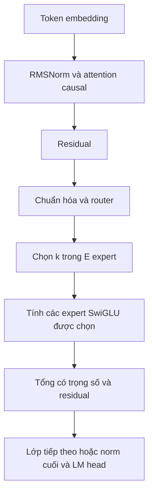
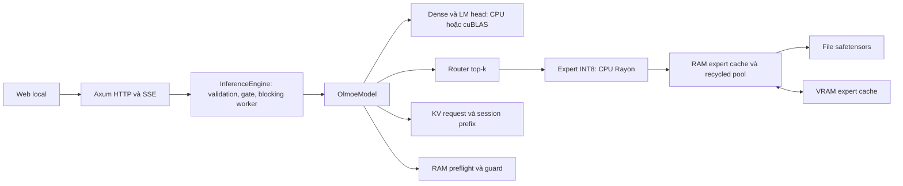
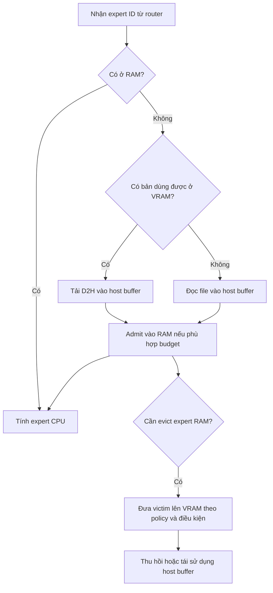
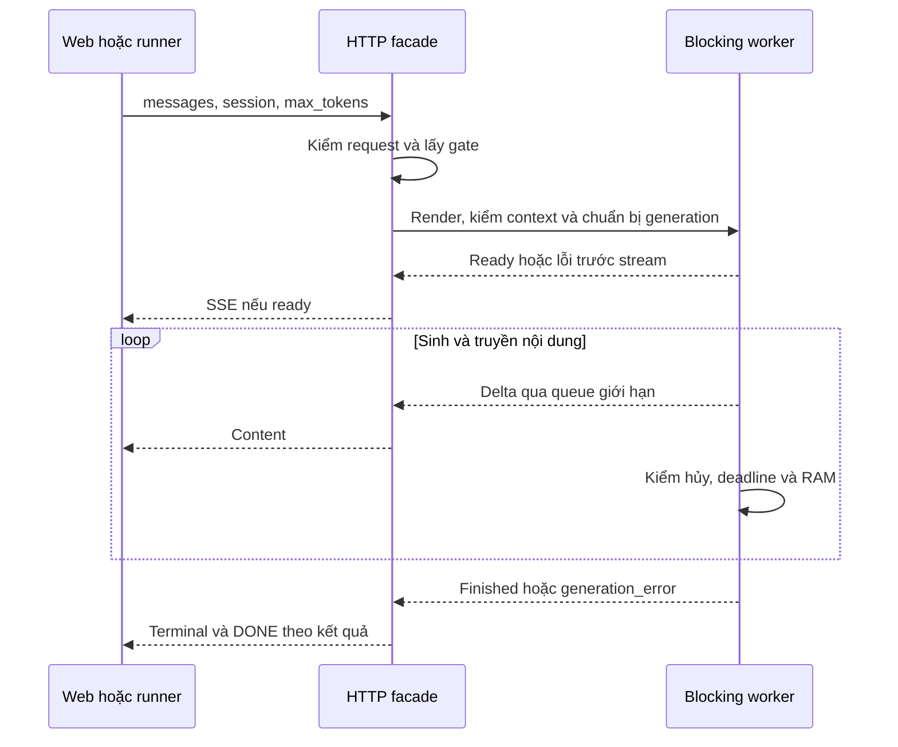

<!--
HƯỚNG DẪN BIÊN TẬP — KHÔNG ĐƯA KHỐI NÀY VÀO BẢN IN
Bản nội dung Markdown để chuyển sang LaTeX; không phải bản đã duyệt hoặc đã dàn trang.
Theo Phụ lục 3 kèm QĐ 449/QĐ-HV ngày 09/03/2026:
A4; lề trái 3cm, trên/dưới/phải 2cm; header/footer 1cm; Times New Roman 12 hoặc 13;
căn đều; trước/sau đoạn 3pt; giãn dòng 1,1–1,2; tiêu đề chương đậm/in hoa 13–15pt.
Header trái: Đồ án tốt nghiệp Đại học; phải: Chương và tên chương.
Footer trái: Họ tên sinh viên, lớp; phải: số trang.
Phần Lời cảm ơn đến Danh mục hình: i, ii,...; từ Mở đầu đến Phụ lục:1,2,...
Đây là lựa chọn theo hướng dẫn chính mục II.5; mẫu 9 có mô tả bắt đầu từ chương 1 khác với mục này.
Mục lục/danh mục/số trang sinh tự động khi dàn LaTeX, không dùng số trang giả trong Markdown.
Công thức dùng tag(chương.thứ tự); bảng/hình đánh số theo chương, ghi nguồn.
Mermaid là mã sơ đồ: xuất SVG/PDF hoặc dựng TikZ trước khi dàn LaTeX.
Ngắt trang giữa các phần đầu và mỗi chương; chuẩn hóa dấu thập phân theo quy định của khoa nếu có.
Thông tin [CẦN BỔ SUNG] phải được nhóm xác nhận. Không ký thay người duyệt/sinh viên.
Phụ lục gốc quy định quyển ĐATN cuối; nhãn “định kỳ lần 1” là điều chỉnh theo mục đích báo cáo này.
-->

# BỘ KHOA HỌC VÀ CÔNG NGHỆ
# HỌC VIỆN CÔNG NGHỆ BƯU CHÍNH VIỄN THÔNG

**KHOA: [CẦN BỔ SUNG]**

**BÁO CÁO ĐỊNH KỲ LẦN 1**

**ĐỒ ÁN TỐT NGHIỆP ĐẠI HỌC**

**ĐỀ TÀI: NGHIÊN CỨU VÀ XÂY DỰNG HỆ THỐNG SUY LUẬN MÔ HÌNH MIXTURE-OF-EXPERTS TRÊN PHẦN CỨNG HẠN CHẾ TÀI NGUYÊN**

*Tên đề tài trên là tên làm việc, cần đối chiếu với quyết định giao đề tài. Tên hệ thống: MoE-TierEngine.*

| Thông tin | Nội dung |
| --- | --- |
| Giáo viên hướng dẫn | [CẦN BỔ SUNG họ tên, học vị, đơn vị] |
| Sinh viên thực hiện thứ nhất | [CẦN BỔ SUNG họ tên, MSSV, lớp] |
| Sinh viên thực hiện thứ hai | [CẦN BỔ SUNG họ tên, MSSV, lớp] |
| Thời gian của kỳ báo cáo | [CẦN BỔ SUNG ngày bắt đầu và ngày kết thúc] |
| Ngày lập bản thảo | 23/10/2026 |
| Mốc dữ liệu thực nghiệm | Các artifact ngày 22/10/2026 được dẫn trong báo cáo |

**TP. HỒ CHÍ MINH, NĂM 2026**

<!-- Khi dàn trang: bìa ngoài, trang lót trắng, bìa phụ lặp thông tin bìa theo mẫu 1/2. -->

# PHÊ DUYỆT, GIAO NHIỆM VỤ ĐỀ TÀI

**[CẦN BỔ SUNG: chèn trang giao nhiệm vụ chính thức có chữ ký phê duyệt, tên đề tài, thành viên, mục tiêu và thời hạn. Bản thảo này không thay thế biểu mẫu đã ký.]**

Phạm vi nội dung trình bày trong kỳ 1 là tìm hiểu nền tảng Transformer và Mixture-of-Experts, khảo sát các ràng buộc bộ nhớ, thiết kế và xây dựng nguyên mẫu suy luận INT8 có phân tầng lưu trữ, đồng thời thực hiện kiểm chứng và đo đạc bước đầu trên máy i5. Phạm vi này cần được đối chiếu với nhiệm vụ chính thức khi hoàn thiện hồ sơ.

# LỜI CẢM ƠN

Nhóm sinh viên xin cảm ơn quý thầy cô Học viện Công nghệ Bưu chính Viễn thông đã trang bị kiến thức nền tảng về lập trình, kiến trúc máy tính và phương pháp nghiên cứu. Nhóm xin cảm ơn giảng viên hướng dẫn **[CẦN BỔ SUNG họ tên]** đã hướng dẫn thực hiện đề tài.

Trong kỳ báo cáo đầu tiên, nhóm tập trung tìm hiểu mô hình ngôn ngữ có kiến trúc hỗn hợp chuyên gia và những khó khăn khi triển khai trên máy tính cá nhân hạn chế bộ nhớ. Quá trình xây dựng nguyên mẫu, ghi nhận các phương án không hiệu quả và phân tích dữ liệu thực nghiệm giúp nhóm liên hệ kiến thức lý thuyết với hoạt động thực tế của hệ thống.

Báo cáo còn những hạn chế về quy mô đánh giá, dữ liệu trên máy thứ hai và mức độ khảo sát chất lượng mô hình. Nhóm mong nhận được góp ý để hoàn thiện phương pháp và triển khai các công việc tiếp theo.

TP. Hồ Chí Minh, ngày [CẦN BỔ SUNG] tháng [CẦN BỔ SUNG] năm 2026

**ĐẠI DIỆN NHÓM SINH VIÊN**

*[Ký và ghi rõ họ tên sau khi duyệt nội dung]*

# LỜI CAM ĐOAN

*Dự thảo để các thành viên kiểm tra và xác nhận trước khi ký.*

Chúng em cam đoan báo cáo phản ánh trung thực nội dung đã tìm hiểu, hệ thống đã triển khai và các kết quả thực nghiệm được lưu trong hồ sơ của đề tài. Những kiến thức, mô hình, thư viện và tài liệu kế thừa được ghi nguồn. Nhóm không nhận việc huấn luyện OLMoE, phát minh Transformer hoặc xây dựng CUDA/cuBLAS là đóng góp của mình.

Các kết quả đo được phân biệt với tính toán lý thuyết và nhận định. Dữ liệu chưa thu thập trên máy i7 được đánh dấu để bổ sung, không suy diễn từ máy i5. Công cụ hỗ trợ lập trình và soạn thảo, bao gồm trợ lý AI, được sử dụng trong quá trình thực hiện; nhóm chịu trách nhiệm kiểm tra mã nguồn, số liệu, trích dẫn và nội dung cuối cùng theo quy định của Học viện.

TP. Hồ Chí Minh, ngày [CẦN BỔ SUNG] tháng [CẦN BỔ SUNG] năm 2026

**ĐẠI DIỆN NHÓM SINH VIÊN**

*[Ký và ghi rõ họ tên]*

# MỤC LỤC

<!-- Sinh mục lục tự động khi chuyển sang LaTeX; không điền số trang dự đoán. -->

- MỞ ĐẦU
- BẢNG PHÂN CÔNG NHIỆM VỤ NHÓM THỰC HIỆN
- CHƯƠNG 1. TỔNG QUAN ĐỀ TÀI VÀ BÀI TOÁN NGHIÊN CỨU
- CHƯƠNG 2. CƠ SỞ LÝ THUYẾT VÀ CÔNG NGHỆ LIÊN QUAN
- CHƯƠNG 3. PHÂN TÍCH VÀ THIẾT KẾ HỆ THỐNG
- CHƯƠNG 4. THUẬT TOÁN VÀ CÁC GIẢI PHÁP KHẢO SÁT
- CHƯƠNG 5. THIẾT KẾ THỰC NGHIỆM VÀ KẾT QUẢ BƯỚC ĐẦU
- KẾT LUẬN, KIẾN NGHỊ
- TÀI LIỆU THAM KHẢO
- PHỤ LỤC

# DANH MỤC CÁC KÝ HIỆU VÀ CHỮ VIẾT TẮT

| Viết tắt | Tiếng Anh | Nghĩa sử dụng trong báo cáo |
| --- | --- | --- |
| API | Application Programming Interface | Giao diện lập trình ứng dụng |
| CPU | Central Processing Unit | Bộ xử lý trung tâm |
| CUDA | Compute Unified Device Architecture | Nền tảng lập trình tính toán GPU của NVIDIA |
| D2H | Device to Host | Truyền dữ liệu từ thiết bị về bộ nhớ máy chủ |
| EOS | End of Sequence | Token kết thúc chuỗi |
| FFI | Foreign Function Interface | Giao tiếp giữa các ngôn ngữ lập trình |
| FP32 | 32-bit Floating Point | Số thực dấu phẩy động 32 bit |
| GPU | Graphics Processing Unit | Bộ xử lý đồ họa |
| H2D | Host to Device | Truyền dữ liệu từ máy chủ lên thiết bị |
| HTTP | Hypertext Transfer Protocol | Giao thức trao đổi giữa giao diện và máy chủ |
| HWM | High Water Mark | Mức sử dụng bộ nhớ cao nhất do hệ điều hành ghi nhận cho tiến trình |
| INT8 | 8-bit Integer | Số nguyên 8 bit dùng lưu trọng số expert |
| KV | Key–Value | Khóa và giá trị được lưu cho attention |
| LLM | Large Language Model | Mô hình ngôn ngữ lớn |
| MoE | Mixture-of-Experts | Kiến trúc hỗn hợp chuyên gia |
| NVMe | Non-Volatile Memory Express | Giao thức truy cập thiết bị lưu trữ; không đồng nhất với bộ đếm file của ứng dụng |
| OOM | Out of Memory | Tình trạng thiếu bộ nhớ |
| RAM | Random Access Memory | Bộ nhớ chính của máy tính |
| RMSNorm | Root Mean Square Layer Normalization | Chuẩn hóa dựa trên căn trung bình bình phương |
| RoPE | Rotary Position Embedding | Biểu diễn vị trí bằng phép quay |
| RSS | Resident Set Size | Lượng bộ nhớ vật lý đang thường trú của tiến trình |
| SSE | Server-Sent Events | Cơ chế truyền sự kiện một chiều qua HTTP |
| TTFT | Time to First Token | Thời gian đến token đầu theo phạm vi đo được xác định |
| VRAM | Video Random Access Memory | Bộ nhớ trên GPU |

Báo cáo dùng $L$ cho số lớp, $d$ cho chiều ẩn, $m$ cho chiều trung gian expert, $E$ cho số expert mỗi lớp, $k$ cho số expert được chọn/token, $T$ cho chiều dài ngữ cảnh, $h_{kv}$ cho số đầu KV và $d_h$ cho chiều mỗi đầu. GB bằng $10^9$ byte; GiB bằng $2^{30}$ byte; MiB bằng $2^{20}$ byte. Hai hệ đơn vị được ghi riêng để tránh nhầm dung lượng.

# DANH MỤC CÁC BẢNG, SƠ ĐỒ, HÌNH VẼ

<!-- Sinh số trang tự động sau khi dàn trang. -->

- Bảng phân công nhiệm vụ dự kiến và chỗ xác nhận.
- Bảng 1.1. Câu hỏi nghiên cứu và phương pháp kiểm chứng.
- Bảng 2.1. Thông số cấu hình checkpoint sử dụng.
- Bảng 2.2. Tính toán dung lượng phục vụ thiết kế.
- Bảng 3.1. Phân công trách nhiệm các thành phần.
- Bảng 3.2. Các vùng bộ nhớ cần phân biệt.
- Bảng 4.1. So sánh nguyên tắc inclusive và victim.
- Bảng 5.1. Phân loại các nhóm bằng chứng.
- Bảng 5.2. Môi trường và cấu hình bộ i5 phase1-v1.
- Bảng 5.3. Từng mẫu của bộ i5 phase1-v1.
- Bảng 5.4. Tổng hợp hiệu năng i5.
- Bảng 5.5. Chi phí expert, attention và file payload.
- Bảng 5.6. Quan sát bộ nhớ trong bộ đo chính.
- Bảng 5.7. Thí nghiệm inclusive/victim.
- Bảng 5.8. Thí nghiệm KV prefix reuse.
- Bảng 5.9. Thí nghiệm dispatch prefill theo nhóm.
- Bảng 5.10. Hai lượt kiểm RAM có giám sát.
- Bảng 5.11. Dữ liệu i7 cần bổ sung.
- Bảng 5.12. Kế hoạch kỳ tiếp theo.
- Hình 2.1. Khối suy luận Transformer–MoE minh họa.
- Hình 3.1. Kiến trúc tổng thể hệ thống.
- Hình 3.2. Luồng lưu trữ expert theo policy victim.
- Hình 3.3. Vòng đời một yêu cầu streaming.

# MỞ ĐẦU

Sự phát triển của mô hình ngôn ngữ mở tạo điều kiện tìm hiểu và triển khai suy luận trên máy tính cá nhân. Tuy nhiên, khả năng tải checkpoint không đồng nghĩa với khả năng phục vụ tương tác hiệu quả. Trọng số, bộ đệm trung gian, lịch sử hội thoại và dữ liệu truyền giữa các thiết bị cùng sử dụng tài nguyên hữu hạn. Một cấu hình chạy được một câu hỏi vẫn có thể chậm hoặc thiếu bộ nhớ khi lịch sử dài hơn.

Kiến trúc hỗn hợp chuyên gia cho phép chỉ kích hoạt một phần tham số ở mỗi token. Đặc điểm này mở ra khả năng nạp expert theo nhu cầu, nhưng đồng thời tạo bài toán quản lý lưu trữ và truyền dữ liệu. Các expert cần cho token tiếp theo phụ thuộc vào định tuyến của mô hình; nếu expert không có trong bộ nhớ phù hợp, hệ thống phải trả thêm chi phí truy xuất. Vì vậy, việc triển khai cần kết hợp kiến thức mô hình học sâu với kiến trúc máy tính và lập trình hệ thống.

Đề tài nghiên cứu hệ thống MoE-TierEngine, một nguyên mẫu suy luận OLMoE INT8 viết bằng Rust, dùng CPU/RAM và file trọng số, có CUDA/cuBLAS khi phần cứng hỗ trợ. Mục tiêu của kỳ 1 là xây dựng cơ sở lý thuyết, làm rõ kiến trúc, triển khai luồng suy luận và tổ chức thực nghiệm có nguồn gốc truy được. Đóng góp ở kỳ này là tích hợp, quản lý tài nguyên, kiểm chứng và phân tích các đánh đổi của nguyên mẫu; chưa đặt mục tiêu huấn luyện mô hình mới hoặc đạt một mức tăng tốc phổ quát.

Phương pháp thực hiện gồm nghiên cứu tài liệu gốc, đọc cấu hình/mã nguồn, thiết kế và kiểm thử bằng fixture nhỏ, sau đó đo mô hình thực trên máy i5. Các thí nghiệm chính giữ checkpoint, cấu hình và workload rõ ràng. Phương án không hiệu quả và sự cố thiếu bộ nhớ được ghi nhận để giải thích quá trình lựa chọn. Kết quả i7 chưa có tại thời điểm lập báo cáo và được dành mục bổ sung riêng.

Báo cáo gồm năm chương, lần lượt trình bày bài toán nghiên cứu, cơ sở lý thuyết, kiến trúc hệ thống, thuật toán và giải pháp, cuối cùng là thực nghiệm và nhận xét. Phần kết luận xác định kết quả của kỳ 1 và kế hoạch tiếp theo. Đây là báo cáo tiến độ có nội dung kỹ thuật và bằng chứng bước đầu, chưa thay thế quyển đồ án cuối cùng đã phê duyệt.

# BẢNG PHÂN CÔNG NHIỆM VỤ NHÓM THỰC HIỆN

**Bảng phân công nhiệm vụ dự kiến và chỗ xác nhận**

| Nhóm công việc | Người phụ trách | Sản phẩm, bằng chứng |
| --- | --- | --- |
| Cơ sở lý thuyết và tổng hợp tài liệu | [CẦN BỔ SUNG] | Chương 1–2 và danh mục tài liệu |
| Thiết kế, triển khai và kiểm chứng engine | [CẦN BỔ SUNG] | Mã nguồn, fixture, kết quả kiểm thử |
| Thực nghiệm máy i5 | [CẦN BỔ SUNG tên thành viên] | Artifact i5 đã lưu |
| Tiếp nhận và thực nghiệm máy i7 | [CẦN BỔ SUNG tên partner] | Chưa có dữ liệu; bổ sung theo mục 5.10 |
| Soạn thảo, kiểm tra số liệu và dàn LaTeX | [CẦN BỔ SUNG] | Bản báo cáo được nhóm duyệt |

*Nguồn: đề xuất tổ chức từ phạm vi công việc; chưa phải xác nhận phân công thực tế. Nhóm cần điền người và thời gian thực hiện trước khi nộp.*

# CHƯƠNG 1. TỔNG QUAN ĐỀ TÀI VÀ BÀI TOÁN NGHIÊN CỨU

## 1.1. Bối cảnh và động cơ nghiên cứu

Một mô hình có nhiều tham số cần dung lượng lớn để lưu trọng số, nhưng lượng tham số tham gia mỗi token có thể nhỏ hơn tổng dung lượng mô hình. OLMoE là một mô hình mở theo hướng kích hoạt thưa; tài liệu gốc công bố mô hình OLMoE-1B-7B và biến thể Instruct [3]. Với đề tài này, đặc điểm kích hoạt thưa được dùng làm cơ sở cho việc quản lý expert theo nhu cầu, thay vì yêu cầu toàn bộ expert cùng nằm trong RAM hay VRAM.

Máy tính cá nhân hạn chế tài nguyên được hiểu theo tương quan với nhu cầu mô hình, không chỉ theo nhãn CPU. Các giới hạn gồm dung lượng RAM còn dành được cho ứng dụng, VRAM sau khi phục vụ hiển thị và dense weights, thời gian truy cập file, chi phí truyền qua PCIe và khả năng tính toán CPU. Trên cùng máy, tải của IDE hoặc trình duyệt cũng ảnh hưởng khoảng trống bộ nhớ và thời gian thực thi.

## 1.2. Phát biểu bài toán

Đầu vào hệ thống là checkpoint đã chuyển đổi, thông điệp hội thoại và cấu hình tài nguyên. Đầu ra là chuỗi văn bản sinh tự hồi quy, trạng thái kết thúc và số liệu đo. Bài toán đặt ra là thực hiện suy luận khi toàn bộ trọng số expert không được giữ thường trú trong RAM/VRAM, đồng thời duy trì các điều kiện đúng về vị trí token, trọng số định tuyến, thứ tự tổng hợp và vòng đời dữ liệu.

Có ba yêu cầu cần xử lý cùng nhau. Thứ nhất, kết quả số học phải phù hợp tham chiếu trong sai số cho phép. Thứ hai, hệ thống cần vận hành trong cấu hình bộ nhớ được lựa chọn, có phản hồi lỗi và cơ chế hủy phù hợp. Thứ ba, hiệu năng phải được đánh giá bằng workload và chỉ số được định nghĩa rõ; một cache hit hoặc một timer thấp hơn chưa đủ chứng minh người dùng nhận câu trả lời nhanh hơn.

## 1.3. Mục tiêu và câu hỏi nghiên cứu

**Bảng 1.1. Câu hỏi nghiên cứu và phương pháp kiểm chứng**

| Câu hỏi | Cách tiếp cận trong kỳ 1 |
| --- | --- |
| Có thể chạy nguyên mẫu OLMoE theo nhu cầu trên máy i5 hiện có không? | Kiểm mô hình thật, giữ output, metadata và giới hạn bộ nhớ |
| Những thành phần nào chiếm chi phí đáng kể? | Tách prefill/decode, expert load/compute, attention và LM head |
| RAM/VRAM cache nên phối hợp như thế nào? | Khảo sát inclusive/victim; đo riêng theo cấu hình đối chứng |
| Tái sử dụng KV có giảm tính toán không? | Kiểm prefix hợp lệ, logits fixture và workload sửa lịch sử |
| Tăng mức song song có luôn nhanh hơn không? | Thử dispatch theo nhóm và giữ cả kết quả không cải thiện |
| Làm sao giảm nguy cơ thiếu bộ nhớ trong demo? | Ngân sách tường minh, preflight, guard và watchdog độc lập |
| Kết quả có thể ghi nhận trên máy i7 không? | Chuẩn hóa protocol; chưa có số đo i7, sẽ bổ sung riêng |

*Nguồn: mục tiêu đề tài và phương pháp thực nghiệm của nhóm [9], [10].*

## 1.4. Phạm vi kỳ báo cáo lần 1

Phạm vi triển khai hiện tại là suy luận local một request OLMoE tại một thời điểm, greedy decoding và context cấu hình. Expert lưu INT8, activation và một số dữ liệu tính toán dùng FP32; GPU là thành phần tùy điều kiện thiết bị. Web cung cấp hội thoại và streaming để quan sát hoạt động của hệ thống.

Kỳ 1 không bao gồm huấn luyện hoặc fine-tuning OLMoE, decoder INT4 hoàn chỉnh, hệ thống phục vụ công khai nhiều người dùng hay đánh giá chất lượng chuẩn hóa quy mô lớn. Các công việc này được phân biệt với những thành phần đã hoàn thành để không mở rộng kết luận vượt dữ liệu.

## 1.5. Nguyên tắc nghiên cứu và nguồn bằng chứng

Nhóm phân biệt ba loại nội dung: kiến thức kế thừa từ tài liệu gốc; mô tả triển khai đối chiếu với mã nguồn; và kết quả đo có artifact. Các suy luận lý thuyết về dung lượng không được thay cho RSS đo thực. Các thí nghiệm thay đổi đồng thời nguồn, cache và workload không được dùng để kết luận một thuật toán riêng làm tăng tốc.

Bộ báo cáo chính i5 sử dụng checkpoint nguồn sạch và năm mẫu mỗi nhóm. Các thử nghiệm khảo sát trước đó được giữ riêng, nêu rõ tính chất exploratory và cỡ mẫu. Lịch sử có tên thư mục i7 không tự trở thành dữ liệu i7 đã được xác minh cho bộ hiện tại.

# CHƯƠNG 2. CƠ SỞ LÝ THUYẾT VÀ CÔNG NGHỆ LIÊN QUAN

## 2.1. Mô hình sinh tự hồi quy

Với chuỗi token $x_1,\ldots,x_n$, bài toán mô hình hóa xác suất có dạng:

$$
p(x_1,\ldots,x_n)=\prod_{t=1}^{n}p(x_t\mid x_1,\ldots,x_{t-1}). \tag{2.1}
$$

Trong nguyên mẫu, bộ tokenizer chuyển văn bản sau chat template thành token IDs. Mô hình tạo logits của token kế tiếp, sau đó greedy decoding chọn token có logit lớn nhất. Quá trình dừng khi gặp EOS hoặc đạt giới hạn sinh. Giới hạn 128 token trong một phép đo không có nghĩa mô hình luôn trả lời trọn ý trong 128 token.

## 2.2. Transformer và attention

Transformer dùng attention để kết hợp thông tin giữa các vị trí [6]. Với biểu diễn đầu vào $X$, các phép chiếu tạo $Q=XW_Q$, $K=XW_K$ và $V=XW_V$. Attention có thể mô tả bằng:

$$
\operatorname{Attention}(Q,K,V)=\operatorname{softmax}\left(\frac{QK^\mathsf{T}}{\sqrt{d_h}}+M\right)V. \tag{2.2}
$$

$M$ là mặt nạ causal, ngăn vị trí hiện tại dùng token tương lai. Multi-head attention thực hiện tính toán trên nhiều đầu rồi kết hợp kết quả. Trong suy luận tự hồi quy, việc giữ $K,V$ đã tính giúp tránh chiếu lại các token cũ. Các chi tiết chuẩn hóa và vị trí của checkpoint cần được giữ đúng, thay vì dùng một khối Transformer tổng quát rồi coi tương đương số học.

### 2.2.1. RMSNorm và biểu diễn vị trí

RMSNorm chuẩn hóa theo căn trung bình bình phương [7]:

$$
\operatorname{RMSNorm}(x)_i=\gamma_i\frac{x_i}{\sqrt{\frac{1}{d}\sum_{j=1}^{d}x_j^2+\epsilon}}. \tag{2.3}
$$

RoPE đưa vị trí vào các thành phần query/key bằng phép quay [5]. Minh họa cho một cặp tọa độ tại vị trí $t$:

$$
\begin{bmatrix}q'_{2j}\\q'_{2j+1}\end{bmatrix}
=\begin{bmatrix}\cos(t\theta_j)&-\sin(t\theta_j)\\\sin(t\theta_j)&\cos(t\theta_j)\end{bmatrix}
\begin{bmatrix}q_{2j}\\q_{2j+1}\end{bmatrix}. \tag{2.4}
$$

Công thức này minh họa nguyên lý quay; cách ghép tọa độ phải theo đúng quy ước checkpoint. Tái sử dụng KV sau khi sửa lịch sử chỉ hợp lệ khi giữ đúng vị trí của prefix còn khớp.

## 2.3. Kiến trúc Mixture-of-Experts

MoE thay khối feed-forward bằng tập expert và bộ định tuyến. Nghiên cứu Switch Transformer cho thấy hướng dùng kích hoạt thưa trong Transformer [2]; đề tài kế thừa nguyên lý định tuyến, không kế thừa các tỷ lệ tăng tốc huấn luyện của công trình đó thành kết quả suy luận của mình.

Với hidden state $x$, router tạo logits $r=W_rx$ và xác suất:

$$
p_e=\frac{\exp(r_e)}{\sum_{j=1}^{E}\exp(r_j)},\quad S=\operatorname{TopK}(p,k),\quad y=\sum_{e\in S}\alpha_e f_e(x). \tag{2.5}
$$

Nếu cấu hình không chuẩn hóa lại top-k thì $\alpha_e=p_e$; nếu có, $\alpha_e=p_e/\sum_{j\in S}p_j$. Checkpoint đang dùng đặt `norm_topk_prob=false`; vì vậy không được tự thêm bước chuẩn hóa lại trong khi tối ưu.

Expert SwiGLU được mô tả theo dạng ma trận đầu ra ở bên trái:

$$
f_e(x)=W_{d,e}\left[\operatorname{SiLU}(W_{g,e}x)\odot(W_{u,e}x)\right],\quad \operatorname{SiLU}(z)=\frac{z}{1+e^{-z}}. \tag{2.6}
$$

Các biến thể GLU là cơ sở cho khối feed-forward có cổng [4]. Trong đề tài, ba ma trận gate/up/down là phần trọng số được lượng tử hóa cho từng expert. Router chọn expert theo hidden state, không theo một danh sách chủ đề do nhóm gán sẵn.



*Hình 2.1. Khối suy luận Transformer–MoE minh họa; sơ đồ lược bỏ chi tiết tensor và các norm phụ. Nguồn: nhóm tổng hợp từ nguyên lý [3], [6] và luồng `src/olmoe.rs` [9].*

### 2.3.1. Cấu hình OLMoE sử dụng

**Bảng 2.1. Thông số cấu hình checkpoint sử dụng**

| Thông số | Giá trị |
| --- | ---: |
| Số lớp $L$ | 16 |
| Chiều ẩn $d$ | 2048 |
| Chiều trung gian expert $m$ | 1024 |
| Expert mỗi lớp $E$ | 64 |
| Expert được chọn/token/lớp $k$ | 8 |
| Đầu attention / đầu KV | 16 /16 |
| Chiều mỗi đầu $d_h$ | 128 |
| Kích thước vocabulary | 50304 |
| Vị trí tối đa trong cấu hình gốc | 4096 |
| Context dùng trong bộ báo cáo | 512 |
| Chuẩn hóa lại xác suất top-k | Không |

*Nguồn: `config.json` checkpoint local được đọc ngày 23/10/2026, đối chiếu artifact cấu hình và mã nguồn [9], [10]. Context 512 là lựa chọn runtime, không phải tuyên bố mô hình gốc chỉ hỗ trợ 512.*

## 2.4. Lượng tử hóa trọng số expert INT8

Converter dùng scale theo hàng. Với hàng $i$ của một ma trận trọng số $W$, mã triển khai tính:

$$
s_i=\frac{\max(\max_j|W_{ij}|,10^{-12})}{127},\quad q_{ij}=\operatorname{clip}\left(\operatorname{round}(W_{ij}/s_i),-128,127\right). \tag{2.7}
$$

Giá trị xấp xỉ là $\widehat W_{ij}=s_iq_{ij}$. Khi nhân với activation FP32, đường expert thực hiện:

$$
y_i=s_i\sum_jq_{ij}x_j. \tag{2.8}
$$

Nguồn công thức triển khai là `tools/prepare_olmoe.py` và `src/int8_expert.rs` [9]. Expert không cần được mở rộng toàn bộ thành ma trận FP32 trước khi tính. Tuy nhiên, INT8 ở đây mô tả định dạng trọng số; không đồng nghĩa đã sử dụng Tensor Core INT8 hoặc toàn bộ activation, attention và KV cũng là INT8. Sai số lượng tử hóa có thể ảnh hưởng đầu ra, cần đánh giá riêng khi muốn kết luận về chất lượng.

## 2.5. Prefill, decode và KV cache

Prefill xử lý các token prompt chưa có KV hợp lệ. Decode dùng logits hiện tại để chọn token tiếp theo, rồi thực hiện các bước suy luận bổ sung. Token đầu tiên được chọn từ logits sau prefill, nên số model steps trong decode không nhất thiết bằng số completion tokens trả cho người dùng.

KV cache lưu key/value cho các vị trí đã xử lý. Với FP32 và $T$ vị trí trên mọi lớp, dung lượng payload lý thuyết là:

$$
B_{KV}=2LTh_{kv}d_hb,\quad b=4\ \text{byte}. \tag{2.9}
$$

Đây là payload tensor; capacity cấp phát, metadata session và KV đang hoạt động có thể làm tổng bộ nhớ lớn hơn. Hội thoại phía trình duyệt là văn bản, còn session KV là trạng thái tensor phía engine. Client vẫn phải gửi history; hệ thống chỉ dùng lại đoạn token prefix còn khớp, không mặc định mọi lần cùng session đều dùng lại toàn bộ history.

## 2.6. Phân tầng bộ nhớ và vai trò GPU

RAM chứa dữ liệu CPU có thể tính trực tiếp; VRAM phục vụ dữ liệu và phép toán GPU; file trọng số là tầng lưu trữ bền vững. Chi phí truy xuất một expert gồm tìm kiếm, cấp hoặc lấy buffer, đọc file hoặc tải từ VRAM, và thời gian chờ tác vụ. Mức cache hit cao chỉ mô tả một phần quyết định này, chưa cho biết mỗi hit có giá bao nhiêu.

cuBLAS là thư viện đại số tuyến tính trên GPU; sử dụng API cần dữ liệu và tài nguyên thiết bị phù hợp [8]. Trong nguyên mẫu, GPU hỗ trợ dense projections/LM head và chứa cache expert. SwiGLU expert hiện tính CPU: hit ở VRAM vẫn cần tải expert về host. Bởi vậy GPU có thể giúp giảm công việc dense và mở rộng tập expert lưu được, nhưng không loại bỏ RAM, CPU compute hoặc truyền D2H.

### 2.6.1. Tính toán dung lượng cho thiết kế

Ba ma trận expert có $3dm$ trọng số INT8. Số scale FP32 theo hàng là $2m+d$. Payload một expert:

$$
B_e=3dm+4(2m+d)=6\,307\,840\ \text{byte}=6.015625\ \text{MiB}. \tag{2.10}
$$

**Bảng 2.2. Tính toán dung lượng phục vụ thiết kế**

| Đại lượng | Phép tính | Giá trị lý thuyết |
| --- | --- | ---: |
| Expert weights+scales toàn mô hình | $LEB_e$ | 6.015625 GiB |
| Expert payload của 8 expert ×16 lớp | $LkB_e$ | 770 MiB |
| Cache RAM cấu hình 64 MiB/lớp | $16\times64$ | 1024 MiB |
| Expert nguyên vừa 64 MiB của một lớp | $\lfloor64/6.015625\rfloor$ | 10 expert |
| KV FP32 đủ 512 vị trí | $2\times16\times512\times16\times128\times4$ | 128 MiB |

*Nguồn: nhóm tính từ Bảng 2.1 và layout expert trong mã [9]; không phải RSS hoặc physical VRAM đo được. Ước lượng 10 expert giả sử payload/capacity lý tưởng, chưa tính metadata và trạng thái pool.*

Con số 770 MiB không phải yêu cầu toàn bộ 8 expert của mọi lớp phải cùng nằm trong RAM. Suy luận có thể xử lý từng lớp và tái sử dụng vùng đệm. Mặt khác, cache 1 GiB không phải toàn bộ tiến trình 1 GiB: còn dense weights, KV, scratch, allocator, tokenizer và CUDA driver. Đây là lý do phải phối hợp tính toán ngân sách với quan sát RSS.

## 2.7. Chỉ số và mô hình phân tích hiệu năng

TTFT engine đo từ mốc bắt đầu generation của engine đến thời điểm chuẩn bị token đầu. TTFT phía client còn chịu ảnh hưởng HTTP, serialization và đọc stream; hai giá trị cần đặt tên riêng. Wall trong bảng chính là `metrics.total_ms` của engine, không gồm startup/load model và không phải toàn bộ thời gian mở trang web.

Throughput decode hiện được tính theo:

$$
R_{decode}=\frac{N_{steps}}{t_{decode}}, \tag{2.11}
$$

trong đó $N_{steps}$ là số bước decode mà engine thực hiện sau logits prefill. Với 128 completion tokens và không EOS sớm, mã thực hiện 127 bước tiếp theo; không đếm chunk SSE làm token. Một cách tính end-to-end khác là $N_{out}/t_{generation}$, nhưng báo cáo không tráo đổi hai cách này.

Nếu số hit/miss có cùng định nghĩa, tỷ lệ hit là:

$$
H=\frac{N_{hit}}{N_{hit}+N_{miss}}. \tag{2.12}
$$

Khi đánh giá hai biến thể tương đương về workload, phần trăm giảm thời gian và speedup lần lượt là:

$$
\Delta_t=100\frac{t_{before}-t_{after}}{t_{before}},\quad S=\frac{t_{before}}{t_{after}}. \tag{2.13}
$$

Hai đại lượng này khác nhau. Khi có song song I/O–compute, tổng các timer có thể lớn hơn wall. Mô hình $t\approx B/\beta$ chỉ có ý nghĩa khi $B$ và $\beta$ thuộc cùng đường truyền, phạm vi và điều kiện. Lấy file payload của ứng dụng chia cho một timer chứa scheduling không cho ra băng thông NVMe thực. Các giới hạn này là cơ sở cho cách diễn giải ở chương 5.

# CHƯƠNG 3. PHÂN TÍCH VÀ THIẾT KẾ HỆ THỐNG

## 3.1. Yêu cầu chức năng và yêu cầu tài nguyên

Hệ thống cần tải checkpoint đúng định dạng; chuyển hội thoại thành token theo template; sinh văn bản có streaming; hỗ trợ session, dừng và reset; công bố trạng thái và số liệu đo. Đầu vào không hợp lệ, vượt context hoặc model đang bận phải có phản hồi rõ ràng. Khi client dừng hoặc mất kết nối, worker cần kết thúc tại điểm kiểm tra hủy và nhả tài nguyên để request kế tiếp có thể sử dụng model.

Về tài nguyên, engine không được giả định toàn bộ expert luôn có trong RAM. Cache cần budget tường minh; active expert, recycled buffer, KV và dense được xét riêng. Nguyên mẫu chỉ nhận một request OLMoE cùng lúc để tránh nhiều bộ trạng thái inference cạnh tranh trên cùng model. Đây là quyết định phạm vi demo và đơn giản hóa ownership, chưa phải thiết kế phục vụ nhiều người dùng đồng thời.

## 3.2. Kiến trúc tổng thể



*Hình 3.1. Kiến trúc tổng thể hệ thống. Mũi tên thể hiện quan hệ gọi/phụ thuộc dữ liệu, không thể hiện mọi tác vụ đều chạy song song. Nguồn: mã nguồn và ARCHITECTURE của dự án [9].*

**Bảng 3.1. Phân công trách nhiệm các thành phần**

| Thành phần | Trách nhiệm |
| --- | --- |
| HTTP và giao diện | Nhận messages, truyền SSE, hiển thị kết quả, Stop/reset và lỗi |
| Facade inference | Kiểm đầu vào, giới hạn một request, đưa công việc nặng ra blocking worker |
| Mô hình OLMoE | Tokenization, prefill/decode, routing, KV, metrics và phối hợp cache |
| Expert INT8 | Xác thực shape/scale, đọc payload và tính SwiGLU CPU |
| Safetensors reader | Tra offset/shape/dtype, kiểm phạm vi và đọc tensor theo nhu cầu |
| Backend CPU | Dense, norm, softmax, attention và các phép toán liên quan |
| Backend CUDA | Context, cuBLAS, pinned memory, pool và cache expert VRAM |
| Công cụ thực nghiệm | Chốt config/hash, chạy workload và lưu output/log/time series |

*Nguồn: ranh giới module hiện hành [9]. Đường tiny/reference phục vụ fixture được phân biệt với đường OLMoE thực.*

### 3.2.1. Lựa chọn Rust và ranh giới FFI

Rust giúp biểu diễn ownership và giới hạn chia sẻ dữ liệu trong phần mã safe. Tuy nhiên, các lời gọi CUDA/cuBLAS qua FFI vẫn cần invariant thủ công: đúng context trên thread, kích thước allocation chính xác, pointer còn sống khi copy/compute diễn ra và thứ tự giải phóng đúng. Vì vậy, việc dùng Rust hoặc Clippy đạt không được coi là chứng minh toàn bộ engine an toàn bộ nhớ tuyệt đối.

Những kiểm tra liên quan pinned buffer bao gồm metadata kích thước không bị sửa từ safe API, zero-initialization trước khi đọc slice và fallback khi staging quá nhỏ. Các kiểm chứng này áp dụng đường đã thử; những đường GPU khác vẫn cần review khi thay đổi.

## 3.3. Checkpoint và quá trình nạp dữ liệu

Bước chuẩn bị checkpoint tách dense tensor và expert đã lượng tử hóa, lưu theo layout mà loader biết. Safetensors cung cấp metadata để reader xác định offset, shape và dtype trước khi đọc. Expert dùng payload ghép gate/up/down cùng scale. Reader cần kiểm tính hợp lệ trước khi cấp phát lớn, kể cả overflow phép nhân kích thước và phạm vi file.

Khi khởi tạo, engine đọc cấu hình, tokenizer/template và dense weights trong budget tương ứng. Expert được nạp khi routing cần. Hash checkpoint được lưu phục vụ xác nhận cùng dữ liệu giữa các run; thao tác hashing đọc file trước đo nên có thể làm ấm OS page cache. Chương 5 vì vậy dùng thuật ngữ engine-cold, không khẳng định SSD-cold.

## 3.4. Thiết kế phân tầng expert

Tầng RAM chứa expert sẵn cho CPU compute. Nếu RAM không có expert, hệ thống kiểm VRAM và tải về host khi hit, sau đó mới cần fallback file nếu không có bản dùng được. Tên L 1 VRAM/L 2 RAM trong giao diện biểu diễn tầng lưu trữ của nguyên mẫu; không phải cache L 1/L 2 phần cứng của CPU và không quy định thứ tự bắt buộc GPU được hỏi trước RAM.



*Hình 3.2. Luồng lưu trữ expert theo policy victim, dạng giản lược; khi expert không vừa RAM cache, đường giữ ở VRAM có xử lý riêng. Nguồn: `acquire_expert_tiered`, admission và eviction trong mã [9].*

Policy victim ưu tiên để VRAM giữ expert bị đẩy khỏi RAM, giảm trùng lặp hai tầng. Khi tải bản VRAM về và admit lại RAM, bản L 1 được bỏ sau khi download đồng bộ hoàn tất, slot mới có thể được tái sử dụng. Inclusive được giữ làm đối chứng. Hai policy thay vị trí lưu trữ, không thay trọng số mô hình hoặc phép cộng theo route.

## 3.5. Quản lý bộ nhớ và session

**Bảng 3.2. Các vùng bộ nhớ cần phân biệt**

| Vùng | Vai trò | Giới hạn cần ghi nhận |
| --- | --- | --- |
| Dense host | Trọng số cho CPU/fallback | Không tự biến mất khi GPU enabled |
| Dense VRAM | Trọng số hỗ trợ tính dense trên GPU | Cạnh tranh VRAM với expert cache và scratch |
| Expert RAM và recycled pool | Dữ liệu expert lưu và buffer tái sử dụng | Tính capacity chung theo budget mỗi lớp |
| Active/inflight expert | Expert đang được dùng hoặc prefetch | Có headroom riêng, không được bỏ qua |
| KV và session | Lưu key/value, tokens và trạng thái dùng lại | Payload khác capacity và metadata |
| Scratch, pinned và GPU pool | Tạm tính toán, staging/copy và tái sử dụng | Telemetry logical chưa bao hết physical allocation |
| Tokenizer, allocator và runtime | Hạ tầng tiến trình | Không nằm trọn trong cache budget |

*Nguồn: thiết kế và giới hạn accounting hiện hành [9], [12].*

Expert cache và recycled pool dùng cùng budget capacity cho mỗi layer. Active payload có trần riêng theo thiết kế hiện tại là tối đa $(k+2)B_e$, chưa gồm metadata và các vùng khác. Prefill chỉ prefetch tối đa $k$ expert; expert còn lại được đọc khi cần. Mục tiêu là tránh gom quá nhiều expert vào bộ nhớ cùng thời điểm chỉ vì prompt có nhiều route.

Session cache tính capacity của keys/values và token IDs cùng một số metadata khi admission/eviction. Phần HashMap buckets, allocator metadata và KV request đang chạy vẫn cần được phân biệt. Reset bỏ entries và recycled buffer nhưng giữ ngân sách session để request sau vẫn có thể lưu KV. Việc xóa cache không bảo đảm RSS giảm ngay vì allocator có thể giữ lại trang nhớ.

## 3.6. HTTP/SSE, hủy yêu cầu và tính nhất quán giao diện



*Hình 3.3. Vòng đời yêu cầu streaming giản lược. Nguồn: `src/engine.rs`, HTTP handler và parser giao diện [9].*

Công việc suy luận nặng chạy trong `spawn_blocking`, tránh chiếm thread async bằng phép tính dài. Queue truyền kết quả có giới hạn; nếu client không đọc trong timeout, worker có thể kết thúc với lỗi. Gate cho phép từ chối request mới khi model đang bận, thay vì vô tình chạy nhiều inference cùng lúc.

Trước khi SSE bắt đầu, lỗi có thể trả HTTP status phù hợp. Sau khi headers đã gửi, lỗi phải được biểu diễn trong stream. Giao diện chỉ lưu câu trả lời thành lịch sử thành công khi nhận terminal, DONE và kết thúc stream hợp lệ. Nội dung bị Stop hoặc stream đứt không được âm thầm ghi thành câu trả lời hoàn chỉnh. Non-stream disconnect chưa có cùng mức hủy worker như streaming; đây là giới hạn hiện tại.

## 3.7. Preflight và bảo vệ RAM hợp tác

Trước khi tải weights lớn, hệ thống ước lượng nhu cầu gồm dense decoded FP32, cache cấu hình, dự phòng session, request và overhead. Nếu kế hoạch không phù hợp RSS limit/headroom, hệ thống từ chối. Trong generation, guard kiểm RSS và RAM còn khả dụng ở các cancellation boundaries, với chu kỳ lấy mẫu được giới hạn để giảm overhead.

Bộ đo dùng guard RSS 5 GiB và headroom 1 GiB. Guard trả lỗi OutOfMemory khi nhận thấy áp lực bộ nhớ; trước SSE có thể là 503, sau ready là sự kiện lỗi generation. Sau khi worker ngừng dùng dữ liệu, hệ thống bỏ host cache/session/recycled phù hợp. Dense và VRAM có thể còn được giữ; không có cam kết allocator lập tức trả trang cho OS.

Đây là bảo vệ hợp tác, không phải hard memory cap. Có thể có overshoot giữa các điểm kiểm tra hoặc do driver/cấp phát khác. Linux `/proc` và cgroup-v 2 nhìn thấy được có phạm vi quan sát hữu hạn. Vì vậy, trong thực nghiệm nhóm còn dùng watchdog độc lập, không dựa vào status snapshot có thể cũ khi model đang bận.

# CHƯƠNG 4. THUẬT TOÁN VÀ CÁC GIẢI PHÁP KHẢO SÁT

## 4.1. Quy trình suy luận tổng thể

Giả mã 4.1 mô tả luồng điều khiển, không thay thế chi tiết triển khai:

```text
Input: messages, session_id, max_tokens, checkpoint đã load
1. Kiểm messages, session_id, gate và budget RAM.
2. Render chat template; tokenize; kiểm context + output budget.
3. Tìm session KV hợp lệ; xác định prefix token được dùng lại.
4. Prefill phần prompt còn thiếu, giữ đúng vị trí causal.
5. Lặp cho tới EOS hoặc max_tokens:
   a. Chọn token argmax từ logits hiện tại.
   b. Phát delta văn bản khi decoder có phần UTF-8 hợp lệ.
   c. Nếu còn cần logits mới, tính một bước model và cập nhật KV.
   d. Kiểm cancel, deadline và RAM tại các ranh giới hỗ trợ.
6. Hoàn thiện decode text, lưu session trong budget, trả metrics/finish.
7. Khi lỗi: kết thúc theo protocol, nhả permit và xử lý cache phù hợp.
```

*Nguồn: nhóm diễn giải luồng `generate_controlled` và facade [9].*

Điều kiện bảo toàn là tokenization/template không đổi giữa các biến thể cần so, vị trí KV chính xác, router sử dụng cùng trọng số và tổng hợp expert có thứ tự xác định. Một phép tối ưu đổi các điều kiện này phải có kiểm chứng số học tương ứng.

## 4.2. Top-k và tổng hợp expert

Router tính xác suất trên $E$ expert, chọn $k$ chỉ số có trọng số lớn nhất. Việc chọn bằng partition rồi sắp xếp phần được chọn có thể giảm công việc so với sắp toàn bộ danh sách; thứ tự khi bằng điểm cần xác định. Sau khi tính từng expert, kết quả được cộng theo thứ tự route cố định để hạn chế thay đổi do thứ tự cộng FP32.

```text
Input: x, router weights, k, policy và caches của layer
1. Tính router probabilities; chọn top-k theo quy tắc ổn định đã quy định.
2. Phân loại expert đã có trong RAM và expert còn thiếu.
3. Tổ chức tải miss và tính hit trong phạm vi scheduling cho phép.
4. Với mỗi miss: lấy từ VRAM hoặc file, cập nhật cache và tính output.
5. Lưu output từng slot; cộng theo thứ tự top-k cùng routing weights.
Output: vector MoE của token
```

Tách hit/miss giúp tạo cơ hội overlap I/O và compute. Tuy nhiên, việc có tác vụ đồng thời không chứng minh toàn bộ I/O đã được che phủ: tiến độ còn phụ thuộc expert còn thiếu, thread pool và lúc kết quả được cần. Đề tài không nhận tỷ lệ overlap 100% nếu chưa có trace chứng minh.

## 4.3. Prefill theo layer và tái sử dụng expert

Prefill xử lý một tập token qua từng layer, tập hợp route theo expert để có cơ hội dùng lại expert giữa các token. Trong đường runtime hiện tại, các token gắn với một expert được tính lần lượt ở phần dispatch tương ứng; đây không đồng nghĩa toàn bộ expert prefill là một GEMM INT8 trên GPU.

Nhóm đã thử biến thể dispatch token dùng chung expert theo nhóm. Giả thuyết là tăng mức song song sẽ giảm thời gian prefill. Rủi ro là scheduling, nested parallelism, cache locality và băng thông bộ nhớ có thể làm chi phí tăng. Đo paired cho kết quả grouped chậm hơn 7/9 cặp, nên candidate chỉ giữ trong `cfg(test)`, không bật runtime. Đây là ví dụ dùng thực nghiệm để bác bỏ một giả thuyết tối ưu trong điều kiện máy hiện có.

## 4.4. Tính toán INT8, buffer recycling và truy xuất file

Hạt nhân expert kết hợp dot product INT8–FP32 với row scale, tránh cấp một ma trận giải lượng tử toàn expert. Gate/up tạo activation trung gian, sau đó down projection tạo output. Các vòng lặp được tối ưu và có đường kiểm so với tính scalar, nhưng mức tăng tốc end-to-end phải được đo riêng vì load expert có thể chiếm phần đáng kể.

Buffer recycling giữ lại vùng weights/scales để tái sử dụng sau eviction. Đây là cơ chế giảm nhu cầu cấp phát lặp, không chứng minh mọi request không có allocation. Pool cũng phải chiếm budget; giữ quá nhiều buffer dù không có entries vẫn có thể làm RAM cao. Positional read cho phép đọc vùng tensor theo offset, nhưng dữ liệu vẫn đi qua các tầng hệ điều hành và bộ nhớ. Báo cáo không gọi đường này là zero-copy SSD hoặc DMA trực tiếp từ NVMe vào VRAM.

## 4.5. Phối hợp cache inclusive và victim

**Bảng 4.1. So sánh nguyên tắc inclusive và victim**

| Khía cạnh | Inclusive tham chiếu | Victim hiện tại |
| --- | --- | --- |
| Bản sao RAM/VRAM | Có thể giữ cùng expert trên cả hai tầng | Cố gắng dùng VRAM cho expert ra khỏi RAM |
| Khi RAM evict | Tùy trạng thái bản sao | Có thể upload victim trước khi tái sử dụng host buffer |
| Khi tải VRAM về và admit RAM | Có thể tiếp tục giữ bản L 1 | Bỏ bản L 1 sau download hoàn tất |
| Đánh đổi | Trùng lặp làm giảm tập expert khác nhau lưu được | Có thể tăng số hit và truyền D2H |
| Điều cần đo | File loads, payload, wall và RAM/VRAM | Cùng các chỉ số, không chỉ cache hit |

*Nguồn: hai policy trong mã và artifact A/B [9], [11].*

Giả thuyết của victim là giảm trùng lặp giúp hai tầng giữ được nhiều expert khác nhau hơn, từ đó giảm fallback file. Đây không phải bảo đảm mọi dữ liệu truyền đều giảm: một expert trước đây đọc file nay có thể trở thành hit VRAM và tăng D2H. Kết quả chương 5 vì vậy xem đồng thời wall, file payload và các đường truyền.

## 4.6. Tái sử dụng KV theo longest common prefix

Gọi $a$ là chuỗi token đã lưu và $b$ là prompt mới, độ dài prefix chung là:

$$
r=\max\{j:a_i=b_i\ \forall\ 0\leq i<j\}. \tag{4.1}
$$

Vì session không giữ logits của mọi vị trí, lượng dùng lại thực tế phải bảo đảm còn ít nhất token cuối prompt được tính lại:

$$
r_{reuse}\leq\min(r,|b|-1). \tag{4.2}
$$

Thuật toán kiểm session trước khi cấp bộ KV mới; nếu có prefix hợp lệ thì truncate keys/values và token metadata theo đúng vị trí, rồi prefill phần còn thiếu. Nếu không có, cấp KV mới trong budget. Cách này hỗ trợ prompt sửa hoặc rút ngắn mà vẫn có phần đầu giống nhau.

Một điểm cần lưu ý là history hiển thị giống về ý nghĩa chưa chắc cho token prefix dài. Chat template, boundary token và việc mã hóa lại văn bản có thể tạo khác biệt; artifact hai lượt Mars→Love chỉ quan sát reuse 11/166 prompt tokens. Nhóm chưa xác định duy nhất nguyên nhân tokenizer/template từ con số đó và không sửa input để tạo tỷ lệ tăng tốc đẹp hơn.

## 4.7. Ngân sách bộ nhớ và kiểm áp lực RAM

Một kế hoạch bộ nhớ khái quát được viết:

$$
B_{plan}=B_{dense}+B_{cache}+B_{session,reserve}+B_{request,reserve}+B_{overhead}. \tag{4.3}
$$

Preflight so kế hoạch với giới hạn tiến trình và headroom. Các reserve là ước lượng thận trọng, không phải tổng RSS chính xác. Trong khi sinh, điều kiện áp lực có thể đến từ RSS cao, RAM khả dụng thấp hoặc ràng buộc cgroup nhìn thấy. Guard kiểm hợp tác và watchdog của runner kiểm độc lập 250 ms.

Thiết kế tách hai trách nhiệm: runtime từ chối hoặc dừng request bằng lỗi có kiểm soát; watchdog có quyền dừng child do nó tạo nếu điều kiện vượt ngưỡng. Runner không được kill server người dùng hoặc tiếp tục đo khi telemetry mất. Phép thử cấu hình cache lớn phải dùng giám sát, không cố gây OOM để chứng minh lỗi.

## 4.8. Tiêu chí lựa chọn giải pháp trong kỳ 1

Một giải pháp được giữ khi bảo toàn correctness, có lợi trong workload được đo hoặc cần cho tính nhất quán/tài nguyên, và giới hạn được công bố. KV prefix được giữ vì có hồi quy/logits và lợi ích workload phù hợp; victim được giữ vì thí nghiệm policy cho kết quả tốt hơn trong cấu hình khảo sát; grouped dispatch không được bật vì dữ liệu paired không ủng hộ.

Các bản vá ownership, budget và SSE vẫn có giá trị dù không chứng minh tăng tok/s: chúng làm rõ hành vi khi lỗi, tránh ghi câu trả lời hỏng và hạn chế các cấp phát không được tính. Kết quả tốc độ của bản sau cùng được đo độc lập, không cộng phần trăm lợi ích của các thay đổi thành một speedup tổng.

# CHƯƠNG 5. THIẾT KẾ THỰC NGHIỆM VÀ KẾT QUẢ BƯỚC ĐẦU

## 5.1. Mục tiêu và phân loại bằng chứng

Thực nghiệm trả lời ba nhóm vấn đề: tính đúng trong phạm vi fixture, hành vi vận hành của model thật và mức hiệu năng của cấu hình hiện tại. Các nhóm này bổ sung cho nhau nhưng không thay thế nhau. Một toy fixture đạt logits không đánh giá chất lượng tri thức của OLMoE; một câu trả lời hợp lý cũng không chứng minh pointer CUDA an toàn.

**Bảng 5.1. Phân loại các nhóm bằng chứng**

| Nhóm | Nguồn | Vai trò trong báo cáo |
| --- | --- | --- |
| i5 phase1-v1 | Source sạch,20 mẫu và 5 warmup | Bộ hiệu năng chính hiện tại |
| Inclusive/victim | Exploratory cùng server, AB/BA | Khảo sát chính sách cache, n nhỏ |
| Prefill/KV | Paired experiments, source lưu riêng | Kiểm giả thuyết thuật toán và workload cụ thể |
| RAM guard | Hai lượt 12 request và kiểm âm tính | Quan sát bộ nhớ hữu hạn, không baseline tốc độ |
| Smoke model/web | Fixture, model thật và báo cáo thủ công | Kiểm chức năng, lỗi và quality sơ bộ |
| Corpus lịch sử | Catalog 40 artifact | Tra cứu; không mặc định đủ provenance cho claim mới |

*Nguồn: các artifact [10]–[13] và ma trận bằng chứng [14].*

Các đo đạc đã có được sử dụng lại trong báo cáo này, không trình bày là vừa chạy thêm ngày 23/10. Tất cả tỷ lệ và kết luận đều gắn với nhóm thí nghiệm tương ứng.

## 5.2. Môi trường và cấu hình bộ báo cáo chính

**Bảng 5.2. Môi trường và cấu hình bộ i5 phase1-v1**

| Thuộc tính | Giá trị/điều kiện |
| --- | --- |
| Testbed | i5, người dùng xác nhận |
| CPU quan sát | Intel Core i5-10500H @2.50GHz,12 logical CPUs |
| RAM vật lý quan sát | 16.571.330.560 byte, khoảng 15,43 GiB |
| GPU inventory | NVIDIA GeForce GTX1650 with Max-Q Design,4096 MiB |
| GPU runtime | Requested auto; enabled trong status thực |
| Source commit | `d4adefd9e53627bdc1fd250eabab436c3ac54b0d` |
| Nguồn/checkpoint/binary | Hash khớp giữa cả 3 record, `git_dirty=false` |
| Rayon threads | 8; chưa chứng minh tối ưu |
| Expert cache policy | victim |
| Cache | 64 MiB/layer;1 GiB cấu hình trên 16 lớp |
| Context/max output | 512/128 token |
| Engine RAM guard | RSS 5 GiB; headroom 1 GiB |
| Watchdog | RSS 5,5 GiB; MemAvailable 1,5 GiB; process swap 128 MiB;250 ms |
| Trình tự | Cold, sau đó warm, sau đó conversation, tuần tự |
| Môi trường | Linux có `/proc`; tải desktop/nhiệt/tần số không cố định |

*Nguồn: ba `result.json`, `memory.jsonl` và `watchdog.json` của [10]. GPU inventory không có nghĩa toàn bộ 4096 MiB đều dành được cho model; không suy số kernel GPU từ một nhãn enabled.*

Báo cáo không tự nhận model SSD, băng thông RAM hoặc thông số PCIe chưa được xác minh. Hash checkpoint đầy đủ nằm trong raw; không chỉ dùng tên thư mục để xác nhận cùng model.

## 5.3. Protocol cold, warm và hội thoại

Cold reset cache ứng dụng trước mỗi mẫu; model vẫn ở cùng server đã load của scenario. Đây không phải năm lần khởi động tiến trình hoặc xóa OS page cache. Warm có một warmup riêng trước mỗi mẫu, dùng session mới để không lẫn lợi ích reuse KV. Conversation reset đầu mỗi cycle, gửi `Where is Mars`, rồi gửi `What is love ?` cùng history chứa câu trả lời trước.

Mỗi scenario chạy năm cycles. Cold có 5 mẫu; warm có 5 mẫu và 5 warmup; conversation có 10 mẫu, gồm 5 Mars và 5 Love. Tổng là 20 request đo và 5 warmup. Warmup không được gộp vào median cuối. Không có benchmark/inference/build/test khác chạy đồng thời với timing; mỗi scenario có bước build trước đo.

Source, checkpoint và config được giữ bất biến suốt bộ. Runner kiểm dirty/revision, tạo thư mục run riêng, giữ turn payload/output và phát hiện lỗi SSE/thiếu terminal. Các run thành công có output và usage khớp trong từng nhóm; Mars khớp qua ba scenario. Đây là text/usage parity qua HTTP, chưa phải bit-exact logits 7B.

## 5.4. Kết quả hiệu năng của phiên bản hiện tại

### 5.4.1. Từng mẫu đo

**Bảng 5.3. Từng mẫu của bộ i5 phase1-v1**

| Nhóm | Lượt | Prompt tokens | Output tokens | TTFT(s) | Decode(steps/s) | Wall(s) |
| --- | ---: | ---: | ---: | ---: | ---: | ---: |
| cold Mars | 1 | 19 | 128 | 2.757 | 3.655 | 37.506 |
| cold Mars | 2 | 19 | 128 | 2.121 | 3.777 | 35.743 |
| cold Mars | 3 | 19 | 128 | 1.791 | 3.783 | 35.364 |
| cold Mars | 4 | 19 | 128 | 1.795 | 3.663 | 36.468 |
| cold Mars | 5 | 19 | 128 | 2.104 | 3.651 | 36.886 |
| warm Mars | 1 | 19 | 128 | 2.039 | 3.980 | 33.950 |
| warm Mars | 2 | 19 | 128 | 2.044 | 3.987 | 33.899 |
| warm Mars | 3 | 19 | 128 | 2.023 | 3.989 | 33.863 |
| warm Mars | 4 | 19 | 128 | 2.005 | 3.995 | 33.791 |
| warm Mars | 5 | 19 | 128 | 2.019 | 3.963 | 34.065 |
| conversation Mars | 1 | 19 | 128 | 2.181 | 3.685 | 36.648 |
| conversation Mars | 2 | 19 | 128 | 2.005 | 3.673 | 36.586 |
| conversation Mars | 3 | 19 | 128 | 2.014 | 3.681 | 36.519 |
| conversation Mars | 4 | 19 | 128 | 1.984 | 3.687 | 36.425 |
| conversation Mars | 5 | 19 | 128 | 2.009 | 3.674 | 36.575 |
| conversation Love | 1 | 166 | 128 | 9.477 | 3.207 | 49.080 |
| conversation Love | 2 | 166 | 128 | 9.099 | 3.228 | 48.446 |
| conversation Love | 3 | 166 | 128 | 8.759 | 3.250 | 47.836 |
| conversation Love | 4 | 166 | 128 | 9.109 | 3.234 | 48.374 |
| conversation Love | 5 | 166 | 128 | 9.086 | 3.225 | 48.461 |

*Nguồn: từng response trong raw [10]; số hiển thị làm tròn 3 chữ số thập phân, raw giữ độ chính xác ban đầu. Lượt trong bảng đánh từ 1; cycle trong raw đánh từ 0.*

### 5.4.2. Tổng hợp và mức dao động

**Bảng 5.4. Tổng hợp hiệu năng i5, trung vị của 5 mẫu/nhóm**

| Nhóm | TTFT(s) | Decode(steps/s) | Wall(s) | Wall min–max(s) |
| --- | ---: | ---: | ---: | ---: |
| Cold Mars | 2.104 | 3.663 | 36.468 | 35.364–37.506 |
| Warm Mars | 2.023 | 3.987 | 33.899 | 33.791–34.065 |
| Conversation Mars | 2.009 | 3.681 | 36.575 | 36.425–36.648 |
| Conversation Love | 9.099 | 3.228 | 48.446 | 47.836–49.080 |

*Nguồn: summary dẫn xuất và raw [10]. Min–max mô tả năm mẫu, không phải khoảng tin cậy thống kê. Wall là thời gian generation engine, không gồm load model.*

Warm Mars có wall thấp hơn cold Mars trong các mẫu đo, phù hợp giả thuyết trạng thái cache đã ấm có ích. Tuy nhiên, đây là mô tả các trạng thái của cùng phiên bản trong trình tự thử; không dùng chênh lệch này làm tốc độ tăng do một bản vá code. Hai nhóm Mars độc lập và Mars đầu conversation có kết quả gần nhau trong bộ hiện tại.

Love có TTFT cao hơn và decode thấp hơn Mars. Prompt Love thực tế là 166 token, gồm history, so với 19 token của Mars; cached prompt chỉ 11 token. Như vậy, cùng session vẫn còn nhiều token cần prefill. Ngoài lượng công việc prefill tăng, routing và attention context cũng khác. Không thể kết luận “cache hit cao nhưng chậm là do SSD yếu” chỉ từ hai tỷ lệ hiển thị.

Cả 20 mẫu kết thúc với `finish_reason=length` tại 128 completion tokens. Đây là kết thúc hợp lệ do giới hạn thử nghiệm, không bảo đảm mọi câu trả lời đã hoàn chỉnh về nội dung. Output khớp giữa các lần lặp giúp giảm một nguồn sai khác workload, nhưng chưa đánh giá độ đúng kiến thức của câu trả lời.

### 5.4.3. Phân tích chi phí thành phần

**Bảng 5.5. Chi phí expert, attention và file payload, trung vị 5 mẫu/nhóm**

| Nhóm | Expert load wait(s) | Expert compute(s) | Attention(s) | File payload(GB) |
| --- | ---: | ---: | ---: | ---: |
| Cold Mars | 12.075 | 8.852 | 1.864 | 36.705 |
| Warm Mars | 10.841 | 9.133 | 1.893 | 34.176 |
| Conversation Mars | 11.947 | 9.289 | 1.910 | 36.705 |
| Conversation Love | 13.911 | 14.309 | 4.179 | 38.156 |

*Nguồn: metrics raw và summary [10]. Expert load wait là legacy `expert_io_ms`, gồm file/VRAM đường liên quan, chưa bao upload theo cùng định nghĩa; các timer có overlap. File payload không phải byte vật lý SSD và có thể gồm prefetch chưa dùng.*

File payload lớn hơn kích thước toàn bộ expert một lần vì một expert có thể bị nạp lại nhiều lần theo token/layer và trạng thái cache. OS page cache có thể cung cấp một phần các lần đọc này. Do đó 36,705 GB payload không chứng minh thiết bị SSD đã đọc vật lý 36,705 GB trong một request.

Ở Love, expert compute và attention tăng cùng workload dài hơn. Từ bảng này có thể nói cả đường cung cấp expert và đường compute đều đáng khảo sát. Chưa thể định lượng lợi ích của việc thay SSD, nâng RAM hay đổi GPU nếu không có phép đo thay đổi phần cứng hoặc profiler tương ứng. Đặc biệt, chia payload cho legacy I/O timer để suy NVMe bandwidth sẽ trộn các phạm vi đo khác nhau.

### 5.4.4. RAM trong bộ hiệu năng chính

**Bảng 5.6. Quan sát bộ nhớ trong bộ đo chính**

| Scenario | HWM cao nhất quan sát(GiB) | VmSwap cao nhất(KiB) | MemAvailable thấp nhất(GiB) | Thời gian quan sát(s) |
| --- | ---: | ---: | ---: | ---: |
| Cold | 3.340 | 0 | 6.845 | 183.3 |
| Warm | 3.494 | 0 | 6.730 | 352.9 |
| Conversation | 3.348 | 0 | 7.085 | 426.3 |

*Nguồn: chuỗi `/proc` lấy mẫu 250 ms trong [10]. Thời gian quan sát khác tổng generation vì có orchestration; không dùng để tính tok/s.*

Cả ba scenario có status success và danh sách watchdog violations rỗng. Mức cao nhất quan sát là 3,494 GiB; process swap bằng 0 trong phạm vi lấy mẫu. Kết quả này hỗ trợ khả năng vận hành cấu hình đã chọn trên i5 trong thời gian đo. Nó không chứng minh peak tức thời không thể cao hơn giữa samples hoặc mọi workload tương lai không OOM.

## 5.5. Khảo sát chính sách inclusive/victim

Thí nghiệm này là artifact khảo sát trước bộ chính, dùng cache 128 MiB/layer, threads 8, context 512, max 128, GPUauto và cùng một loaded server/model. Thứ tự bốn cycles là inclusive→victim→victim→inclusive; mỗi cycle có Mars rồi Love. Text/usage khớp theo prompt và mỗi policy có hai mẫu/prompt [11]. Điều kiện khác bộ 64 MiB ở mục 5.4, nên không ghép trực tiếp để suy tổng tăng tốc.

**Bảng 5.7. Thí nghiệm inclusive/victim: từng wall mẫu và trung vị**

| Policy | Prompt | Wall mẫu 1(s) | Wall mẫu 2(s) | Trung vị(s) |
| --- | --- | ---: | ---: | ---: |
| Inclusive | Mars | 63.253 | 59.214 | 61.234 |
| Victim | Mars | 45.111 | 51.914 | 48.512 |
| Inclusive | Love | 66.629 | 65.664 | 66.147 |
| Victim | Love | 54.970 | 59.565 | 57.268 |

*Nguồn: raw AB/BA và số liệu chưa làm tròn dùng để tổng hợp trong [11]. Các timer thành phần/từng cycle đầy đủ nằm trong artifact; đây là n=2/policy/prompt.*

Theo công thức(2.13), trung vị wall giảm 20,77% cho Mars và 13,42% cho Love trong phép thử này. Dữ liệu file loads/payload giảm trong khi D2H tăng, phù hợp cơ chế dùng VRAM cho victim thay vì chỉ nhân bản expert RAM. Kết quả hỗ trợ chọn victim cho cấu hình khảo sát, chưa xác lập một tỷ lệ cải thiện cố định cho mọi lần chat.

Nhiệt/tần số, tải desktop và OS cache chưa được cố định; biến động giữa các samples còn lớn. Đặc biệt, n 2 không đủ cho ước lượng thống kê mạnh. Các nguồn sai khác này được giữ cùng kết luận để người đọc biết phạm vi áp dụng.

## 5.6. Khảo sát tái sử dụng KV prefix

Workload sửa câu hỏi cuối nhưng giữ ngữ cảnh chung, target 116 prompt tokens, được dùng để cô lập lợi ích reuse. Cấu hình cache 128 MiB/layer, threads 4, context 512, GPUauto, serial expert dispatch và max_tokens 1. Seed KV được chuẩn bị ngoài timing; mỗi biến thể có warmup riêng rồi năm cặp xen kẽ. Bản strict cũ reuse 0, bản mới reuse 104 token, còn 12 token cần prefill [12].

**Bảng 5.8. Thí nghiệm KV prefix reuse**

| Cặp | Prefill cũ(ms) | Prefill mới(ms) |
| --- | ---: | ---: |
| 1 | 8827.777 | 2922.145 |
| 2 | 9352.213 | 3006.887 |
| 3 | 9349.372 | 2870.175 |
| 4 | 8846.971 | 2703.790 |
| 5 | 8434.258 | 2629.063 |
| Trung vị | 8846.971 | 2870.175 |

*Nguồn: `paired-session.json` và provenance/source riêng của [12].*

Trung vị prefill giảm 67,56% trong workload này. Token đầu khớp ở mọi cặp; các hồi quy MHA/GQA kiểm sửa, rút ngắn và thay prompt cùng logits tolerance. Kết quả thể hiện lợi ích tránh tính lại prefix hợp lệ, không phải kernel chạy nhanh hơn 67,56%. Max_tokens 1 cũng không đo lợi ích decode 128 token. Không dùng tỷ lệ này làm mức tăng tốc của hội thoại Mars→Love ở mục 5.4.

## 5.7. Khảo sát dispatch prefill theo nhóm không được chọn

Lượt đo theo tiến trình riêng ban đầu có drift lớn: baseline cuối nhanh hơn baseline đầu. Nhóm không dùng trung vị gộp của lượt đó để nhận tăng tốc, mà đo lại trong cùng process/binary/model, warmup 4 và chín cặp xen kẽ. Workload `Where is Mars ?`, max_tokens 1 được dùng để cô lập prefill, với cấu hình khảo sát cache 128 MiB/context 512/threads 4/GPUauto [12].

**Bảng 5.9. Thí nghiệm dispatch prefill theo nhóm**

| Cặp | Serial(ms) | Grouped(ms) |
| --- | ---: | ---: |
| 1 | 2571.892 | 2132.050 |
| 2 | 2184.676 | 2143.930 |
| 3 | 1988.396 | 2176.767 |
| 4 | 2004.289 | 2151.255 |
| 5 | 1945.666 | 2108.076 |
| 6 | 2150.463 | 2248.372 |
| 7 | 2046.680 | 2129.426 |
| 8 | 2050.890 | 2121.548 |
| 9 | 1985.965 | 2181.052 |
| Trung vị | 2046.680 | 2143.930 |

*Nguồn: `paired-prefill.json`, source và provenance trong [12]. Cặp ở đây đánh từ 1, raw đánh từ 0.*

Grouped chậm hơn 7/9 cặp; trung vị thay đổi tính theo từng cặp là tăng 4,55%. Số này khác tỷ lệ lấy hai trung vị chia nhau, nên không thay cách tính mà giữ nguyên tên thống kê. Giả thuyết “thêm song song sẽ nhanh hơn” không được dữ liệu ủng hộ trong điều kiện này. Chưa có profiler để khẳng định riêng overhead scheduling hay bandwidth là nguyên nhân duy nhất. Runtime giữ serial dispatch tương ứng, candidate chỉ tồn tại trong test.

## 5.8. Sự cố thiếu bộ nhớ và kiểm guard

### 5.8.1. Sự cố và điều chỉnh cấu hình

Trong đợt kiểm web thủ công, người dùng báo IDE bị terminated khi RAM tăng. Kernel log lưu ngày 22/10 xác nhận OOM giết tiến trình engine với anon-rss 10.416.220 KiB, khoảng 9,93 GiB [15]. Cấu hình và trạng thái history/cache của toàn bộ lượt lỗi chưa được xác minh đầy đủ; startup adaptive trước đó có thể chọn budget lớn theo RAM trống. Không có đủ dữ liệu để quy duy nhất nguyên nhân là leak hoặc chỉ do expert cache.

Nhóm thay mặc định server bằng cache 64 MiB/layer cố định, thêm preflight và RAM guard, rồi kiểm có watchdog. Đây là quyết định chừa tài nguyên cho hệ thống và ứng dụng khác, chấp nhận khả năng cache nhỏ hơn làm tăng churn. Không so RSS 3,5 GiB của lượt mới với 9,93 GiB của sự cố để tuyên bố một tỷ lệ giảm do thuật toán, vì cấu hình và điều kiện khác nhau.

### 5.8.2. Hai lượt kiểm có giám sát

**Bảng 5.10. Hai lượt kiểm RAM có giám sát**

| Thuộc tính | Reset-32 | Keep-128 |
| --- | ---: | ---: |
| Request hoàn tất | 12 | 12 |
| Giới hạn output/request | 32 | 128 |
| Reset | Xen kẽ theo phase của runner | Chỉ reset đầu |
| Thời gian quan sát(s) | 212.1 | 488.7 |
| Số sample bộ nhớ | 848 | 1952 |
| HWM cao nhất quan sát(GiB) | 3.468647 | 3.525585 |
| Process VmSwap cao nhất(KiB) | 0 | 0 |
| MemAvailable thấp nhất(GiB) | 6.471 | 6.520 |
| Watchdog violation | 0 | 0 |

*Nguồn: raw/time series và từng request trong [13]. Cùng binary/checkpoint/Rust source giữa hai lượt; runner lượt sau có thêm tùy chọn keep-cache được lưu riêng. Đây là exploratory dirty tests, không bộ hiệu năng revision sạch.*

Cả 24 request hoàn tất. Lượt giữ cache có RSS tiếp tục nhích tăng, nên chưa chứng minh một plateau hoặc loại trừ leak/allocator retention. Thời gian khoảng 3,5 và 8,1 phút là kiểm hữu hạn, không được gọi là vận hành ổn định nhiều giờ. Một số request kết thúc EOS trước 128 token; giới hạn output không đồng nghĩa mọi request sinh đủ 128.

Kiểm âm tính cache 256 MiB/layer dưới guard 5 GiB bị từ chối ở preflight trước weights lớn. Raw giữ status failed, với planned reserve 7.288.299.520 byte; đây là thất bại mong đợi của cấu hình không đủ ngân sách, không phải một request inference bị hỏng. Sampler 250 ms không bắt đủ peak startup rất ngắn, nên không lấy sample max của kiểm này làm peak thực. Bài kiểm có watchdog và không cố gây OOM.

## 5.9. Correctness, chức năng và chất lượng sơ bộ

### 5.9.1. Kiểm số học và kiểm đường GPU

Fixture toy MHA/GQA đối chiếu tham chiếu với sai số tuyệt đối $2\times10^{-5}$ theo kiểm hiện có. Hồi quy KV kiểm vị trí causal sau truncate, reset giữ budget, prefix reuse và ownership buffer. Các targeted CUDA tests đã có probe khả dụng và dấu EXECUTED trên host, bao gồm pinned bounds/zero-init, staging quá nhỏ/fallback, victim tier disjoint/pool reset và logits fixture [9], [13], [14].

Bộ kiểm trước đo chính có 76 Rust tests pass mỗi profile debug/release,5 ignored mỗi profile, fmt/Clippy đạt; Python 40 và Node 7 đạt. HTTP stress fixture trước đó có 30 vòng,20 hoàn tất và 10 hủy. Kết quả ignored không được coi đã chạy chỉ vì lệnh tổng thành công; các kiểm CUDA/experiment cần đọc log thực thi riêng. Không có lần chạy lại toàn bộ các kiểm này khi soạn báo cáo ngày 23/10.

### 5.9.2. Streaming, Stop/reset và kiểm web

Smoke model thật trước bộ chính ghi 16 request hoàn tất, thêm một request cố ý hủy; reset/gửi lại sau hủy đạt. Một lượt harness trước đó lỗi Python do alias module, được giữ riêng và không quy thành lỗi engine. Người dùng đã báo thủ công bảy thao tác chat/history/Stop/retry/lỗi context/reset/reload hoạt động. Đây là báo cáo kiểm thủ công, không thay cho browser automation hoặc xác nhận Console không lỗi.

Các hồi quy parser kiểm UTF-8/CRLF bị chia chunk, generation_error sau nội dung dở, EOF thiếu terminal/DONE, dữ liệu sau terminal, abort và request kế tiếp. Việc không lưu phản hồi bị hủy vào history giúp tránh đưa dữ liệu không hoàn chỉnh vào lượt tiếp theo.

Một hạn chế provenance được phát hiện khi rà lại: trong aggregate `model-smoke/result.json`, metadata messages của case Mars bị bổ sung history sau khi request đã chạy, do script giữ tham chiếu tới list rồi sửa list. File `model-smoke/mars.json` được ghi ngay tại lượt Mars giữ đúng một user message và usage 19 prompt tokens; aggregate về sau chứa ba messages cho case đó. Khi tái dựng request phải ưu tiên payload từng lượt này, không dùng history đã biến đổi trong aggregate. Giữ nguyên cả hai raw và công bố sai lệch metadata; việc này không thay số 16 request hoàn tất hoặc kết quả quality 10/12 [16].

### 5.9.3. Quality smoke và giới hạn nội dung

Suite 12 câu kiểm heuristic exact/substring đạt 10/12 trong smoke trước checkpoint chính [16]. Hai lỗi gồm câu hỏi thủ đô bằng tiếng Việt trả Hồ Chí Minh và tác vụ retrieval-day. Một số case có giới hạn output khác nhau; evaluator là heuristic, không phải bộ chuẩn đánh giá năng lực ngôn ngữ.

Không thể từ 10/12 kết luận “độ chính xác 83,33%” đại diện cho người dùng hoặc mọi nhiệm vụ. Cũng chưa có A/B FP32/INT8 trên model 7B để quy hai lỗi cho lượng tử hóa. Tốc độ, khả năng vận hành và chất lượng câu trả lời là ba chiều đánh giá cần được giữ riêng.

## 5.10. Thực nghiệm máy i7 — Kết quả đối chiếu cùng protocol phase1-v1

Thực nghiệm trên cấu hình máy `i7` (máy đồng nghiệp) được thực hiện nhằm cung cấp dữ liệu vận hành có thể truy nguồn, sử dụng cùng bộ kiểm thử, cùng revision mã nguồn sạch `d4adefd9e53627bdc1fd250eabab436c3ac54b0d` và cùng ngân sách cache RAM (64 MiB/layer) như đã đo trên máy `i5` [10], [18]. Mục tiêu là mô tả năng lực vận hành của hệ thống trên cấu hình phần cứng khác, không đặt mục tiêu xếp hạng hiệu năng CPU hay suy diễn tăng tốc giữa hai máy.

**Bảng 5.11. Môi trường và cấu hình thực nghiệm trên máy i7**

| Thuộc tính | Giá trị / Điều kiện quan sát thực tế |
| --- | --- |
| Testbed | `i7`, người dùng xác nhận |
| CPU quan sát | Intel(R) Core(TM) i7-14650HX, 24 logical cores, 16 physical cores |
| RAM vật lý quan sát | 14,0 GiB tổng (Available: ~9,6 GiB) |
| GPU inventory | NVIDIA GeForce RTX 5060 Laptop GPU, 8151 MiB VRAM (7,53 GB khả dụng) |
| GPU runtime | Requested `auto`; enabled thực (`cuBLAS SGEMV Active`, 1,38 GB Dense offload) |
| Source commit | `d4adefd9e53627bdc1fd250eabab436c3ac54b0d`, `git_dirty=false` |
| Rayon threads | 8 threads |
| Expert cache policy | `victim` |
| Cache expert | 64 MiB/layer (1 GiB cấu hình trên 16 layers) |
| Context / max output | 512 / 128 tokens |
| Engine RAM guard | RSS 5 GiB; headroom 1 GiB |
| Watchdog | RSS 5,5 GiB; MemAvailable 1,5 GiB; process swap 128 MiB; 250 ms |
| Trình tự | Cold → Warm → Conversation, tuần tự qua `tools/run_scenarios.py` |

*Nguồn: các file `result.json`, `memory.jsonl` và `watchdog.json` của artifact [18].*

### 5.10.1. Từng mẫu đo trên máy i7

**Bảng 5.12. Từng mẫu đo của bộ i7 phase1-v1 (20 requests đo, không gồm warmup)**

| Nhóm | Lượt | Prompt tokens | Output tokens | TTFT(s) | Decode(steps/s) | Wall(s) |
| --- | ---: | ---: | ---: | ---: | ---: | ---: |
| cold Mars | 1 | 16 | 128 | 4.062 | 4.183 | 34.421 |
| cold Mars | 2 | 16 | 128 | 4.163 | 4.121 | 34.979 |
| cold Mars | 3 | 16 | 128 | 3.873 | 4.447 | 32.429 |
| cold Mars | 4 | 16 | 128 | 4.110 | 4.463 | 32.568 |
| cold Mars | 5 | 16 | 128 | 3.615 | 4.261 | 33.420 |
| warm Mars | 1 | 16 | 128 | 2.141 | 4.906 | 28.029 |
| warm Mars | 2 | 16 | 128 | 2.276 | 4.744 | 29.046 |
| warm Mars | 3 | 16 | 128 | 2.016 | 4.862 | 28.135 |
| warm Mars | 4 | 16 | 128 | 2.121 | 4.961 | 27.721 |
| warm Mars | 5 | 16 | 128 | 2.363 | 4.568 | 30.167 |
| conversation Mars | 1 | 16 | 128 | 3.651 | 4.240 | 33.602 |
| conversation Mars | 2 | 16 | 128 | 3.912 | 3.971 | 35.892 |
| conversation Mars | 3 | 16 | 128 | 3.727 | 4.298 | 33.279 |
| conversation Mars | 4 | 16 | 128 | 4.103 | 4.172 | 34.543 |
| conversation Mars | 5 | 16 | 128 | 3.976 | 3.440 | 40.893 |
| conversation Love | 1 | 162 | 128 | 3.234 | 3.717 | 37.404 |
| conversation Love | 2 | 162 | 128 | 2.929 | 3.603 | 38.173 |
| conversation Love | 3 | 162 | 128 | 2.379 | 3.734 | 36.391 |
| conversation Love | 4 | 162 | 128 | 2.389 | 3.223 | 41.799 |
| conversation Love | 5 | 162 | 128 | 3.357 | 3.069 | 44.732 |

*Nguồn: raw payload trong [18]; tất cả 20 mẫu đều đạt `finish_reason=length` tại 128 output tokens và text/usage khớp tuyệt đối trong từng nhóm.*

### 5.10.2. Tổng hợp hiệu năng và phân tích chi phí i7

**Bảng 5.13. Tổng hợp hiệu năng i7, trung vị của 5 mẫu/nhóm**

| Nhóm | TTFT(s) | Decode(steps/s) | Wall(s) | Wall min–max(s) |
| --- | ---: | ---: | ---: | ---: |
| Cold Mars | 4.062 | 4.261 | 33.420 | 32.429–34.979 |
| Warm Mars | 2.141 | 4.862 | 28.135 | 27.721–30.167 |
| Conversation Mars | 3.912 | 4.172 | 34.543 | 33.279–40.893 |
| Conversation Love | 2.929 | 3.603 | 38.173 | 36.391–44.732 |

*Nguồn: `summary.json` và raw artifact [18]. Wall là tổng thời gian sinh token nội bộ.*

**Bảng 5.14. Phân tích chi phí expert, attention và file payload trên i7 (trung vị 5 mẫu)**

| Nhóm | Expert load wait(s) | Expert compute(s) | Attention(s) | File payload(GB) |
| --- | ---: | ---: | ---: | ---: |
| Cold Mars | 13.485 | 8.312 | 0.864 | 5.757 |
| Warm Mars | 9.573 | 7.664 | 0.855 | 0.000 |
| Conversation Mars | 13.745 | 8.990 | 0.910 | 5.757 |
| Conversation Love | 13.718 | 9.083 | 1.922 | 0.176 |

*Nguồn: raw metrics trong [18]. File payload tính theo gigabyte nhị phân (GiB).*

Ở cấu hình máy i7:
- Trong lượt **Warm Mars**, toàn bộ các expert cần thiết đều được phục hồi từ bộ đệm phân tầng (L2 host cache và L1 VRAM victim cache), dẫn đến **File payload bằng 0,000 GB** (0 lượt đọc file vật lý bổ sung). Nhờ đó, thời gian sinh tổng thể (Wall) giảm từ 33,420s xuống 28,135s và tốc độ giải mã (Decode) đạt **4,862 steps/s**.
- Trong lượt **Conversation Love**, nhờ cơ chế KV cache prefix tái sử dụng 143 token ngữ cảnh từ lượt Mars trước đó, thời gian TTFT prefill chỉ mất **2,929s** (thay vì 9,099s như trên máy i5 vốn chỉ tái sử dụng được 11 tokens do chênh lệch template), và decode đạt **3,603 steps/s**.

### 5.10.3. Quan sát bộ nhớ và độ ổn định RAM trên i7

**Bảng 5.15. Quan sát bộ nhớ máy i7 trong bộ đo chính**

| Scenario | HWM cao nhất quan sát(GiB) | VmSwap cao nhất(KiB) | MemAvailable thấp nhất(GiB) | Thời gian quan sát(s) |
| --- | ---: | ---: | ---: | ---: |
| Cold | 3.161 | 0 | 5.463 | 169.1 |
| Warm | 3.278 | 0 | 6.347 | 314.1 |
| Conversation | 3.164 | 0 | 5.607 | 378.2 |

*Nguồn: chuỗi `/proc` lấy mẫu 250 ms từ `memory.jsonl` trong [18].*

Cả ba kịch bản trên máy i7 đều hoàn tất với trạng thái `success`, danh sách vi phạm watchdog rỗng (`violations: []`). Đỉnh sử dụng bộ nhớ vật lý quan sát được (HWM) tối đa chỉ đạt **3,278 GiB**, thấp hơn đáng kể so với ngưỡng bảo vệ RSS guard 5,0 GiB và ngưỡng dừng khẩn cấp 5,5 GiB. Toàn bộ tiến trình không ghi nhận bất kỳ dữ liệu nào bị đẩy sang đĩa Swap (`VmSwap = 0 KiB`), và lượng RAM khả dụng của hệ thống luôn duy trì ở mức an toàn trên 5,4 GiB. Kết quả này chứng minh cấu hình 64 MiB/layer vận hành hoàn toàn ổn định và an toàn về mặt bộ nhớ trên testbed i7.

### 5.10.4. Nhận xét đối chiếu hai testbed

Việc hoàn tất bộ dữ liệu i7 cho phép hoàn chỉnh bức tranh thực nghiệm của đề tài:
1. **Tính tương thích và khả năng vận hành**: Hệ thống MoE-TierEngine chứng minh khả năng nạp và suy luận ổn định checkpoint OLMoE-1B-7B INT8 trên cả hai cấu hình phần cứng i5 và i7 mà không gặp lỗi cạn kiệt bộ nhớ hay sự cố ngắt mạch GPU.
2. **Khác biệt về hạ tầng phần cứng**: Tốc độ xử lý của attention trên i7 (khoảng 0,86s) nhanh hơn rõ rệt so với i5 (khoảng 1,86s) do dung lượng VRAM lớn hơn (8 GB so với 4 GB) và năng lực tính toán FP32 cao hơn của GPU RTX 5060 so với GTX 1650 Max-Q. Tốc độ giải mã tổng thể đạt mức 4,26 – 4,86 steps/s trên i7 so với 3,66 – 3,99 steps/s trên i5.
3. **Giới hạn diễn giải**: Sự chênh lệch giữa hai máy đến từ tổng hòa các yếu tố kiến trúc phần cứng (CPU, GPU architecture, băng thông bus RAM và PCIe), do đó không được quy kết một cách đơn giản là chênh lệch do riêng tốc độ CPU.

## 5.11. Đánh giá tiến độ và kế hoạch kỳ tiếp theo

Kỳ 1 đã có nguyên mẫu suy luận INT8 phân tầng và một bộ hiệu năng i5 trên source sạch. Tốc độ quan sát cho thấy demo hoạt động nhưng vẫn có độ trễ đáng kể, nhất là lượt hội thoại có nhiều token prompt cần tính lại. Các thử nghiệm cho thấy tối ưu có thể có ích trong phạm vi cụ thể, đồng thời có phương án thêm song song làm chậm. Đây là kết quả thực tế cần báo cáo, không cần chuyển mọi thử nghiệm thành thành công.

**Giai đoạn 1 chưa kết thúc.** Đã có nguyên mẫu và bộ số liệu i5 hữu hạn, nhưng ưu tiên hiện hành vẫn là điều tra OOM và kiểm soát tổng RAM trên i5. Các bản vá cache và các lượt hoàn tất không tự chứng minh total RSS an toàn. Ngân sách cache chung i5/i7 chưa được nghiệm thu; dữ liệu i7 còn chờ bổ sung. Các kết quả đã đo được giữ như bằng chứng có phạm vi, không đồng nghĩa nền tảng bộ nhớ đã được xác nhận đầy đủ.

**Bảng 5.12. Kế hoạch kỳ tiếp theo**

| Công việc | Kết quả cần có | Ưu tiên |
| --- | --- | --- |
| Điều tra OOM và kiểm soát tổng RAM i5 | Xác minh các vùng cấp phát, theo dõi tăng RSS và thử có giám sát; không cố gây OOM | Trước tiên |
| Chốt cấu hình chung rồi bổ sung i7 | Cùng revision/checkpoint/workload/cache tường minh sau kiểm bộ nhớ; raw riêng mỗi máy | Sau bước kiểm RAM |
| Hoàn thiện báo cáo và dàn LaTeX | Thông tin hành chính, nguồn, hình và đánh số đúng mẫu | Trước khi nộp |
| Làm rõ memory/VRAM accounting | Phân biệt capacity, RSS, pool/scratch và physical allocation | Gắn với điều tra RAM |
| Đánh giá chất lượng có hệ thống hơn | Tập câu hỏi, tiêu chí, output budget và đối chứng phù hợp | Giai đoạn tiếp |
| Profile bottleneck trước tối ưu mới | Đo cùng revision/config, trace và giả thuyết kiểm được | Khi mở tối ưu tiếp |
| Khảo sát INT4/backend mới | Correctness trước, rồi chất lượng/bộ nhớ/hiệu năng | Chưa triển khai trong kỳ 1 |

*Nguồn: nhóm tổng hợp từ PLAN và giới hạn thực nghiệm [9], [14]. Thời hạn/người phụ trách cần điền theo lịch nhóm và GVHD.*

# KẾT LUẬN, KIẾN NGHỊ

Trong kỳ báo cáo đầu tiên, nhóm đã tìm hiểu nền tảng suy luận tự hồi quy, attention, MoE, lượng tử hóa và phân tầng bộ nhớ; đồng thời xây dựng nguyên mẫu MoE-TierEngine để kiểm tra các khái niệm trong điều kiện phần cứng thực. Kiến trúc sử dụng expert INT8 tính CPU, dense có thể được hỗ trợ bởi CUDA/cuBLAS, cùng cache expert trên RAM/VRAM và file theo nhu cầu.

Bộ i5 phase1-v1 trên checkpoint nguồn sạch có 20 request đo và 5 warmup. Trung vị decode của bốn nhóm cold Mars, warm Mars, conversation Mars và conversation Love lần lượt là 3,663; 3,987; 3,681 và 3,228 steps/s. HWM cao nhất quan sát trong bộ này khoảng 3,494 GiB, process swap 0 và không watchdog violation. Kết quả xác nhận mức vận hành của cấu hình đã chọn trong phạm vi thử; không đặt thành cam kết cho mọi prompt hoặc máy khác.

Các khảo sát thuật toán cho thấy victim cache và KV prefix có lợi trong điều kiện đo tương ứng, còn dispatch prefill theo nhóm không được chọn vì chậm hơn đa số cặp thử. Sự cố OOM và quá trình bổ sung budget/guard cho thấy mục tiêu chạy mô hình trên máy hạn chế tài nguyên cần xét tổng bộ nhớ, không chỉ dung lượng cache. Chưa có bằng chứng xác định trần phần cứng, bảo đảm hết leak/OOM hoặc chất lượng chuẩn hóa; những giới hạn này là nội dung cần tiếp tục làm rõ.

Nhóm kiến nghị ưu tiên điều tra OOM và kiểm soát tổng RAM trên i5, sau đó chốt cấu hình chung và hoàn thành phần i7 với cùng protocol phù hợp. Cần hoàn thiện thông tin nhóm, hình thức trình bày và tiếp tục đo bottleneck/chất lượng trước khi mở thêm tối ưu. Giai đoạn 1 chưa được đóng chỉ dựa vào các kết quả hữu hạn hiện có. Trong giai đoạn tiếp theo, mọi phương án như INT4 hoặc backend mới cần được đánh giá đồng thời về correctness, chất lượng, bộ nhớ và hiệu năng. Báo cáo kỳ 1 là cơ sở kỹ thuật và thực nghiệm cho các bước đó.

# TÀI LIỆU THAM KHẢO

Các nguồn nước ngoài được xếp theo tác giả/tổ chức đầu tiên; tài liệu nội bộ tách riêng để người đọc biết số liệu thuộc dự án. Ngày truy cập nguồn trực tuyến: 23/10/2026. Số thứ tự dưới đây là mã trích dẫn trong bản thảo; khi chuyển sang LaTeX có thể dùng BibTeX để sinh lại theo quy định của khoa.

**Tài liệu tiếng Việt**

[1] Học viện Công nghệ Bưu chính Viễn thông, *Phụ lục 3: Hình thức, quy cách và cấu trúc quyển đồ án, khóa luận tốt nghiệp*, kèm Quyết định 449/QĐ-HV ngày 09/03/2026. Bản văn bản do nhóm cung cấp: [tệp quy cách](<3_Phuluc_Hinh thuc va quy cach trinh bay quyen DATN-QD449-09032026.docx.txt>).

**Tài liệu tiếng Anh**

[2] Fedus, W.; Zoph, B.; Shazeer, N., *Switch Transformers: Scaling to Trillion Parameter Models with Simple and Efficient Sparsity*, arXiv:2101.03961, 2021, phiên bản sửa 2022. [Bản tác giả trên arXiv](https://arxiv.org/abs/2101.03961).

[3] Muennighoff, N. và cộng sự, *OLMoE: Open Mixture-of-Experts Language Models*, arXiv:2409.02060, 2024, phiên bản sửa 2025. [Bản tác giả trên arXiv](https://arxiv.org/abs/2409.02060).

[4] Shazeer, N., *GLU Variants Improve Transformer*, arXiv:2002.05202, 2020. [Bản tác giả trên arXiv](https://arxiv.org/abs/2002.05202).

[5] Su, J. và cộng sự, *RoFormer: Enhanced Transformer with Rotary Position Embedding*, arXiv:2104.09864, 2021, phiên bản sửa 2023. [Bản tác giả trên arXiv](https://arxiv.org/abs/2104.09864).

[6] Vaswani, A. và cộng sự, *Attention Is All You Need*, arXiv:1706.03762, 2017. [Bản tác giả trên arXiv](https://arxiv.org/abs/1706.03762).

[7] Zhang, B.; Sennrich, R., *Root Mean Square Layer Normalization*, arXiv:1910.07467, 2019. [Bản tác giả trên arXiv](https://arxiv.org/abs/1910.07467).

**Website và tài liệu kỹ thuật chính thức**

[8] NVIDIA, *cuBLAS Library — API Reference*, tài liệu trực tuyến. [Trang chính thức](https://docs.nvidia.com/cuda/cublas/index.html). Tham khảo chức năng/API; không dùng phiên bản trang web hiện tại để suy phiên bản thư viện đã cài trên máy thử.

**Mã nguồn và hồ sơ thực nghiệm nội bộ**

[9] Nhóm MoE-TierEngine, *Kiến trúc và mã nguồn hệ thống*, checkpoint nguồn `d4adefd9e53627bdc1fd250eabab436c3ac54b0d`, 2026. [ARCHITECTURE](../docs/ARCHITECTURE.md), [OLMoE](../src/olmoe.rs), [expert INT8](../src/int8_expert.rs), [converter](../tools/prepare_olmoe.py), [GPU](../src/gpu.rs), [facade](../src/engine.rs), [RAM guard](../src/ram.rs).

[10] Nhóm MoE-TierEngine, *Báo cáo giai đoạn 1 — bộ đo i5 phase1-v1*, 22/10/2026. [Báo cáo và audit links](../benchmarks/experiments/2026-10-22-phase1-i5/README.md), [summary](../benchmarks/experiments/2026-10-22-phase1-i5/summary.json), [cold raw](../benchmarks/experiments/2026-10-22-phase1-i5/cold/result.json), [warm raw](../benchmarks/experiments/2026-10-22-phase1-i5/warm/result.json), [conversation raw](../benchmarks/experiments/2026-10-22-phase1-i5/conversation/result.json).

[11] Nhóm MoE-TierEngine, *Thí nghiệm web session và chính sách cache i5*, 22/10/2026. [Báo cáo, raw, source và giới hạn](../benchmarks/experiments/2026-10-22-web-session-i5-081202/README.md).

[12] Nhóm MoE-TierEngine, *Thí nghiệm prefill/session trên i5*, 22/10/2026. [Báo cáo](../benchmarks/experiments/2026-10-22-prefill-i5/README.md), [paired dispatch](../benchmarks/experiments/2026-10-22-prefill-i5/paired-prefill.json), [paired session](../benchmarks/experiments/2026-10-22-prefill-i5/paired-session.json).

[13] Nhóm MoE-TierEngine, *Kiểm RAM i5 sau guard hợp tác*, 22/10/2026. [Báo cáo](../benchmarks/experiments/2026-10-22-ram-guard-i5/README.md), [reset-32](../benchmarks/experiments/2026-10-22-ram-guard-i5/reset-32/result.json), [keep-128](../benchmarks/experiments/2026-10-22-ram-guard-i5/keep-128/result.json), [preflight-256](../benchmarks/experiments/2026-10-22-ram-guard-i5/preflight-256/result.json).

[14] Nhóm MoE-TierEngine, *Nhật ký kiểm chứng và ma trận bằng chứng*, 2026. [PROGRESS](../docs/PROGRESS.md), [AGENTS hiện hành](../AGENTS.md), [EVIDENCE_MATRIX](../docs/thesis/EVIDENCE_MATRIX.md), [PLAN](../docs/PLAN.md).

[15] Nhóm MoE-TierEngine, *Log sự cố OOM máy i5*, 22/10/2026. [Kernel log lưu trữ](../docs/reviews/2026-10-22-i5-oom.log).

[16] Nhóm MoE-TierEngine, *Smoke chức năng và quality trước bộ baseline*, 22/10/2026. [Báo cáo](../benchmarks/experiments/2026-10-22-stage1-validation/README.md), [record model-smoke](../benchmarks/experiments/2026-10-22-stage1-validation/model-smoke/result.json), [payload Mars ghi tại request](../benchmarks/experiments/2026-10-22-stage1-validation/model-smoke/mars.json), [runner smoke](../benchmarks/experiments/2026-10-22-stage1-validation/model-smoke/smoke_runner.py), [suite quality](../benchmarks/suites/quality-v1.json).

[17] Nhóm MoE-TierEngine, *Protocol benchmark và kịch bản HTTP/SSE*, 2026. [Giao thức](../benchmarks/README.md), [SCENARIOS](../benchmarks/SCENARIOS.md), [WORKFLOWS](../docs/WORKFLOWS.md).

[18] Nhóm MoE-TierEngine, *Báo cáo giai đoạn 1 — bộ đo i7 phase1-v1*, 23/10/2026. [Báo cáo và audit links](../benchmarks/experiments/2026-10-23-phase1-i7/README.md), [summary](../benchmarks/experiments/2026-10-23-phase1-i7/summary.json), [cold raw](../benchmarks/experiments/2026-10-23-phase1-i7/cold/result.json), [warm raw](../benchmarks/experiments/2026-10-23-phase1-i7/warm/result.json), [conversation raw](../benchmarks/experiments/2026-10-23-phase1-i7/conversation/result.json).

# PHỤ LỤC

## PHỤ LỤC A. TÁI LẬP BỘ ĐO PHASE1-V1

Các lệnh dưới đây minh họa tái lập cấu hình i5 đã đo, chưa phải chỉ định ngân sách nghiệm thu chung. Không mở thêm phép đo tốc độ để thay việc kiểm RAM đang được ưu tiên. Khi được thực hiện phép tái lập, hoàn tất checks/build, kiểm bộ nhớ và GPU probe trước; dừng các inference khác. Dùng source sạch `d4adefd9e53627bdc1fd250eabab436c3ac54b0d` và checkpoint có hash khớp raw. Trên i7, tạo branch riêng từ checkpoint này; không reset hoặc ghi đè thay đổi chưa lưu của thành viên.

```bash
python3 tools/check.py --rust --release --http --web
```

Lệnh trên có chọn Node tests nhưng không chọn converter và không buộc các CUDA tests phải thực thi trên thiết bị. Converter/CUDA cần lệnh/probe phù hợp riêng nếu thuộc phạm vi kiểm; thiếu môi trường hoặc không chạy phải ghi rõ, không tự coi là đã kiểm. Lệnh checks không được chạy cùng lúc với bộ timing dưới đây. Chỉ sau kiểm RAM và trong phạm vi tái lập được giao mới thực hiện tuần tự:

```bash
export MOE_RAM_LIMIT_BYTES=5368709120
export MOE_RAM_HEADROOM_BYTES=1073741824

for scenario in cold warm conversation; do
  python3 tools/run_scenarios.py "$scenario" \
    --testbed i5 --gpu auto --threads 8 \
    --cache 64 --context 512 --max-tokens 128 --runs 5 \
    --single-policy --expert-cache-policy victim \
    --output-root benchmarks/runs/phase1-v1 || break
done
```

Khi đã xác nhận cấu hình chung phù hợp trên cả hai máy, trên i7 đổi đúng `--testbed i7`, chọn `--model-dir` nếu đường checkpoint khác và kiểm hash nội dung. Không thêm `--allow-dirty` để gọi dữ liệu là baseline sạch. Nếu backend/config phải đổi vì phần cứng, ghi điều kiện mới riêng thay vì sửa metadata cho giống i5.

Thực nghiệm trên i5 đã kiểm source/revision sạch trước từng scenario và cùng commit suốt bộ. Khi tái lập, cần duy trì điều kiện này ngoài việc sao chép lệnh. Runner lưu các record ở thư mục mới theo UTC/run ID; không overwrite một run trước, kể cả run lỗi. Xem [17] để preview bằng `--dry-run`.

## PHỤ LỤC B. BẢN ĐỒ BẰNG CHỨNG VÀ KIỂM TÍNH TOÀN VẸN

Bộ phase1-v1 có source snapshots, result, từng turn, build/server logs và time series. `summary.json` là dữ liệu dẫn xuất; raw là nguồn để kiểm lại số làm tròn. `CHECKSUMS.sha256` kiểm byte các payload đã lưu, không tự chứng minh điều kiện đo hoặc tính đúng nội dung.

```bash
cd benchmarks/experiments/2026-10-22-phase1-i5
sha256sum -c CHECKSUMS.sha256
```

Bộ báo cáo chính có 52 payload checksum được kiểm ở lần chốt. Các artifact exploratory có checksum/source riêng và được giữ bất biến. Corpus 40 lịch sử được quản lý bằng manifest; không lấy số trong corpus đó thay số còn thiếu của protocol mới.

Đường đọc cho người review: xem chương 5 và [10] trước; chỉ mở raw/source/log khi kiểm một nhận định hoặc tái lập. Bản báo cáo học thuật này tổng hợp nội dung theo vấn đề, không yêu cầu giảng viên đọc toàn bộ nhật ký phát triển.

## PHỤ LỤC C. THÔNG TIN CẦN NHÓM HOÀN THIỆN TRƯỚC KHI NỘP

1. Xác nhận tên đề tài theo quyết định; điền khoa, GVHD, họ tên, MSSV, lớp và thời gian báo cáo.
2. Chèn trang giao nhiệm vụ có phê duyệt; duyệt lời cảm ơn/cam đoan và phân công thực tế trước khi ký.
3. Partner bổ sung i7 theo mục 5.10; nếu chưa có trước hạn nộp, giữ nguyên nhãn chưa có dữ liệu và ghi kế hoạch thực hiện.
4. Chuyển sơ đồ sang hình vector hoặc TikZ; sinh mục lục/danh mục, đánh số công thức và tham chiếu chéo bằng LaTeX.
5. Áp dụng A4, lề, font, header/footer và số trang theo [1]; không coi bản Markdown đã hoàn tất dàn trang.
6. Đối chiếu tài liệu tham khảo, số liệu và đường dẫn sau khi đóng gói bản nộp; bỏ khối ghi chú biên tập ở đầu file khỏi bản in.
