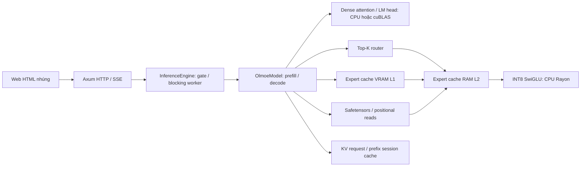

# Kiến trúc hiện tại

Mô tả mã hiện có; invariant mong muốn không đồng nghĩa đã được bảo đảm. Phát hiện gốc: [review R1–R9](reviews/2026-10-22-system-review.md); trạng thái vá hiện hành ở [PLAN](PLAN.md).

## Ranh giới module

| Module | Trách nhiệm | Invariant khi sửa |
| --- | --- | --- |
| `src/main.rs` | HTTP/status/control, SSE serialize, HTML nhúng | 400/429 trước SSE; lỗi sau headers thành error event; DONE một lần |
| `src/engine.rs` | API thư viện, một request OLMoE, spawn_blocking, queue/cancel | Không block Tokio; hủy/timeout nhả permit; snapshot có thể cũ |
| `src/olmoe.rs` | Load/config, prefill/decode, RoPE/KV/route, caches/metrics | Causal positions, reduction xác định, budget tất cả buffer, model dùng lại sau lỗi |
| `src/int8_expert.rs` | Merged layout/scales, payload recycling, CPU SwiGLU | Shape/scales hợp lệ, không mở rộng toàn expert FP32 |
| `src/safetensors.rs` | Header/offset/shape/overlap, đọc theo nhu cầu | File bất biến sau index, kiểm budget trước allocation khi API có budget |
| `src/backend.rs` | Dense/norm/softmax/attention CPU, Rayon | Tolerance fixture, finite input/output, threads thực |
| `src/gpu.rs` | CUDA/cuBLAS FFI, matrix/pinned/pool/cache | Allocation length không giả mạo, context/lifetime/drop order, scratch đồng bộ/fallback |
| `src/model/`, attention/expert/moe/memory/router/tokenizer | Tiny/reference building blocks | Không nhầm tiny format với OLMoE |
| `src/generation.rs` | Kết quả/metrics và tiny generation | Token count, finish reason, định nghĩa throughput |

Expert có thể tìm RAM trước, tải từ VRAM về host, rồi fallback file. **L1/L2 mô tả tầng lưu trữ**, không khẳng định thứ tự tra cứu hoặc expert compute trên GPU. SwiGLU hiện chạy CPU; dense GPU giữ bản weights CPU cho fallback.

Mặc định `MOE_EXPERT_CACHE_POLICY=victim`: expert đang ở RAM không upload bản sao lên VRAM; khi evict RAM, upload victim trước khi thu hồi host buffer. Admit trở lại RAM xóa bản sao L1 và trả slot sau khi download đồng bộ đã xong. Nếu expert không vừa L2, L1 vẫn có thể giữ nó. `inclusive` giữ hành vi cũ để đối chứng. Đổi policy qua `POST /api/cache/reset?expert_cache_policy=victim|inclusive` chỉ khi model idle, cùng model lock với reset; request không query giữ policy hiện hành. Không đổi thứ tự route/reduction hoặc trọng số.

## Request và bộ nhớ

1. Validate messages/model/session/context; gate trả WouldBlock/429 nếu OLMoE bận.
2. Blocking worker render template/tokenize; streaming báo ready sau validation.
3. Prefill theo layer/gom route expert, token của mỗi expert xử lý lần lượt. Candidate dispatch nhóm token chỉ còn ở cfg(test) vì A/B i5 cho thấy chậm hơn. Decode dispatch expert song song rồi cộng theo Top-K. Delta qua bounded queue; disconnect/deadline hủy hợp tác.
4. Text/token IDs/finish/metrics trả về. Prefix KV có thể giữ theo session; client vẫn gửi toàn lịch sử. Khi lượt mới khác phần cuối hoặc ngắn hơn, giữ longest common token prefix và truncate KV theo đúng vị trí causal; luôn prefill ít nhất token cuối vì session không lưu logits. Chỉ cấp KV mới nếu không có prefix dùng lại, tránh cấp bộ buffer tạm trước lookup.

Non-stream chưa hủy worker theo disconnect. Status khi suy luận có thể là snapshot cũ. Frontend chỉ commit history/metrics sau terminal+DONE và EOF hợp lệ; error/abort không commit, reader được cancel/release. Routing/VRAM placement hiển thị là minh họa, không dùng làm trace token.

Dense host/GPU, pool/scratch, L2 cache, recycled/inflight, KV capacity và tokenizer là vùng riêng. Cache limit không phải tổng RSS. Session admission/eviction tính capacity keys/values, token IDs, vector KV, SessionState và session ID; chưa gồm HashMap buckets/allocator metadata hoặc KV của request đang chạy. Metric `kv_cache_bytes` vẫn là logical keys/values bytes của request, không phải toàn bộ allocation session. Cache expert và recycled pool dùng chung ngân sách capacity mỗi layer; status báo recycled_bytes riêng. Prefill chỉ prefetch tối đa topK experts, phần còn lại đọc khi cần. Active expert payload có headroom riêng tối đa (topK+2) × bytes/expert, bao gồm decode ready/miss và lookahead2 hoặc prefill preloaded+expert đang xử lý; chưa gồm metadata, scratch/dense/KV/pinned staging và không phải tổng RSS. Reset xóa session/expert entries và recycled buffers nhưng giữ ngân sách KV để lượt sau tiếp tục lưu session. VRAM report thiếu physical pool/scratch; `expert_bytes_read` trộn file/PCIe. Timer I/O/compute chồng lấn không cộng thành wall time. Theo dõi trong PLAN trước khi dùng số liệu.

PinnedBuffer sở hữu pointer/length private, allocation portable không rỗng và không quá isize::MAX; host bytes được zero-init trước khi có slice. Getter chỉ đọc kích thước thật. Typed slice vẫn unsafe: caller chịu trách nhiệm validity/alignment của T, aliasing và đồng bộ DMA; giữ driver sống đến Drop. Upload kiểm kích thước staging bằng checked arithmetic, fallback host slices khi buffer quá nhỏ. Đây là invariant pinned buffer đã kiểm, không phải tuyên bố an toàn toàn bộ CUDA API.

Metrics mới tách `prefill_expert_io_ms`/`decode_expert_io_ms`, `expert_file_read_ms`, `expert_vram_download_ms`, `expert_vram_upload_ms` cùng payload/load counters. File timer là wall của đường load/prefetch (gồm scheduling), không phải riêng thời gian syscall; upload gồm đường staging/upload và không nằm trong legacy `expert_io_ms`. File payload đếm các load thành công, gồm speculative chưa dùng; không phải physical SSD bytes. HTTP runner ghi delta `/proc/<pid>/io:read_bytes` riêng. Không cộng các timer chồng lấn hoặc suy băng thông thiết bị từ payload/timer này.

## Hướng thay đổi

Sửa invariant với hồi quy trước, rồi tách accounting/telemetry khi cần. Chưa chia crate/di chuyển `olmoe.rs` hoặc `gpu.rs` trong lượt chuẩn hóa; refactor lớn cần PR riêng giữ API và fixture parity để không trộn thay đổi kiến trúc với bug fixes.

## Bảo vệ RAM hợp tác (đang kiểm ổn định)

Server không override cache dùng64MiB/layer cố định, không tăng theo MemAvailable. Model load kiểm kế hoạch dense decoded FP32 + toàn bộ cache cấu hình +256MiB session + working request estimate +512MiB overhead trước khi đọc weights lớn. Dense bytes trên status là số bytes weights thực đã load, không còn hardcode dense budget3GiB. Estimate không thay allocator/RSS profiler.

Guard mặc định RSS limit=min(6GiB,1/2 RAM hiệu dụng), system headroom=min(1GiB,1/8 RAM hiệu dụng); MOE_RAM_LIMIT_BYTES/MOE_RAM_HEADROOM_BYTES override bằng byte dương. Linux đọc VmRSS/MemAvailable và cgroup-v2 memory.max/current nếu nhìn thấy; ancestor constraints ngoài namespace/cgroup-v1 hoặc thiếu /proc chưa được bao phủ đầy đủ. Không có telemetry thì cảnh báo, không tuyên bố bảo vệ toàn nền tảng.

Generation kiểm reserve trước tokenization/clone/scratch, sau đó lấy mẫu tối đa mỗi25ms tại cancellation boundaries (cancel vẫn kiểm mọi lần). Áp lực RAM trả OutOfMemory: trước SSE là503, sau ready là generation_error; worker bỏ session/cache/recycled host sau khi ngừng dùng. Giữ dense và VRAM cache, không force allocator trả trang; retry chỉ thành công nếu headroom thực đủ. Guard là kiểm hợp tác, có thể overshoot giữa samples/cấp phát/driver khác, không phải hard RSS cap và chưa chứng minh hết leak/OOM. `logits()` chẩn đoán trực tiếp chưa dùng wrapper generation này.

Status bổ sung limit/headroom, session capacity/budget, VmSwap và MemAvailable; khi model bận status có thể là snapshot cũ. Đo ổn định dùng sampler /proc độc lập và watchdog, không dựa vào polling status như peak RSS.

## Đánh giá khoa học: Perplexity & Cross-Entropy Loss

Nhằm phục vụ đánh giá định lượng học thuật cho đồ án (thay thế hoàn toàn các bài kiểm tra heuristic chuỗi con 12 câu), engine tích hợp bộ đo lường chất lượng mô hình chuẩn hóa dựa trên xác suất tự hồi quy (Autoregressive Logits Evaluation).

### 1. Cơ sở toán học
Cho một chuỗi văn bản đầu vào được mã hóa thành $N$ token: $x_1, x_2, \dots, x_N$. Tại mỗi vị trí $t \in [1, N-1]$, mô hình sinh ra vector logits $z_t \in \mathbb{R}^V$ trên toàn bộ không gian từ vựng $V$ (50.280 tokens).

- **Kỹ thuật Log-Sum-Exp ổn định số học** (ngăn chặn tràn số FP32 trên exp):
  $$\text{LSE}(z_t) = \max_{v \in V}(z_{t, v}) + \ln \left( \sum_{v \in V} \exp\left(z_{t, v} - \max_{u \in V}(z_{t, u})\right) \right)$$

- **Hàm mất mát Cross-Entropy (Negative Log-Likelihood - NLL)** cho token mục tiêu $x_{t+1}$:
  $$\text{NLL}_t = -\ln P(x_{t+1} \mid x_{1..t}) = \text{LSE}(z_t) - z_{t, x_{t+1}}$$

- **Cross-Entropy Loss trung bình**:
  $$\mathcal{L} = \frac{1}{N - 1} \sum_{t=1}^{N - 1} \text{NLL}_t \quad (\text{đơn vị: nats})$$

- **Độ phức tạp ngôn ngữ (Perplexity - PPL)**:
  $$\text{PPL} = \exp(\mathcal{L})$$

- **Số bit trên mỗi ký tự (Bits-Per-Character - BPC)**:
  $$\text{BPC} = \frac{\sum_{t=1}^{N-1} \text{NLL}_t}{\ln(2) \times C} \quad (\text{với } C \text{ là tổng số ký tự văn bản})$$

### 2. Tích hợp module và thực thi
- `OlmoeModel::compute_perplexity`: Tính toán tuần tự logits trên token stream, tích lũy NLL với Log-Sum-Exp ổn định và trả về `PerplexityMetrics`.
- `InferenceEngine::compute_perplexity`: Bọc lệnh gọi qua Semaphore Gate và Tokio `spawn_blocking`, đảm bảo an toàn đa luồng và không chặn event loop.
- `examples/evaluate_perplexity.rs`: Công cụ dòng lệnh hỗ trợ đánh giá trên văn bản thô hoặc file corpus (Wikitext-2, tiếng Việt), xuất báo cáo JSON chuẩn để trích dẫn vào Chương 4 Luận văn.

## Đa định dạng Lượng tử hóa Chuyên gia: INT4 Nibble Packing & AVX2 Kernel

Nhằm tối ưu hóa băng thông I/O đĩa SSD NVMe và tiết kiệm 50% bộ nhớ RAM trong điều kiện thiết bị biên (edge devices/laptops), engine hỗ trợ cấu trúc chuyên gia INT4 nibble-packed song hành với INT8 mặc định.

### 1. Cơ chế đóng gói nhị phân (Nibble Packing)
Mỗi chuyên gia gồm 3 ma trận chiếu (Gate, Up, Down) với tổng số phần tử $N = 3 \times d_{\text{hidden}} \times d_{\text{intermediate}} = 6.291.456$ tham số:
- **INT8**: 1 tham số có dấu $\in [-128, 127]$ chiếm 1 byte $\rightarrow 6.291.456$ bytes ($\approx 6,016$ MB).
- **INT4**: 2 tham số có dấu $\in [-8, 7]$ được nén trong 1 byte `u8` $\rightarrow 3.145.728$ bytes ($\approx 3,008$ MB, giảm đúng 50%).

Quy tắc đóng gói:
- Phần tử chẵn $2i$ nằm ở 4 bit thấp (low nibble, bit 0..3):
  $$\text{byte}_i[0..3] = q_{2i} \ \& \ \text{0x0F}$$
- Phần tử lẻ $2i + 1$ nằm ở 4 bit cao (high nibble, bit 4..7):
  $$\text{byte}_i[4..7] = (q_{2i+1} \ \& \ \text{0x0F}) \ll 4$$

### 2. Giải mã và Mở rộng dấu không điều kiện (Branchless Sign Extension)
Để khôi phục số nguyên có dấu 4-bit $[-8, 7]$ về số nguyên 8-bit hoặc 32-bit:
- **Đại số bit học**: với giá trị $x \in [0, 15]$, mở rộng dấu bù 2 thực hiện qua:
  $$\text{sign\_extend}(x) = (x \oplus 8) - 8$$
  - Khi $x \in [0, 7]$: $x \oplus 8 = x + 8$, trừ 8 thu được $x$ (dương).
  - Khi $x \in [8, 15]$: $x \oplus 8 = x - 8$, trừ 8 thu được $x - 16$ (âm, dải $[-8, -1]$).
- Phương pháp này loại bỏ hoàn toàn các rẽ nhánh điều kiện (branchless), chuyển đổi trực tiếp thành 2 chỉ thị phần cứng duy nhất (`_mm_xor_si128` và `_mm_sub_epi8`).

### 3. Tăng tốc phần cứng SIMD AVX2/FMA
Kernel `dot_i4_f32_avx2` xử lý 32 nibbles (16 bytes) trên mỗi chu kỳ lặp:
1. `_mm_loadu_si128`: Đọc 16 bytes từ bộ nhớ.
2. `_mm_srli_epi16` và `_mm_and_si128(0x0F)`: Trích xuất song song 16 nibbles thấp và 16 nibbles cao.
3. `_mm_unpacklo_epi8` / `_mm_unpackhi_epi8`: Xen kẽ các nibbles trở lại thứ tự ban đầu của vector đầu vào.
4. `_mm256_cvtepi8_epi32` + `_mm256_cvtepi32_ps`: Chuyển đổi trực tiếp các số nguyên 8-bit sang 8 số thực FP32.
5. `_mm256_fmadd_ps`: Nhân dồn đồng thời với vector `input` vào 4 thanh ghi tích lũy `sum0..sum3`, giải phóng tối đa throughput của đơn vị FMA trên CPU.
