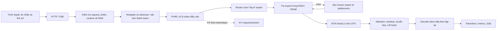

# Hướng dẫn hệ thống MoE-TierEngine

Tài liệu này là điểm bắt đầu để hiểu đồ án và lần theo bằng chứng. Nó mô tả mã nguồn hiện tại ở mức dễ đọc; số đo chỉ được khẳng định khi có hồ sơ benchmark liên kết. Cập nhật lần cuối: 08/11/2026.

## Đồ án đang giải quyết câu hỏi gì?

Đồ án xây dựng hệ thống suy luận cho mô hình ngôn ngữ OLMoE trên máy có RAM/VRAM hạn chế. Mô hình có nhiều **expert** (mạng con chuyên biệt); mỗi token chỉ dùng một nhóm nhỏ expert được bộ định tuyến chọn. Vì không cần giữ mọi expert trên GPU, engine có thể đọc expert từ file, giữ một phần trong RAM hoặc VRAM, rồi tính trên CPU. Câu hỏi kỹ thuật trung tâm là: **làm sao chạy đúng mô hình và quản lý tổng bộ nhớ/tốc độ nạp expert trong một ngân sách hữu hạn?**

Các phép thử hiện tại trả lời những câu hỏi hẹp, không chứng minh toàn hệ thống tối ưu hay hết OOM. Trạng thái nghiệm thu tổng RAM vẫn đang mở.

## Luồng từ tin nhắn tới câu trả lời

1. Web gửi các tin nhắn của cuộc chat cùng session ID. Server xác thực đầu vào và điều phối một tác vụ suy luận blocking để không chặn runtime HTTP. Khi dùng streaming, token/kết quả được gửi qua SSE.
2. Engine dựng template, biến nội dung thành **token**, rồi chạy **prefill** để xử lý prompt/lịch sử.
3. Ở mỗi layer MoE, router tính điểm expert và chọn **Top-K**. Engine tìm tensor expert trong cache VRAM/RAM; nếu thiếu, đọc tensor cần thiết từ checkpoint safetensors. Expert INT8 chạy SwiGLU trên CPU/Rayon. Attention, dense weights và LM head chạy CPU hoặc đường CUDA/cuBLAS tùy cấu hình/khả năng máy.
4. **Decode** sinh token từng bước. Mỗi bước lại chạy qua các layer, chọn expert và cập nhật KV. Engine dừng theo EOS, giới hạn token hoặc lý do khác; trả nội dung, usage và metrics.
5. Nếu client gửi lại cùng session và tiền tố token khớp, engine có thể lấy KV prefix đã lưu, cắt phần không còn khớp rồi tính tiếp. Client vẫn gửi lịch sử hội thoại; KV là dữ liệu tính toán trong RAM, không phải file transcript hay bản sao trạng thái toàn hệ thống.

Chi tiết ownership, cancellation/SSE và giới hạn telemetry nằm trong [kiến trúc kỹ thuật](ARCHITECTURE.md).

## Mô hình và thuật toán chính

### Mixture of Experts

Một layer MoE gồm router và nhiều expert. Router chấm điểm các expert cho hidden state hiện tại rồi chọn Top-K. Kết quả các expert được kết hợp theo trọng số router. Do token kế tiếp có thể chọn expert khác, engine phải tra/nạp expert liên tục. Sắp xếp tie, thứ tự reduction và phép tính ảnh hưởng kết quả số; các tối ưu phải giữ fixture/tolerance hiện có.

### Expert INT8 và phân tầng lưu trữ

Checkpoint giữ tensor expert theo định dạng safetensors. Engine lập index vị trí/shape, đọc expert theo nhu cầu; tensor INT8/scales được dùng trong SwiGLU, tránh mở rộng đồng thời toàn bộ expert thành FP32. Cache RAM và VRAM giữ một phần expert; policy hiện hành mặc định `victim`, `inclusive` còn để đối chứng. Hai policy thay cách duy trì bản host/device khi đẩy expert giữa tầng; không thay router hoặc toán học expert. VRAM cache không đồng nghĩa expert được tính trên GPU: SwiGLU hiện chạy CPU, trong khi dense/attention có thể dùng CUDA.

### Prefill, decode và KV

Attention tạo Key (K) và Value (V) theo layer/token; ở bước decode tiếp theo chúng giúp tính attention mà không xử lý lại toàn prefix. Tích hợp K/V qua layer và token gọi là **KV cache**. Session giữ KV prefix hợp lệ trong RAM; đây không lưu toàn bộ chat dưới dạng văn bản và không phải trạng thái duy nhất của engine. Transcript phía client là đầu vào để tái dựng token; cache có thể bị loại bỏ và tính lại.

Đường tái dùng prefix đã có: nếu token prefix khớp thì giữ KV tương ứng và truncate phần dư; luôn tính lại token cuối do session không giữ logits. Candidate mới `MOE_KV_BUFFER_REUSE=on` tái dùng **vùng cấp phát** KV của session sắp bị loại khi ngân sách buộc phải evict và buffer tương thích/đủ lớn. Nó xóa nội dung cũ, chuyển vùng nhớ sang request mới rồi tính KV mới. Đây không phải dùng lại kết quả KV giữa hai chat khác nhau. Tính năng opt-in, mặc định off; evict sớm nghĩa là session cũ có thể mất cache nếu request mới hủy/lỗi và phải tính lại từ transcript.

## Các tối ưu / cơ chế và câu hỏi chúng trả lời

| Cơ chế | Câu hỏi nó nhắm tới | Hiện trạng và bằng chứng | Điều chưa được kết luận |
| --- | --- | --- | --- |
| INT8 expert, nạp theo nhu cầu | Có thể chạy expert với ít bộ nhớ thường trú hơn cách giữ toàn bộ expert giải mã không? | Là đường thực thi của engine; benchmark lịch sử có hồ sơ riêng. | Chưa tự chứng minh tổng RSS, chất lượng mô hình chuẩn hóa hoặc lợi ích trên mọi máy. |
| Cache expert RAM/VRAM, victim/inclusive | Với ngân sách cache giới hạn, policy nào phù hợp hit/I/O và tổng bộ nhớ? | Có implementation và thí nghiệm policy trong hồ sơ kỳ 1; xem evidence matrix. | Kết quả cũ phụ thuộc revision, checkpoint, workload; không áp thành mặc định chung nếu thiếu điều kiện tương đương. |
| Tái sử dụng prefix KV | Khi chat tiếp tục, có thể tránh prefill lại prefix không đổi? | Có trong đường session; phép thử 5 cặp lịch sử kiểm token đầu khớp 5/5, nhưng chỉ `max_tokens=1`. | Không chứng minh tăng tốc decode dài hoặc giảm RSS toàn tiến trình. |
| Candidate tái sử dụng buffer KV | Khi phải bỏ một session, có thể dùng lại vùng KV của nó cho session mới và tránh overlap cấp phát? | Model thật i5: capacity KV đồng tồn tại 256,001→128,001 MiB; handoff 134.218.496 byte; output HTTP khớp 2/2. RSS peak lấy mẫu thấp hơn 51,910 MiB trong đúng một cặp. [Raw và giới hạn](../benchmarks/experiments/2026-11-05-kv-reuse-narrow-i5/README.md). | Một cặp, tải/swap khác nhau; không khẳng định giảm RSS ổn định, hết OOM, tăng tốc hoặc đúng logits toàn mô hình. Mặc định off. |
| Lookahead dự đoán expert lớp kế tiếp | Nếu dự đoán/nạp expert trước khi cần, có giảm chờ đọc expert không? | Có thuật toán chuyển tiếp lịch sử và gate; telemetry model thật gần nhất chỉ có cơ hội rất ít, các điều kiện miss chặn hầu hết; đang tạm gác và tắt trong phép đo RAM mới. | Chưa có bằng chứng tốc độ tổng thể khi predictor hoạt động thường xuyên; dự đoán sai có thể tăng I/O/bộ nhớ. |
| Gom/song song expert prefill | Gom token cùng expert hoặc dispatch song song có giảm thời gian prefill? | Phép thử cặp cũ candidate chậm hơn 7/9; implementation thử nghiệm đã bị bỏ khỏi đường chạy production. | Kết quả chỉ thuộc workload/revision đó. |
| Guard RAM hợp tác | Có ngăn request tiếp tục khi RSS/headroom vượt ngưỡng quan sát? | Có reserve check và sampler/watchdog trong đường generation. | Không phải hard cap: cấp phát có thể vượt giữa mẫu; không bảo đảm allocator/driver trả trang hoặc loại hết OOM. |
| Memory trace theo stage | Ở ranh giới nào capacity KV/scratch/session đổi? | 7 mốc, opt-in; dùng trong phép đo model thật. | Không phải allocator profiler; không bao phủ mọi cấp phát và không bằng RSS. |

Bảng này tóm tắt các nhánh quan trọng đang có trong source/bằng chứng. Lịch sử đầy đủ và các phép thử khác nằm trong [ma trận bằng chứng đồ án](thesis/EVIDENCE_MATRIX.md), [kế hoạch/trạng thái hiện hành](PLAN.md) và [danh mục benchmark](../benchmarks/README.md).

## RAM và thuật ngữ cần phân biệt

| Thuật ngữ | Nghĩa trong đồ án |
| --- | --- |
| Token | Đơn vị con mà tokenizer đưa cho mô hình; một từ có thể thành nhiều token. |
| Session / phiên | ID hội thoại dùng để tìm lịch sử/KV cache phía engine; không nhất thiết là file lưu chat. |
| KV cache | K/V của attention đã tính cho token trước; dữ liệu số trong RAM theo layer/session. |
| Buffer | Vùng nhớ chứa tensor/dữ liệu; buffer có thể có capacity lớn hơn số phần tử đang dùng. |
| Capacity | Dung lượng vùng đã cấp/được tính vào ngân sách; không nói bao nhiêu trang đang resident. |
| RSS | Trang của tiến trình hiện cư trú trong RAM theo hệ điều hành tại lúc lấy mẫu. RSS không bằng capacity tổng. |
| Swap / VmSwap | Trang tiến trình chuyển ra vùng swap; không phải RAM resident. Đọc RSS cùng swap giúp hiểu reclaim nhưng vẫn không phải tổng allocation. |
| MemAvailable | Ước lượng RAM hệ thống còn có thể cấp mà không phải swap mạnh; là số toàn hệ thống. |
| Cache hit/miss | Expert có/không có trong tầng cache được tra; miss thường phải lấy từ tầng khác/file. |
| Evict | Loại một mục cache/session để nhường ngân sách; lịch sử hội thoại ở client có thể còn. |
| Prefill / decode | Xử lý prompt đầu vào / sinh token kế tiếp từng bước. |
| Top-K | Chọn K expert có điểm router cao nhất cho token. |
| INT8 | Số nguyên 8-bit dùng để lưu/trình bày trọng số expert; scales giúp diễn giải giá trị. |
| RSS peak | RSS lớn nhất trong các mẫu quan sát; có thể bỏ sót đỉnh ngắn giữa hai lần lấy mẫu. |
| I/O payload | Số byte tensor engine đọc thành công theo counter; không nhất thiết là byte vật lý đọc từ SSD. |
| Fixture / parity | Mô hình nhỏ để kiểm đường code / sự bằng nhau đầu ra; fixture không đại diện bộ nhớ hay tốc độ model 7B. |
| Opt-in | Chỉ chạy khi cấu hình bật rõ ràng; mặc định không dùng. |
| i5 / i7 | Nhãn testbed trong hồ sơ; luôn kiểm hardware/checkpoint thực đo, không suy ra chỉ từ tên. |

## Đọc loại file và “report” trong repo

Repo có nhiều tài liệu vì chúng phục vụ việc khác nhau; không phải file nào cũng là báo cáo dành cho người đọc.

| Vị trí | Chức năng | Ai/việc nào dùng |
| --- | --- | --- |
| `README.md` | Giới thiệu và điểm vào repo. | Người mới clone project. |
| `docs/SYSTEM_GUIDE.md` | Bản đồ hệ thống, thuật toán, tối ưu, thuật ngữ và cách lần theo bằng chứng. | Người cần hiểu hệ thống hoặc viết đồ án. |
| `docs/ARCHITECTURE.md` | Ownership, luồng module, invariant, giới hạn kỹ thuật chi tiết. | Người phát triển/review code. |
| `docs/PLAN.md` | Câu hỏi tiếp theo, trạng thái ưu tiên và handoff hiện hành. | Chọn việc kế tiếp. |
| `docs/PROGRESS.md` | Nhật ký theo thời gian: thay đổi, lệnh, pass/fail, số liệu, giới hạn. | Truy nguyên vì sao kết luận hiện tại như vậy. |
| `benchmarks/README.md`, `SCENARIOS.md` | Quy tắc benchmark và protocol kịch bản. | Thiết kế/đọc/tái lập phép thử. |
| `benchmarks/experiments/*/README.md` | Diễn giải một thí nghiệm cụ thể, liên kết raw/checksum. | Đánh giá một kết luận có điều kiện. |
| `baocao/BAO_CAO_DINH_KY_LAN_1.md` | Báo cáo học thuật đã soạn cho kỳ 1; snapshot phạm vi/thời điểm đó. | Đọc kết quả kỳ 1, không phải trạng thái live hiện tại. |
| `baocao/HUONG_DAN_LENH_THUC_NGHIEM.md` | Sổ tay tái lập và diễn giải benchmark kỳ 1. | Tái lập/giải thích bảng trong báo cáo. |
| `docs/thesis/EVIDENCE_MATRIX.md` | Bản đồ claim ↔ benchmark/raw ↔ giới hạn. | Chuẩn bị luận văn và kiểm nguồn kết luận. |

### JSON dài hàng nghìn dòng là gì?

Nhiều JSON dài trong `benchmarks/experiments/` hoặc `benchmarks/results/` là **raw record do runner benchmark tạo ra**, đúng. Chẳng hạn `result.json` thường ghi cấu hình/provenance của một lần chạy; `turn-*.json` ghi request, câu trả lời, token/metrics/status; `memory.jsonl` là nhiều mẫu RAM theo thời gian, một JSON mỗi dòng. File suite/summary lưu nhiều mẫu hoặc kết quả tổng hợp. Chúng dài vì giữ chi tiết để kiểm tra/tái phân tích, không phải vì người đọc phải đọc tuần tự.

`benchmarks/manifest.json` là catalog các artifact lịch sử (đường dẫn, hash, loại, nhãn testbed/trạng thái/alias), **không phải một lượt đo** và không tự xác nhận số liệu. `machines.json` mô tả cấu hình dự kiến/nhãn máy, không chứng minh máy đang chạy có phần cứng đó. Các JSON trong `tests/fixtures/` là cấu hình/đầu ra kỳ vọng test; JSON trong `docs/reviews/` là bằng chứng review/validation, không phải benchmark suy luận.

Để đọc một kết quả, mở README của experiment trước; sau đó xem `result.json` cho config/run status, `turn-*.json` cho từng đầu vào/đầu ra/metrics, `memory.jsonl` cho timeline và `CHECKSUMS.sha256` để xác thực payload. Không sửa raw nhằm “sửa” kết luận; sửa phần diễn giải và giữ lịch sử gốc. Một record `historical_unverified` trong manifest là dữ liệu lưu trữ chưa được tái xác nhận theo quy tắc hiện tại, không nên trích như kết luận đã kiểm.

## Quy tắc dùng số liệu trong báo cáo

Mỗi kết luận phải kèm: câu hỏi, revision/source/checkpoint, máy/backend/threads, workload/prompt/history/context/token limit, cache/budget, số mẫu, output parity/tolerance, raw link và giới hạn. So sánh tối ưu cần cùng máy và các điều kiện trên, chỉ đổi yếu tố đang khảo sát. Tách capacity khỏi RSS, payload khỏi physical I/O, thời gian chồng lấn khỏi wall-clock, GPU được bật khỏi việc kernel GPU đã thực thi. Xem README của experiment cụ thể trước khi chép số.

## Điểm vào để tiếp tục

- **Muốn hiểu hệ thống:** đọc tài liệu này, rồi [ARCHITECTURE](ARCHITECTURE.md).
- **Muốn biết đang ở đâu/việc tiếp theo:** [PLAN](PLAN.md) và mục mới nhất trong [PROGRESS](PROGRESS.md).
- **Muốn viết báo cáo:** [Evidence Matrix](thesis/EVIDENCE_MATRIX.md), rồi mở hồ sơ raw liên kết.
- **Muốn chạy phép đo:** [Benchmark guide](../benchmarks/README.md), [scenarios](../benchmarks/SCENARIOS.md), skill `moe-benchmark` và kiểm tra guard tại máy đích.

Dự toán và bước kiểm kế tiếp: [Ngân sách RAM và thiết kế phép kiểm i5](RAM_BUDGET.md), lập08/11; phép kiểm12request đã hoàn tất trong ngưỡng nhưng RSS vẫn tăng, kết quả liên kết trong tài liệu.

Rà trọng tâm08/11: dùng [PLAN](PLAN.md) để theo lộ trình hữu hạn và [Evidence Matrix](thesis/EVIDENCE_MATRIX.md) để chọn benchmark cho từng luận điểm. Điều tra RAM hỗ trợ xác định giới hạn; đóng góp chính vẫn là suy luận/phân tầng expert và đánh đổi bộ nhớ–I/O–độ trễ.

Allocator đã được đo trên model thật08/11: [hồ sơ](../benchmarks/experiments/2026-11-08-allocator-i5/README.md). RSS tăng nhưng chỉ báo allocator đang dùng gần cố định, phần free tăng; kết quả ủng hộ giữ vùng đã giải phóng, chưa chứng minh hếtleak hoặc ổn định dài hạn.
