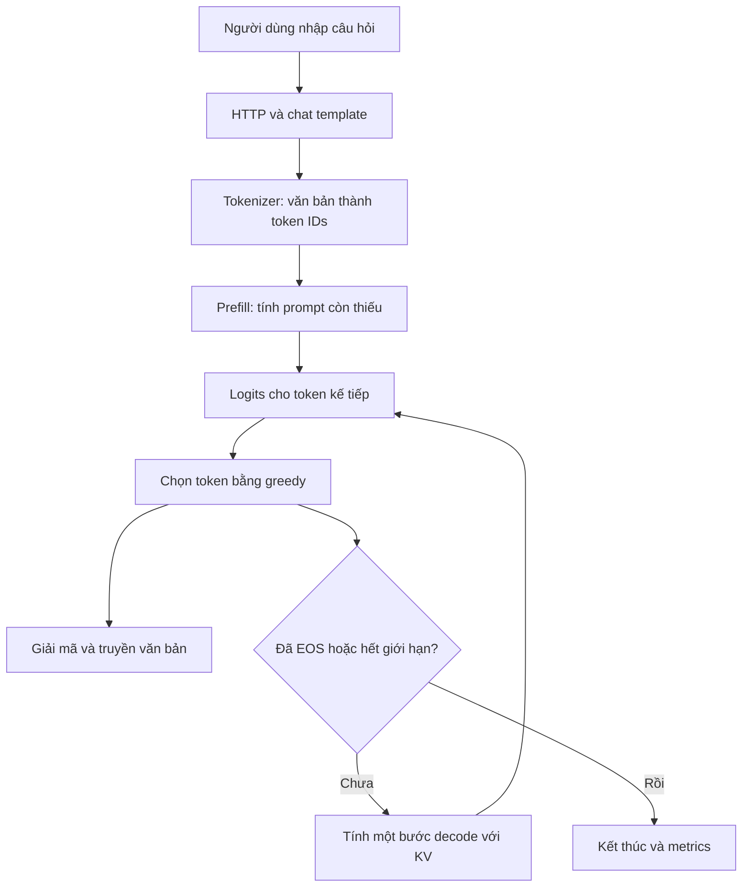

# Học và hiểu MoE-TierEngine theo từng module

*Tài liệu tự học dành cho thành viên mới, cập nhật ngày 23/10/2026. Mục tiêu là tự giải thích được đồ án và đọc được luồng code, không phải học thuộc tên thuật toán. Thay thế kế hoạch học cũ tại cùng đường dẫn.*

## Cách sử dụng tài liệu này

Bạn không cần hiểu hết Transformer, Rust, CUDA và hệ điều hành trong một buổi. Mỗi buổi chỉ học một phần, làm bài nhỏ rồi giải thích lại bằng lời. Nếu vướng một khái niệm nền, dừng ở đó; đừng mở cả `olmoe.rs` và cố đọc từ đầu đến cuối.

Mỗi module đi theo thứ tự: **bài toán → ví dụ nhỏ → cách hệ thống xử lý → chỗ đọc code → bài tập → tự kiểm tra**. Phần “đào sâu” là hướng tìm tiếp, chưa phải yêu cầu đọc hết trước khi học module sau.

Một module được xem là đã hiểu ở mức đầu khi bạn có thể làm ba việc mà không nhìn tài liệu:

1. Nói nó nhận dữ liệu gì, trả dữ liệu gì và vì sao cần có nó.
2. Chỉ ra hàm hoặc kiểu dữ liệu liên quan trong code.
3. Nêu một tình huống lỗi hoặc một đánh đổi của thiết kế.

Đây là giáo trình học, không phải hồ sơ xác nhận hiệu năng. Trạng thái hiện hành vẫn là **chưa đóng giai đoạn 1; ưu tiên OOM và tổng RAM trên i5**. Cấu hình64 MiB/layer đã được thử trên i5 nhưng chưa phải ngân sách nghiệm thu chung i5/i7. Xem [AGENTS](../../AGENTS.md) khi cần quyết định bước triển khai tiếp.

### Lộ trình đọc

| Chặng | Module | Bạn sẽ làm được |
| --- | --- | --- |
| Nhìn toàn cảnh | [M00](#m00) | Kể được hệ thống đang xây gì và phân biệt hai đường model |
| Kiến thức nền | [M01](#m01), [M02](#m02), [M03](#m03) | Đọc shape, bộ nhớ và biến đổi văn bản thành số |
| Bên trong mô hình | [M04](#m04), [M05](#m05), [M06](#m06) | Giải thích attention, router và expert INT8 |
| Dữ liệu và tái sử dụng | [M07](#m07), [M08](#m08), [M09](#m09) | Hiểu checkpoint, cache expert và KV |
| Hệ thống phục vụ | [M10](#m10), [M11](#m11), [M12](#m12) | Phân biệt GPU compute, streaming và guard RAM |
| Kiểm chứng | [M13](#m13), [M14](#m14) | Đọc benchmark và biết một test chứng minh được gì |
| Ghép tất cả lại | [M15](#m15), [M16](#m16) | Lần theo request và trả lời câu hỏi bảo vệ bằng lập luận |
| Tra cứu khi quên | [Bản đồ file](#files), [Nguồn học](#sources) | Tìm đúng module và hướng đào sâu |

Nếu chỉ có một buổi hôm nay: đọc **M00 và M01**, làm phép nhân ma trận ở M01, rồi đóng tài liệu và kể lại hệ thống trong một phút. Không cần chạy model 7B để hoàn thành buổi này.

<a id="m00"></a>
## M00. Toàn cảnh: đồ án của mình đang giải quyết việc gì?

### Bắt đầu bằng một câu hỏi thực tế

Giả sử ta có mô hình mà tất cả trọng số không thể giữ trong lượng RAM/VRAM muốn dành cho ứng dụng. Có cách nào vẫn suy luận bằng cách chỉ đưa phần cần dùng vào bộ nhớ không?

Với MoE, mỗi token chỉ đi qua một số expert được router chọn. Vì vậy, có thể giữ trọng số trên file, cache một phần ở RAM/VRAM và tải phần thiếu khi cần. Bài toán không dừng ở “load được model”: phải giữ kết quả đúng, quản lý bộ nhớ và chấp nhận/giảm chi phí đọc, truyền, tính toán.

Hệ thống của mình là một **engine suy luận**. Nó sử dụng trọng số đã được huấn luyện; không tự huấn luyện kiến thức về Sao Hỏa từ câu bạn vừa hỏi.



Trong mỗi lớp của prefill/decode còn có attention, router, expert và các hoạt động cache. Đó là phần ta sẽ mở dần ở các module sau.

### Những gì engine hiện tại làm

- Dùng OLMoE với 16 lớp, mỗi lớp 64 expert và chọn 8 expert/token/lớp theo checkpoint hiện dùng.
- Lưu trọng số expert bằng INT8, tính SwiGLU expert trên CPU.
- Dùng GPU hỗ trợ các phép dense/LM head và chứa cache expert khi môi trường đáp ứng.
- Tải expert từ VRAM về host hoặc từ file khi RAM cache không có.
- Có web local, streaming, hủy hợp tác, session KV và bảo vệ RAM có giới hạn.

Không suy ra “expert nằm trên GPU thì expert đang tính trên GPU”. **Chỗ lưu dữ liệu và chỗ tính toán là hai quyết định khác nhau.**

### Hai đường model rất dễ đọc nhầm

Trong [engine.rs](../../src/engine.rs), tìm `enum Model` và `load_with_limits`:

- Có `model.json`: đi qua `DecoderModel`, một đường model nhỏ dùng để thử các khái niệm và fixture riêng.
- Đường OLMoE thực: dùng `OlmoeModel` trong [olmoe.rs](../../src/olmoe.rs).

Vì thế đọc `src/router.rs` chưa đủ để kết luận router OLMoE hiện hoạt động thế nào. `src/tokenizer.rs` cũng là tokenizer byte đơn giản của đường tiny, không phải tokenizer thật của OLMoE.

**Bài tập:** vẽ lại sơ đồ trên bằng6–8 ô. Tô một màu cho frontend/HTTP, một màu cho model và một màu cho lưu trữ expert.

**Tự kiểm tra:** “Đồ án có thay mô hình bằng thuật toán mới không?”

<details><summary>Gợi ý trả lời</summary>

Trọng tâm là xây engine và tổ chức tài nguyên để suy luận mô hình có sẵn. Cache/prefetch/KV giúp tránh công việc hoặc truy xuất lặp trong điều kiện phù hợp; chúng không phải huấn luyện lại hay tự thêm tri thức cho model.

</details>

<a id="m01"></a>
## M01. Số, vector, ma trận và shape — nền để đọc mọi module

### Vector không đáng sợ như tên gọi

Vector là một danh sách số có thứ tự. Ví dụ `x=[2,-1]` có 2 phần tử, shape `[2]`. Ma trận là bảng số. Nếu `W` có 3 hàng, mỗi hàng 2 số, shape là `[3,2]`.

Phép nhân `y=W@x` lấy từng hàng của W nhân với x rồi cộng:

```text
W = [[1, 2],     x = [2, -1]
     [3, 4]]

y[0] = 1*2 + 2*(-1) = 0
y[1] = 3*2 + 4*(-1) = 2
=> y = [0, 2]
```

Ở đây shape `[2,2] × [2] → [2]`. Nếu x có 3 phần tử thì phép nhân không hợp lệ, dù cả hai biến đều là mảng số.

**Quy tắc đọc code:** trước khi quan tâm tối ưu, hãy viết shape bên cạnh từng biến. Rất nhiều lỗi AI thực chất là sai shape, offset hoặc số phần tử.

### Dot product nói điều gì?

Dot product là `sum(a[i]*b[i])`. Trong attention nó giúp tạo điểm tương tác giữa Q và K. Không nên luôn gọi nó là “độ giống nhau”: độ lớn vector cũng ảnh hưởng, trừ khi có chuẩn hóa phù hợp.

### Logits, softmax và argmax

Logits là điểm số chưa chuẩn hóa. Softmax chuyển danh sách điểm hữu hạn thành các trọng số không âm có tổng gần1 theo sai số số thực:

$$
p_i=\frac{e^{z_i-\max(z)}}{\sum_j e^{z_j-\max(z)}}.
$$

Trừ max giúp tránh `exp` quá lớn mà không đổi kết quả lý tưởng. Với logits `[0,2]`, xác suất xấp xỉ `[0.1192,0.8808]`. Argmax chọn chỉ số1. Greedy chỉ cần token có điểm lớn nhất; không phải lấy ngẫu nhiên theo xác suất.

### Chạy ví dụ nhỏ, không cần thư viện AI

```python
import math

W = [[1.0, 2.0], [3.0, 4.0]]
x = [2.0, -1.0]
y = [sum(w * v for w, v in zip(row, x)) for row in W]
exps = [math.exp(v - max(y)) for v in y]
probs = [e / sum(exps) for e in exps]
print("y =", y)
print("softmax =", probs)
print("argmax =", max(range(len(y)), key=lambda i: y[i]))
```

Đây là mã Python chuẩn, không cần NumPy hay tải weights. Đổi x và tự dự đoán y trước khi chạy. `zip` trong ví dụ học không tự bắt shape sai; engine cần validation chặt hơn.

### Đọc code ở đâu?

Mở [backend.rs](../../src/backend.rs), đọc `Matrix`, `validate`, `multiply`, rồi `softmax`. Bỏ qua phần tối ưu dot product ở lượt đầu. Phân biệt `rows`, `columns`, `values`: ma trận có thể được lưu thành một vector phẳng, phần tử hàng r/cột c ở `r*columns+c` theo row-major.

**Bài tập:** W shape `[4,3]`, x shape `[3]` thì output shape gì? Nếu W dùng FP32, riêng dữ liệu W chiếm bao nhiêu byte?

<details><summary>Đáp án</summary>

Output `[4]`; W có 12 phần tử ×4 byte =48 byte payload. Chưa tính metadata/capacity của Vec.

</details>

**Đào sâu khi cần:** tìm `matrix vector multiplication row major example`, `numerically stable softmax`, `floating point non associativity`. Chưa cần đạo hàm ma trận để đọc luồng inference.

<a id="m02"></a>
## M02. Rust cần biết để không bị lạc trong source

### Chỉ học trước những cấu trúc gặp hàng ngày

| Cú pháp/kiểu | Nghĩa trong đồ án |
| --- | --- |
| `struct` | Gom trạng thái, ví dụ matrix hoặc cache |
| `impl` | Các hàm gắn với kiểu đó |
| `Vec<f32>` | Buffer số thực có độ dài và capacity |
| `&[f32]` | Mượn một lát dữ liệu để đọc |
| `&mut [f32]` | Mượn độc quyền để sửa trong phạm vi hợp lệ |
| `Option<T>` | Có hoặc không có giá trị, ví dụ GPU khả dụng |
| `Result<T, E>` | Thành công hoặc lỗi |
| `?` | Nếu lỗi thì trả lỗi lên hàm gọi |
| `Arc<T>` | Nhiều owner chia sẻ ownership cùng đối tượng |
| `Mutex<T>` | Đồng bộ truy cập; khóa không có nghĩa phép tính tự chạy song song |
| `pub(crate)` | Chỉ dùng được trong crate |

Đọc một hàm theo5 câu hỏi: ai gọi, input là gì, output là gì, sửa trạng thái nào, lỗi thì sao. Không cần hiểu mọi trait/lifetime trước mới được xem engine.

### Ownership và buffer recycling

Giả sử cache sở hữu một expert. Khi expert bị evict và không còn được dùng, có thể tách weights/scales để dùng lại allocation cho expert khác. Nếu còn một worker đọc vùng nhớ đó mà ta ghi đè, kết quả có thể sai hoặc xảy ra truy cập không hợp lệ.

Ownership giúp biểu đạt ai giữ dữ liệu. Với FFI/raw pointer, compiler không tự biết hết việc thiết bị đang dùng buffer; vẫn cần invariant và đồng bộ. Vì vậy “viết bằng Rust” không phải bằng chứng mọi `unsafe` đều đúng. Nguồn học nền: [Rust Book — Ownership](https://doc.rust-lang.org/book/ch04-00-understanding-ownership.html).

### `len` khác `capacity`

```text
Vec có len=3, capacity=8, mỗi phần tử f32=4 byte:
- Payload đang dùng: 3*4 =12 byte.
- Vùng phần tử đã dành chỗ: 8*4 =32 byte.
- Metadata/allocator còn là chuyện khác.
```

Nếu chỉ tính `len` để nhận thêm session mới, bạn có thể tưởng còn RAM trong khi buffer đã reserve nhiều. Đây là một lý do đồ án quan tâm capacity khi admission cache/KV.

### Bài tập đọc source

Mở [int8_expert.rs](../../src/int8_expert.rs), tìm `resident_bytes` và `allocated_bytes`. Viết lại bằng lời mỗi hàm đang đếm gì. Sau đó tìm `into_raw`: tại sao trả weights/scales ra thay vì cấp Vec mới?

**Tự kiểm tra:** `Arc` có tự làm mọi dữ liệu thread-safe không?

<details><summary>Gợi ý</summary>

Không. Arc giúp chia sẻ ownership; tính an toàn khi sửa dữ liệu còn phụ thuộc kiểu T, đồng bộ và invariant. Với CUDA còn phải xét context, pointer và thời điểm copy/compute hoàn tất.

</details>

**Đào sâu:** `Rust ownership borrowing slices`, `Vec len capacity`, `Send Sync Arc Mutex`. Để lifetime nâng cao và unsafe đến M10.

<a id="m03"></a>
## M03. Văn bản → template → token → embedding → logits

### Token không bằng một từ

Tokenizer ánh xạ văn bản thành token IDs. Một từ có thể thành nhiều token; dấu cách, dấu câu và tiếng Việt có thể ảnh hưởng số token. IDs cụ thể phụ thuộc tokenizer. Ví dụ `[101,205,9]` trong một bài giảng chỉ là minh họa, không phải kết quả thật của `Where is Mars`.

Chat template thêm cấu trúc role và boundary: system/user/assistant. Vì vậy prompt người dùng nhìn thấy rất ngắn nhưng prompt tokens vẫn có thể gồm token cấu trúc. Không lấy `len(text.split())` làm token count của engine.

### Token ID dùng để làm gì?

Embedding là bảng `[vocab_size, hidden_size]`. Token ID chọn một hàng của bảng, tạo vector đầu vào cho model. Với cấu hình đang dùng, hidden size2048 và vocab50304. Một token đi vào các lớp sẽ biến thành hidden state có cùng chiều ẩn; không phải mã ID nguyên được đem nhân trực tiếp với expert.

Ở cuối model, LM head biến hidden state cuối thành 50304 logits. Greedy chọn một index trong vocabulary. Tokenizer giải mã index thành văn bản; một token có thể chưa đủ một chuỗi UTF-8 hiển thị hoàn chỉnh, nên streaming cần decoder tăng dần.

### Học bằng ví dụ nhỏ

Giả sử vocab chỉ có 3 token: `A`, `B`, `EOS`. Model trả logits `[1.0,3.0,-2.0]`. Greedy chọn `B`. Lượt tiếp theo model có thể trả EOS. Đó là cơ chế chọn số, không phải một hàm tra nguyên câu trả lời đã viết sẵn.

### Đọc code

- [engine.rs](../../src/engine.rs): `ChatMessage`, `chat_with_session`, `chat_stream_with_session`.
- [olmoe.rs](../../src/olmoe.rs): `render_chat`, `require_chat`, `generate_inner`.
- [generation.rs](../../src/generation.rs): `Generation`, `GenerationMetrics`.
- [tokenizer.rs](../../src/tokenizer.rs): đọc để học đường tiny, không coi là tokenizer OLMoE.

**Bài tập:** vẽ4 dữ liệu khác nhau: messages JSON, rendered text, token IDs, embedding vectors. Ghi kiểu/shape bên cạnh. Chúng không phải bốn tên của cùng một biến.

**Tự kiểm tra:** tại sao đổi dấu hỏi hoặc whitespace có thể làm phép đo không còn cùng workload?

<details><summary>Gợi ý</summary>

Tokenization có thể đổi, dẫn đến hidden state/routing/output khác. Khi so hiệu năng cần giữ input/template/token budget rõ ràng, không chỉ nói hai câu hỏi “cùng ý nghĩa”.

</details>

**Đào sâu:** tìm `chat template tokenization special tokens`, `token embedding language model head`, `incremental UTF-8 decoding`. Khi thử tokenizer thật, dùng tokenizer/checkpoint của repo; không cần tải một model mới chỉ để học khái niệm.

<a id="m04"></a>
## M04. Attention, residual, RMSNorm và RoPE

### Attention đang thiếu thông tin gì?

Khi xử lý token hiện tại, model cần kết hợp thông tin từ các vị trí được phép nhìn. Attention tạo trọng số cho các value dựa trên tương tác query/key. Cách nói “token đang tìm gì” chỉ là phép ví von; Q/K/V thực chất là những vector số được tính bằng các phép chiếu đã học.

Một đầu attention có thể viết:

$$
q=W_Qx,\quad k=W_Kx,\quad v=W_Vx,
$$

$$
a_j=\operatorname{softmax}_j(q\cdot k_j/\sqrt{d_h}),\qquad c=\sum_j a_jv_j.
$$

Causal nghĩa là vị trí hiện tại không dùng vị trí tương lai. Nhiều head xử lý các không gian con rồi ghép và chiếu output. Không nên gán sẵn “head1 chuyên ngữ pháp, head2 chuyên hành tinh” nếu chưa có phân tích cụ thể.

### Tự tính một attention hai vị trí

Cho `q=[1,0]`, hai keys `[1,0]`, `[0,1]`, hai values `[10,0]`, `[0,10]`, head dimension2. Scores là `[1/sqrt(2),0]`; softmax xấp xỉ `[0.6698,0.3302]`. Output khoảng `[6.698,3.302]`.

Điểm học ở đây: output là tổng có trọng số của **values**, không phải lấy key lớn nhất rồi bỏ mọi vị trí khác.

### Ba thành phần đi kèm

- **Residual:** cộng đầu vào nhánh với đầu ra nhánh, ví dụ `hidden += attention_output`. Nó là đường cộng cụ thể, không một buffer bí mật chứa mọi kiến thức.
- **RMSNorm:** chia vector theo thang căn trung bình bình phương rồi nhân trọng số norm; code còn có epsilon để tránh vấn đề ở mẫu số. Không tự bỏ norm vì cho rằng chỉ “chuẩn hóa phụ”.
- **RoPE:** biến đổi Q/K theo vị trí bằng phép quay. Khi dùng lại KV, vị trí phải còn đúng. Có các quy ước ghép tọa độ khác nhau; đừng chép RoPE đường tiny vào OLMoE mà không kiểm.

### Đọc code theo hai tầng

Đầu tiên đọc [attention.rs](../../src/attention.rs) để thấy phiên bản nhỏ: Q/K/V, push cache, scores và cộng values. Đây là **bài học minh họa của đường tiny**.

Sau đó xem `step`/`prefill` trong [olmoe.rs](../../src/olmoe.rs), `causal_attention_into` và các hàm norm trong [backend.rs](../../src/backend.rs). Tìm `apply_rope_cached`, không đoán rằng hàm của engine thật nằm trong `attention.rs`.

**Bài tập:** viết ra những dữ liệu bắt buộc phải giữ khi đã xử lý3 token mà muốn tính token thứ 4. Phân biệt trọng số `W_K` với cache `k_1,k_2,k_3`.

<details><summary>Gợi ý</summary>

W_K là tham số cố định giữa các request; các k_j/v_j phụ thuộc nội dung và vị trí của request. KV cache không phải bản sao các weight matrices.

</details>

**Đào sâu:** xem attention trong [bài Transformer gốc](https://arxiv.org/abs/1706.03762), rồi tra `scaled dot product attention worked example`, `RMSNorm epsilon`, `RoPE half rotation vs interleaved`. Mục tiêu lượt đầu là tự tính ví dụ2 vị trí, chưa cần đọc toàn bài báo.

<a id="m05"></a>
## M05. Router và MoE: chọn ai tính, không phải chọn đáp án

### Dense và MoE khác nhau ở đâu?

Một khối feed-forward dense dùng cùng khối trọng số cho các token. Với MoE, một router chọn một số expert từ tập có sẵn. Expert vẫn là mạng tính trên vector, không phải một file chứa kiến thức bằng văn bản.

Trong OLMoE đang dùng, mỗi lớp có 64 expert và mỗi token chọn 8. Có 16 lớp, nên8 không phải tổng số expert cho toàn bộ một request. Nhiều token cũng có thể chọn các tập khác nhau.

### Ví dụ đồ chơi:4 expert, chọn 2

Giả sử probabilities là `[0.5,0.3,0.15,0.05]`. Top2 là expert0 và1. Nếu không chuẩn hóa lại top-k:

```text
y = 0.5 * expert0(x) + 0.3 * expert1(x)
```

Nếu có chuẩn hóa lại, weights sẽ thành `[0.625,0.375]`; output nói chung khác. **Checkpoint OLMoE hiện đặt `norm_topk_prob=false`**, nên phiên bản thật không được tự thêm bước renormalize. Đó là chỗ kế hoạch học cũ đã hướng dẫn sai với cấu hình này.

Với outputs expert0=`[2,0]`, expert1=`[0,4]`, output không renorm là `[1.0,1.2]`. Tự tính output nếu renorm để thấy vì sao đây không chỉ là thay đổi trình bày.

### Đọc code

Trong [olmoe.rs](../../src/olmoe.rs), tìm `norm_topk_prob`, `top_experts`, `select_nth_unstable_by`, `step`, `prefill`. Học theo trình tự: điểm router → softmax → chọn indices → weights → cộng outputs.

[router.rs](../../src/router.rs) giúp đọc một triển khai nhỏ hơn, nhưng chính sách của nó không thay thế cấu hình/đường OLMoE. Khi bằng điểm còn cần tie-break để các lần chạy chọn thứ tự xác định.

**Tự kiểm tra:** cache có được đổi top8 thành 8 expert đang sẵn trong RAM để nhanh hơn không?

<details><summary>Gợi ý</summary>

Không được coi là tối ưu giữ nguyên model. Như vậy đã đổi lựa chọn của router và có thể đổi đầu ra. Cache phải phục vụ expert mà model yêu cầu, không âm thầm thay model để phù hợp cache.

</details>

**Đào sâu:** [OLMoE paper](https://arxiv.org/abs/2409.02060), đọc phần architecture trước. Từ khóa: `token choice routing top k`, `MoE total versus active parameters`, `router load balancing training`. Load-balancing loss là chủ đề huấn luyện, chưa cần triển khai nó để chạy inference.

<a id="m06"></a>
## M06. Expert SwiGLU và lượng tử hóa INT8

### Mở hộp một expert

Expert nhận vector x 2048 chiều và trả vector2048 chiều. Bên trong có hai nhánh gate/up đi tới chiều trung gian 1024, rồi down đưa về2048:

$$
g=W_gx,\quad u=W_ux,\quad a=\operatorname{SiLU}(g)\odot u,\quad y=W_da.
$$

`⊙` là nhân từng phần tử: `[2,3] ⊙ [4,5]=[8,15]`. Gate/up ở đây là tên các nhánh ma trận trong expert; **gate này khác router gate chọn expert**. Hai khái niệm cùng được gọi gate dễ gây nhầm.

### INT8 tiết kiệm gì?

FP32 dùng 4 byte cho mỗi trọng số. INT8 dùng 1 byte, nhưng cần scale để hiểu giá trị xấp xỉ của số nguyên. Engine dùng row-wise scale FP32:

```text
Hàng weights thật gần [0.2, -0.4, 0.1]
scale = max_abs/127 =0.4/127
quantized xấp xỉ [64, -127, 32]
reconstructed = quantized * scale
```

Số0.2 trở thành khoảng 0.20157, không đúng y hệt. Tùy số, scale và rounding sẽ có sai số khác nhau. Công thức converter còn clamp và bảo vệ hàng gần0.

Trong dot product, có thể tính `scale*sum(q[j]*x[j])` mà không tạo toàn bộ ma trận FP32. Đây là **weight-only INT8**; activation vẫn có thể là FP32. Không có nghĩa engine đã dùng instruction/Tensor Core INT8 cho toàn bộ phép tính.

### Tính dung lượng bằng tay

Một expert có 3×2048×1024 trọng số INT8, cộng `(2×1024+2048)` scale FP32:

```text
Weights: 6,291,456 byte
Scales:     16,384 byte
Tổng:    6,307,840 byte =6.015625 MiB
```

Toàn bộ16×64 expert có khoảng 6.015625 GiB payload. Điều đó **không tự chứng minh “không vừa RAM”**: còn phải biết RAM dành được bao nhiêu và những vùng khác của tiến trình. Mục tiêu là không buộc tất cả expert phải thường trú khi budget không cho phép.

### Đọc code

- [prepare_olmoe.py](../../tools/prepare_olmoe.py): tìm `amax`, `127.0`, `.qs`, `.merged_weight`.
- [int8_expert.rs](../../src/int8_expert.rs): `load_reusing` → `forward_reuse` → `fused_gate_up_swiglu` → `matvec_into`.
- Đọc `forward_single_threaded` sau: nó phục vụ scheduling ở mức expert, không có nghĩa toàn bộ engine chỉ dùng một thread.

**Bài tập:** với hàng `[1,-1]` và input `[2,3]`, nếu scale=`1/127` và q=`[127,-127]`, output là gì?

<details><summary>Đáp án và điều cần nhớ</summary>

Output=-1. Ví dụ này lượng tử hóa biểu diễn chính xác hai trọng số, nhưng không chứng minh mọi hàng đều không sai số. Tolerance logits2e-5 của fixture là kiểm triển khai trong phạm vi fixture, không phải bảo đảm chất lượng7B INT8 giống FP32.

</details>

**Đào sâu:** `symmetric per channel weight quantization`, `quantization error scale zero point`, `SwiGLU feed forward example`. INT4 cần học thêm đóng gói nibble, scale/layout và kiểm chất lượng; có enum INT4 trong repo chưa có nghĩa decoder OLMoE INT4 đã hoàn chỉnh.

<a id="m07"></a>
## M07. Checkpoint, safetensors và đọc theo offset

### Vì sao phải có một module riêng cho file?

Model chỉ tính đúng khi đọc đúng bytes, đúng shape và đúng dtype. File có thể rất lớn, chứa nhiều tensor. Nếu cần một expert mà nạp tất cả tensors vào RAM trước thì đã làm mất mục tiêu on-demand.

Một tensor có thông tin tương tự:

```text
Tên: layer0.expert7.weights      (tên minh họa)
Shape: [số hàng, số cột]
Dtype: INT8
Offset: vị trí dữ liệu trong shard
Byte length: số byte phải đọc
```

Reader lập chỉ mục rồi đọc vùng cần. Offset thuộc định dạng file; không được đoán rằng byte thứ 0 của file là trọng số đầu tiên. Header/metadata cũng chiếm không gian.

### Ví dụ không cần model thật

Tưởng tượng file chứa header và3 khối dữ liệu A/B/C. Muốn B, cần biết offset và length của B. Nếu `offset+length` vượt file hoặc tràn số nguyên, reader phải báo lỗi, không “cố đọc một phần rồi tính tiếp”.

Checkpoint còn gồm tokenizer/config. Tên thư mục giống nhau không bảo đảm bytes giống nhau; hash giúp xác nhận nội dung dùng để đo.

### Đọc code

Trong [safetensors.rs](../../src/safetensors.rs): `DType`, `TensorInfo`, `TensorIndex::open`, `add_shard`, `tensor`, `read_raw_into`, `read_f32`. Tự phân biệt raw byte length với dung lượng sau decode sang FP32.

Sau đó quay lại [olmoe.rs](../../src/olmoe.rs), hàm `load`: dữ liệu nào load đầu, dữ liệu nào chỉ được đánh index? Xem converter từ M06 để hiểu phía ghi và phía đọc phải thống nhất layout.

**Bài tập:** tensor shape `[100,200]` nếu lưu INT8 thì payload bao nhiêu? Nếu decode toàn bộ sang FP32 thì bao nhiêu? File bytes và RAM sau decode có bằng nhau không?

<details><summary>Đáp án</summary>

20,000 byte INT8;80,000 byte FP32. Chưa tính header, scales hoặc metadata. Reader phải kiểm budget đúng với representation sẽ cấp phát.

</details>

**Đào sâu:** [Safetensors documentation](https://huggingface.co/docs/safetensors/index), `positional read pread file offset`, `integer overflow tensor shape validation`. Không cần tự viết định dạng checkpoint mới để hiểu phần này.

<a id="m08"></a>
## M08. Expert cache: RAM, VRAM, eviction và prefetch

### Cache là giữ lại thứ có khả năng cần tiếp

Ví dụ cache chỉ chứa 2 expert. Chuỗi truy cập `A,B,A,C,A`:

```text
A: miss, tải A
B: miss, tải B
A: hit, không cần đọc lại A từ file
C: miss, cần bỏ một entry nếu đầy
A: hit hay miss tùy entry đã bỏ
```

Cache có hai câu hỏi khác nhau: **cái gì đang có** và **khi đầy thì bỏ cái gì**. Heat/recency/protected-probationary giúp chọn entry giữ/bỏ. Inclusive/victim lại quyết định phối hợp bản sao giữa hai tầng RAM/VRAM. Đừng coi “heat”, “LRU” và “victim” là ba tên cùng cấp cho một quyết định duy nhất.

### Hai tầng không có cùng giá hit

- Hit RAM: expert sẵn cho CPU compute.
- Miss RAM nhưng hit VRAM: vẫn cần tải D2H về host để expert CPU tính.
- Miss cả hai: đọc expert từ file, có thể được OS page cache phục vụ.

Nếu UI ghi L1 VRAM/L2 RAM, đây là cách gọi tầng lưu trữ của dự án, không phải cache L1/L2 phần cứng CPU. Thực tế đường lookup có thể kiểm RAM trước.

### Inclusive và victim qua một ví dụ

RAM giữ A/B. Nếu VRAM cũng giữ A/B, hai tầng chỉ giữ 2 expert khác nhau. Nếu RAM giữ A/B còn VRAM giữ C/D, tổng tập expert khác nhau là4.

Policy victim muốn tận dụng trường hợp thứ hai: expert bị evict RAM có thể đưa lên VRAM. Khi một expert từ VRAM được đưa vào RAM, loại bản L1 theo policy sau khi download xong. Đổi lại có thể phải truyền dữ liệu nhiều hơn. Không có định lý rằng victim luôn nhanh hơn; cần đo đúng workload.

### Prefetch là dự đoán, không phải phép màu

Giả sử ta đoán lớp sau sẽ dùng expert C nên tải sớm. Nếu đoán đúng và tải kịp, request có thể chờ ít hơn. Nếu sai, vừa đọc thêm bytes vừa giữ thêm bộ nhớ, có thể cạnh tranh với tải đang cần thật.

Trong repo có dự đoán inter-layer, lookahead và giới hạn prefetch. Học nguyên lý trước; sau đó đọc `predict_next_layer_experts`, `prefetch_missing_experts`. Không nhận “prefetch che100% I/O” chỉ từ việc thấy code gọi một tác vụ song song.

### Cache budget không bằng RSS

Cache 64 MiB/layer ×16 lớp =1 GiB budget. Trong engine hiện tại, **cache entries và recycled capacity dùng chung budget mỗi layer**; pool không được mặc định cộng thêm ngoài 64 MiB/layer. Tuy vậy, tổng RSS còn có active/inflight, dense, KV, scratch và runtime. Nếu buffer evict vẫn được giữ trong pool, nó vẫn dùng RAM dù entry count giảm.

### Đọc code

Trong [olmoe.rs](../../src/olmoe.rs), đọc theo thứ tự:

1. `Layer`, `CachedExpert` và các field cache/recycled.
2. `acquire_expert_tiered`: lấy dữ liệu từ đâu?
3. `admit_expert_l2`: có đủ budget không, evict ai?
4. `promote_to_vram`: chuyển và giữ ownership thế nào?
5. `reset_cache` và `reset_cache_with_policy`.

Trong [gpu.rs](../../src/gpu.rs), chỉ đọc interface `GpuExpertCache` ở lượt này. Để FFI bên dưới đến M10. [memory.rs](../../src/memory.rs) là đường quản lý nhỏ khác, không phải toàn bộ logic cache OLMoE; `MemoryTier::Vram` ở đó không đủ chứng minh có allocation CUDA thật.

**Bài tập:** dùng giấy mô phỏng RAM 2 entry +VRAM2 entry, lần lượt truy cập A/B/C/A/D/B theo inclusive và victim giản lược. Ghi miss file và lượt D2H. Quy định rõ chính sách bỏ entry trước khi mô phỏng, vì không có một kết quả duy nhất nếu chưa quy định eviction.

**Tự kiểm tra:** cache hit90% có bảo đảm nhanh hơn cache hit80% không?

<details><summary>Gợi ý</summary>

Không. Cần biết định nghĩa/count, cost mỗi loại hit/miss, số lần truy cập, compute và context.90% của workload dài hơn vẫn có thể có nhiều miss hơn80% của workload ngắn.

</details>

**Đào sâu:** `cache admission versus eviction`, `victim cache inclusive exclusive`, `cache thrashing working set`, `prefetch accuracy pollution`. Bắt đầu bằng mô phỏng4 expert, chưa cần học toàn bộ CPU cache coherence.

<a id="m09"></a>
## M09. Prefill, decode và KV session — hai loại cache khác nhau

### Cache expert giữ weights; KV cache giữ kết quả của nội dung đã xử lý

| | Expert cache | KV cache |
| --- | --- | --- |
| Giữ gì? | Trọng số expert | Keys/values theo token/vị trí |
| Phụ thuộc prompt? | Trọng số không đổi; tập entry nóng có thể đổi | Có, dữ liệu KV gắn với prefix cụ thể |
| Có dùng chung giữa hai câu khác nhau? | Có thể dùng lại cùng expert weights | Chỉ khi các điều kiện prefix/context hợp lệ |
| Reset có thể bỏ? | Có | Có |

### Prefill không đơn giản là chạy decode lặp từng token

Về ý nghĩa causal, phải xử lý prompt đúng thứ tự phụ thuộc. Về tổ chức, có thể đi theo layer, tính các phép dense theo batch và gom token có cùng expert. Cách tổ chức giúp dùng lại dữ liệu và giảm overhead trong trường hợp phù hợp.

Runtime prefill hiện có dispatch token theo expert tương ứng; candidate nhóm song song chỉ giữ trong test vì paired i5 cho kết quả chậm hơn đa số cặp. “Batch”, “group” và “parallel” không tự đồng nghĩa tăng tốc.

### Vì sao cần tính ít nhất token cuối prompt lại?

Giả sử session có KV cho prefix `A B C`. Prompt mới là `A B D`. Prefix chung dài2, dùng lại KV của A/B rồi tính D. Nếu prompt mới khớp toàn bộ, engine vẫn cần logits để chọn token tiếp; session hiện không giữ mọi logits nên đường reuse chặn để còn ít nhất token cuối được prefill.

Ví dụ logic:

```python
old = [10, 20, 30, 40]
new = [10, 20, 99]
common = 0
for a, b in zip(old, new):
    if a != b:
        break
    common += 1
reused = min(common, len(new) - 1)  # giả sử new không rỗng
print(reused)  # 2
```

Đây chỉ minh họa số token; code thật còn truncate KV đúng layer/vị trí, quản lý ownership và budget.

### Tính dung lượng KV để thấy context có giá

Với FP32,16 lớp,16 KV heads, head_dim128:

$$
B_{KV}=2\times16\times T\times16\times128\times4.
$$

Nếu T 512, payload128 MiB cho một bộ KV đầy đủ. Chưa gồm capacity dự phòng, tokens và metadata. Nhiều session giữ lại sẽ cộng thêm; context dài hơn không miễn phí dù weights không đổi.

### Đọc code

[olmoe.rs](../../src/olmoe.rs): `Kv`, `SessionState`, `session_bytes`, `take_prefix_kv`, `prefill`, `generate_inner`.

Bắt đầu với `take_prefix_kv`: khi nào reuse 0, khi nào reuse một phần, điều gì bị truncate? Sau đó mới đọc các tensor batch trong prefill. Luôn giữ causal positions đúng khi giải thích.

**Bài tập:** old=`[1,2,3]`. Với từng new=`[1,2,3]`, `[1,2,4]`, `[1]`, `[9,2,3]`, tính giới hạn reuse theo ví dụ trên.

<details><summary>Đáp án</summary>

Lần lượt 2,2,0,0. Trường hợp prompt khớp toàn bộ vẫn còn token cuối phải tính lại theo thiết kế này.

</details>

**Tự kiểm tra:** cùng session nhưng TTFT tăng có mâu thuẫn không?

<details><summary>Gợi ý</summary>

Không. Prompt mới có thể dài hơn, prefix token khớp ít và attention/context lớn hơn. Bộ i5 đã quan sát Love166 prompt tokens nhưng chỉ reuse 11; không nên giả định toàn history đã có KV hợp lệ.

</details>

**Đào sâu:** [Hugging Face — KV cache](https://huggingface.co/docs/transformers/main/en/kv_cache), `prefix caching longest common prefix`, `causal prefill decode KV memory`. Các chiến lược trong thư viện khác là tài liệu học, không mặc định đã được engine mình hỗ trợ.

<a id="m10"></a>
## M10. GPU, cuBLAS, pinned memory và FFI

### GPU giúp gì trong hệ thống này?

Có hai công việc tách nhau:

1. **Compute:** dense Q/K/V/O và LM head có thể dùng cuBLAS trên GPU.
2. **Storage:** VRAM giữ expert cache để giảm nhu cầu fallback file.

Expert SwiGLU INT8 hiện tính CPU. Vì vậy GPU on không có nghĩa mọi lớp/phép toán chạy GPU. Dense host vẫn có thể được giữ để fallback, nên bật GPU không tự giảm RAM theo đúng số bytes đã upload.

### GEMV khác GEMM

GEMV là nhân ma trận–vector: phù hợp xem một hidden vector. GEMM là nhân ma trận–ma trận: có thể xử lý nhiều token thành batch. Cùng phép toán lý tưởng nhưng shape/layout, overhead gọi và truyền dữ liệu khác nhau. Không lấy tỷ lệ giảm kernel launch làm tỷ lệ giảm wall nếu compute/I/O khác vẫn chiếm thời gian.

### Mỗi lần đi qua ranh giới thiết bị đều có giá

```text
Host RAM --H2D--> VRAM
Host RAM <--D2H-- VRAM
```

Một phép GPU nhỏ có thể không bù được chi phí chuẩn bị/copy/synchronize. Một hit VRAM phục vụ expert CPU lại phải D2H. Muốn nói PCIe bão hòa cần đo đường truyền tương ứng, không suy từ một timer tổng hợp.

### Pinned memory và pool giải quyết phần nào?

Pinned host memory được dành cho các đường copy thiết bị phù hợp; đây vẫn là bộ nhớ có ownership và lifetime. Pool giữ allocation/slot để tái sử dụng. Giảm số lần allocate có thể có ích, nhưng pool chiếm bộ nhớ dù slot chưa chứa payload logic mà giao diện đang đếm.

Ví dụ lỗi cần hình dung: copy cần100 byte nhưng staging chỉ có 80; hoặc slot được trả pool trong khi DMA chưa đọc xong. Hai lỗi này không sửa được bằng đổi tên biến hoặc tăng cache hit.

### CUDA context và thread

Context là môi trường tài nguyên của thiết bị. Một công việc được chuyển sang thread khác cần bảo đảm context phù hợp trên thread đó trước các API liên quan. `spawn_blocking`/Rayon có thể đưa công việc qua worker khác; đó là lý do các kiểm GPU có case across-thread, không chỉ một phép GEMV trong main thread.

### Đọc code theo lượt, không đọc cả FFI ngay

- Lượt 1: `GpuTierManager::probe`, `GpuDenseStorage`, `GpuExpertCache` trong [gpu.rs](../../src/gpu.rs).
- Lượt 2: `GpuComputeEngine::gemv`, `gemm`, `upload_expert`, `download_expert`.
- Lượt 3: `PinnedBuffer`, `GpuExpertPool`, `Drop` và các lời gọi `unsafe extern`.
- So lại nơi gọi `dense_gemv`, `dense_gemm`, `acquire_expert_tiered` trong [olmoe.rs](../../src/olmoe.rs).

**Bài tập:** vẽ nơi sống của input/output cho một dense GEMV và cho một expert hit VRAM. Hai hình khác nhau ở chỗ tính ở đâu?

<details><summary>Gợi ý</summary>

Dense GEMV dùng compute GPU khi đường GPU hoạt động; expert hit VRAM cần lấy weights về host cho expert CPU. Đây là hai lý do dùng VRAM khác nhau.

</details>

**Đào sâu — có thể để sau:** [cuBLAS chính thức](https://docs.nvidia.com/cuda/cublas/index.html); từ khóa `CUDA driver context current thread`, `pinned host memory lifetime`, `CUDA synchronous asynchronous copy`, `Rust FFI unsafe invariants`. Chưa cần học viết kernel CUDA để hiểu kiến trúc hiện có.

<a id="m11"></a>
## M11. HTTP, Tokio, streaming và hủy

### API là cửa vào, không phải một model khác

Web gửi JSON gồm messages, max_tokens và session_id đến `/v1/chat/completions`. Terminal runner HTTP cũng có thể gọi endpoint này. Nếu history/config giống nhau thì cùng đi vào engine; khác ở client, cách reset/warmup và cách ghi nhận kết quả.

Các đường CLI benchmark trực tiếp có thể bỏ qua HTTP. Vì vậy không mặc định mọi lệnh terminal có cùng phạm vi timing với web.

### Vì sao phải có `spawn_blocking`?

Async giúp thread phục vụ nhiều công việc phải chờ I/O. Vòng tính toán dài không tự nhường executor chỉ vì hàm được khai báo async. Facade đưa suy luận nặng sang blocking worker để HTTP runtime còn xử lý công việc khác. `spawn_blocking` không tự làm thuật toán MoE nhanh hơn.

Nguồn học ngắn: [Tokio — Bridging with sync code](https://tokio.rs/tokio/topics/bridging). Chỉ cần hiểu ranh giới async/sync trước khi học runtime sâu.

### Gate, lock và queue làm ba việc khác nhau

| Cơ chế | Giải quyết gì? |
| --- | --- |
| Semaphore gate | Giới hạn request OLMoE đang được xử lý |
| Mutex model | Bảo vệ trạng thái model/caches khi truy cập |
| Bounded channel | Giới hạn lượng event chờ client tiêu thụ |

Nếu queue đầy vì client không đọc, producer phải chờ hoặc timeout; đó là backpressure. Không thể cứ cấp thêm RAM để giữ vô hạn delta. Engine có hủy hợp tác khi receiver đóng/deadline; thread đang tính không biến mất ngay lúc người dùng bấm Stop.

### SSE cần hiểu ở mức protocol

Một phản hồi có nhiều delta nội dung, terminal kết thúc và marker DONE. Chunk mạng không bằng token; có thể tách giữa các byte UTF-8. Frontend chỉ nên nhận câu trả lời thành công khi chuỗi kết thúc đúng protocol. Nếu đứt stream sau câu “Mars is…”, lưu nó như câu hoàn chỉnh có thể làm history lượt sau sai.

Trước headers có thể trả HTTP400/429/503 phù hợp. Sau khi SSE đã bắt đầu, lỗi được truyền trong stream; không thể quay lại đổi status như chưa gửi gì.

### Đọc code

1. [main.rs](../../src/main.rs): `app`, `chat`, `api_error`.
2. [engine.rs](../../src/engine.rs): `chat_stream_with_session`, `blocking_stream_send`, `ChatEvent`.
3. [chat_stream.js](../../web/chat_stream.js): parser stream.
4. [index.html](../../web/index.html): ghép messages, cập nhật history, Stop/reset và hiển thị.

**Bài tập:** mô tả chuyện gì cần xảy ra khi Stop sau delta đầu rồi gửi câu mới. Đừng chỉ nói “hủy request”: ai phát hiện, worker nhả lock/permit khi nào, history có lưu câu dở không?

<details><summary>Gợi ý</summary>

Client hủy; server/worker quan sát disconnect hoặc receiver đóng tại điểm kiểm. Worker kết thúc hợp tác rồi nhả tài nguyên. Request mới có thể phải chờ hoặc bị báo busy trước lúc đó. Frontend không commit phản hồi lỗi/dở thành history thành công.

</details>

**Đào sâu:** `SSE event stream framing`, `Tokio bounded mpsc backpressure`, `cooperative cancellation`, `blocking task cancellation`. Đây là kiến thức backend hệ thống, không riêng AI.

<a id="m12"></a>
## M12. Tổng RAM, RSS, OOM và guard — phần ưu tiên hiện hành

### Vì sao cache 1 GiB mà process có thể lớn hơn nhiều?

Hãy liệt kê một “sổ chi tiêu bộ nhớ”:

```text
Dense host weights
+ Expert cache và recycled capacity
+ Active/prefetch expert payload
+ KV đang chạy và session giữ lại
+ Scratch, tokenizer, runtime
+ Pinned memory, driver, allocator và metadata
```

Danh sách này dùng để tìm nguồn; không cộng vài con số không đồng nhất rồi nhận là RSS chính xác. Capacity là một khía cạnh allocation; RSS là trang đang thường trú theo OS; page cache và VRAM lại có phạm vi khác.

### Bốn nhầm lẫn rất thường gặp

1. `clear()` làm len0 nhưng có thể giữ capacity.
2. Giải phóng object không bảo đảm allocator lập tức trả trang cho OS.
3. RSS tăng chưa đủ kết luận leak; có thể cache/scratch/allocator retention. Nhưng cũng không được tự kết luận chắc chắn không leak.
4. Process VmSwap0 không đồng nghĩa toàn hệ thống không swap hoặc mọi lượt tương lai an toàn.

### Preflight, guard và watchdog khác nhau

- **Preflight:** ước lượng kế hoạch trước cấp phát/nạp lớn, có thể từ chối sớm.
- **Guard runtime:** kiểm RSS/headroom hợp tác trong generation và trả lỗi nếu nhận thấy pressure.
- **Watchdog runner:** sampler độc lập theo dõi child nó tạo; dừng phép thử nếu vượt ngưỡng hoặc thiếu telemetry.

Guard không phải kernel hard cap. Giữa hai lần sample/cancellation boundary vẫn có thể cấp phát thêm. Các ràng buộc cgroup không nhìn thấy hết hoặc hoạt động ứng dụng khác cũng làm giới hạn thay đổi.

### Ví dụ một quyết định preflight

Giả sử giới hạn là5 GiB, RSS hiện tại2 GiB và reserve dự tính 3.2 GiB. Dù request chưa chạy, `2+3.2>5`, nên có lý do từ chối sớm. Reserve không phải số đã allocate; đây là dự phòng dùng cho quyết định.

Trong phép kiểm cache 256 MiB/layer, kế hoạch bị từ chối trước weights lớn dưới guard5 GiB. Đây là kiểm âm tính mong đợi, không cần cố gây OOM thật để “chứng minh” guard.

### Đọc code

- [ram.rs](../../src/ram.rs): `Snapshot`, `RamGuard`, `check_snapshot`.
- [olmoe.rs](../../src/olmoe.rs): `load`, `generate_controlled`, các kiểm reserve và xử lý lỗi memory pressure.
- [main.rs](../../src/main.rs): `default_cache_bytes`, mapping lỗi HTTP.
- [check_ram_stability.py](../../tools/check_ram_stability.py) và [benchmark_http_session.py](../../tools/benchmark_http_session.py): sampler/watchdog.

**Bài tập:** xem một `memory.jsonl` đã có trong [artifact RAM](../../benchmarks/experiments/2026-10-22-ram-guard-i5/README.md). Chọn 5 điểm theo thời gian, ghi RSS/HWM/VmSwap/MemAvailable. Điểm nào cho thấy “process dùng RAM tăng”? Điểm nào mới chỉ là “RAM hệ thống trống ít hơn”?

Không cần chạy lại model để làm bài đọc dữ liệu này. Đừng tăng cache hoặc tắt guard chỉ để xem máy có sập không.

**Tự kiểm tra:** một lượt 12 request không OOM cho phép kết luận gì?

<details><summary>Gợi ý</summary>

Cấu hình/workload đã hoàn tất trong khoảng thời gian đó và ngưỡng giám sát không bị vi phạm. Chưa chứng minh không leak, đã đạt plateau hoặc mọi context đều an toàn.

</details>

**Đào sâu:** `Linux RSS PSS virtual memory page cache`, `allocator retention memory leak difference`, `cgroup v2 memory.max`, `process VmHWM VmSwap`. Đọc từng khái niệm rồi quay lại một field thật, không cần học hết quản lý bộ nhớ Linux một lượt.

<a id="m13"></a>
## M13. Đọc benchmark và lập một giả thuyết tối ưu

### Học đọc các field trước khi chạy thêm

Dùng [bộ i5 phase1-v1 đã có](../../benchmarks/experiments/2026-10-22-phase1-i5/README.md). Đây là dữ liệu hữu hạn trên config đã ghi, không xác nhận đóng giai đoạn 1 hoặc ngân sách chung.

| Chỉ số | Câu hỏi nó trả lời | Điều không được tự suy |
| --- | --- | --- |
| TTFT engine | Đến mốc chuẩn bị token đầu mất bao lâu? | Không phải toàn thời gian từ bấm nút trên browser |
| Decode steps/s | Sau prefill, engine thực hiện bước decode nhanh thế nào? | Không đếm SSE chunk hay luôn bằng output_tokens/wall |
| Wall `total_ms` | Generation trong phạm vi engine mất bao lâu? | Không gồm toàn bộ startup/load và network |
| File payload | Ứng dụng đã load bao nhiêu byte tensor theo bộ đếm? | Không phải bytes SSD vật lý |
| Load wait timer | Đường load/prefetch liên quan tốn bao nhiêu thời gian? | Không riêng thời gian syscall hoặc bandwidth SSD |
| Cache counters | Có bao nhiêu hit/miss theo định nghĩa của code? | Không tự cho biết tổng thời gian tiết kiệm |
| HWM/RSS samples | Bộ nhớ quan sát của tiến trình trong khoảng thử? | Không là bằng chứng mọi lần cấp phát an toàn |

Với 128 completion tokens không EOS sớm, engine có 127 bước model sau prefill. Token đầu được chọn từ logits prefill. Vì vậy lấy128 chia `decode_ms` sẽ không khớp cách engine tính throughput hiện tại.

### Vì sao không cộng timer thành wall?

Giả sử đọc expert A mất2 giây và tính expert B mất2 giây, nhưng diễn ra đồng thời. Wall phần này có thể gần2 giây, không nhất thiết4. Trong code thực còn scheduling và các mốc khác. Vì vậy cả phép cộng lẫn phép lấy tỷ lệ phần trăm timer/wall để nhận “phần chiếm” đều phải xét phạm vi/overlap.

### Một ví dụ đọc dữ liệu bằng Python chuẩn

Chạy từ thư mục gốc repo; mã này chỉ đọc JSON đã có, không load model:

```python
import json
import statistics
from pathlib import Path

path = Path("benchmarks/experiments/2026-10-22-phase1-i5/cold/result.json")
record = json.loads(path.read_text())
runs = record["result"]["runs"]
values = [r["response"]["metrics"]["total_ms"] / 1000 for r in runs]
print("wall từng mẫu(s):", values)
print("n:", len(values))
print("median/min/max:", statistics.median(values), min(values), max(values))
```

**Bài tập:** đổi đường dẫn sang conversation. Đừng gộp cả Mars/Love làm một median: tách theo `turn=0` và `turn=1` trước. Xem prompt_tokens của từng nhóm rồi giải thích vì sao Love không phải cùng workload với Mars.

### Một phép so sánh tốt cần giữ gì?

Checkpoint, prompt/history, token limit, cache, context, threads/backend, điều kiện reset/warmup và hardware phải được ghi. So code chỉ thay biến thể code có chủ đích trên cùng máy/config; so khả năng vận hành hai máy là thí nghiệm khác và không tự quy chênh lệch cho riêng CPU.

Warmup là lượt chuẩn bị, không lén gộp vào mẫu đo. Engine-cold không có nghĩa OS-cache-cold. Raw `git_dirty=false` cùng hash giúp truy nguồn, nhưng không tự chứng minh nguyên nhân tăng tốc.

### Cách đặt giả thuyết thay vì đoán

```text
Quan sát: file loads nhiều.
Giả thuyết: hai tầng đang giữ nhiều bản trùng, giảm tập expert khác nhau.
Thay đổi có chủ đích: thử victim thay inclusive, giữ config còn lại.
Kiểm correctness: output/usage và fixture phù hợp.
Đo: wall, file loads/payload, D2H/H2D, memory; giữ từng mẫu.
Kết luận: có lợi/không có lợi trong điều kiện đã đo, ghi giới hạn.
```

Nếu kết quả không cải thiện thì cũng đã học được điều gì đó. Thử grouped prefill của repo chậm hơn7/9 cặp là một ví dụ; không chỉnh expected hoặc chọn một lượt đẹp để che kết quả.

### Đọc công cụ theo tầng

- [run_scenarios.py](../../tools/run_scenarios.py): chọn preset và gọi tuần tự.
- [run_benchmark.py](../../tools/run_benchmark.py): validate args, hash, hardware, source, record và publish không overwrite.
- [benchmark_http_session.py](../../tools/benchmark_http_session.py): workload HTTP, reset/history/warmup, parser và watchdog.
- [manifest.json](../../benchmarks/manifest.json): catalog bằng chứng lịch sử, không tự biến dữ liệu cũ thành số đo mới.

**Chú ý mặc định:** wrapper scenarios mặc định làm AB/BA policy comparison nếu không chọn single policy. Khi chỉ cần một runtime, phải hiểu `--single-policy` có tác dụng gì. Đọc [SCENARIOS](../../benchmarks/SCENARIOS.md) và preview trước; đừng chạy `cache-sweep` để học cú pháp vì nó có thể khởi động nhiều lượt model lớn tuần tự.

**Tự kiểm tra:** “Máy có giới hạn phần cứng nên không tối ưu được nữa” có được chứng minh bởi một lần đổi code không nhanh hơn không?

<details><summary>Gợi ý</summary>

Không. Có thể tối ưu sai bottleneck, tăng overhead, hoặc biến động môi trường che hiệu ứng. Muốn nói bão hòa cần đo tài nguyên/đường truyền liên quan. Kết luận đúng hơn là “phương án này chưa cải thiện trong phép thử đã làm”.

</details>

**Đào sâu:** `paired benchmark AB BA order effects`, `Amdahl law examples`, `roofline model arithmetic intensity`, `measurement noise confidence interval`. Roofline/Amdahl là mô hình phân tích cần số liệu phù hợp, không thay profiler bằng một công thức.

<a id="m14"></a>
## M14. Tests, fixture và “đúng” nghĩa là đúng đến đâu?

### Các tầng kiểm chứng khác nhau

1. **Unit nhỏ:** tính đúng dot product, shape, scale, parser hoặc budget.
2. **Fixture logits:** model nhỏ đối chiếu tham chiếu với tolerance.
3. **Targeted CUDA:** kiểm đường GPU cụ thể trên thiết bị có thật và xác nhận thực thi.
4. **HTTP fixture:** kiểm protocol/hủy/timeout mà không cần model lớn.
5. **Model thật:** quan sát hội thoại, bộ nhớ và timing ở checkpoint/config cụ thể.
6. **Quality evaluation:** nội dung đáp án có đúng/hữu ích không trên tập và tiêu chí đã chọn?

Không tầng nào thay thế hết các tầng còn lại. Clippy đạt không chứng minh CUDA không dùng pointer sai; model nói “2+2=4” không chứng minh KV truncate đúng; fixture2e-5 không chứng minh mọi tri thức của bản INT8 giống FP32.

### Tolerance cần đọc cho đúng

Nếu test yêu cầu `abs(actual-reference)<2e-5`, nghĩa là các giá trị **trong case đó** phải đủ gần. Nó không nói lỗi lượng tử hóa model thật luôn dưới2e-5, cũng không nói xác suất chất lượng là99,999%.

### Bài tập đọc một test có ích

Mở [olmoe.rs](../../src/olmoe.rs), tìm `reset_cache_preserves_session_budget_and_allows_new_prefix_reuse`. Ghi ra:

- Chuẩn bị trạng thái gì trước reset?
- Trigger là gì?
- Assert nào bắt lỗi cũ?
- Nếu chỉ xóa assert thì vì sao test “pass” không còn ý nghĩa?

Sau đó đọc `truncated_session_kv_preserves_logits_and_buffer_ownership`. Đây là lý do đọc test giúp hiểu invariant nhanh hơn đọc hàng trăm dòng pipeline.

### Lệnh học với fixture, không phải benchmark7B

Sau khi đã hiểu phần kiểm và máy không chạy benchmark khác, có thể chạy một test cụ thể:

```bash
cargo test --locked --lib reset_cache_preserves_session_budget_and_allows_new_prefix_reuse
```

Lệnh có thể build và dùng tài nguyên CPU; không chạy đồng thời phép đo hiệu năng. Xem output số test để biết có match filter hay không. Đừng tự thêm `--ignored` vào một filter chưa đọc: vài ignored tests là thực nghiệm model thật.

Cổng kiểm chung là [tools/check.py](../../tools/check.py). Mặc định kiểm tooling/docs/catalog; `--rust`, `--release`, `--http`, `--web`, `--converter` mở thêm nhóm tương ứng. Không chọn một nhóm nghĩa là chưa chạy nhóm đó.

**Bài tập:** chia các câu sau thành “test hỗ trợ được” hoặc “kết luận quá mức”:

- Prefix fixture khớp logits sau khi sửa prompt.
- Vì vậy mọi hội thoại7B đều sinh cùng token trên mọi GPU.
- Parser từ chối EOF thiếu DONE.
- Vì vậy web không thể lỗi trên mọi browser.

<details><summary>Đáp án</summary>

Câu 1 và3 là kết luận có phạm vi rõ. Câu 2 và4 vượt dữ liệu kiểm.

</details>

**Đào sâu:** `regression test minimal reproducer`, `absolute relative floating point tolerance`, `unit integration end to end testing`, `property based testing`. Bắt đầu từ test có trigger cụ thể trong repo, không viết test chỉ lặp lại công thức của implementation.

<a id="m15"></a>
## M15. Bài tổng hợp: lần theo một request từ web đến expert

Đây là bài quan trọng nhất. Bạn không cần đọc toàn bộ source; chỉ cần lần được đường gọi và các dữ liệu chính. Làm từng bước, ghi chú vào giấy hoặc file riêng của bạn.

### Lượt A — giải thích trong một phút

> Web gửi messages. HTTP kiểm request và facade lấy quyền dùng model. Worker render/tokenize, kiểm context và bộ nhớ, tìm KV prefix. Prefill phần thiếu qua các layer; mỗi layer có attention và router chọn expert. Expert lấy từ RAM, VRAM hoặc file và tính CPU; dense có thể dùng GPU. Sau logits, engine chọn token, stream text và tiếp tục decode đến EOS/giới hạn. Khi lỗi hoặc client hủy, kết thúc hợp tác và không lưu câu dở như thành công.

Đừng học thuộc đoạn trên. Hãy thay bằng lời của bạn rồi tự chỉ vào từng box trong sơ đồ M00.

### Lượt B — lần theo code

| Bước | Mở đâu | Điều phải tìm ra |
| --- | --- | --- |
| 1 | `main.rs`: `app`, handler `chat` | Endpoint nào, field nào bắt buộc? |
| 2 | `engine.rs`: streaming facade | Ai lấy gate? Ai giữ model lock? |
| 3 | `olmoe.rs`: `render_chat`, `generate_inner` | Messages thành tokens khi nào? |
| 4 | `take_prefix_kv` | Reuse bao nhiêu và buffer thuộc ai? |
| 5 | `prefill` | Layer-major, attention và route ở đâu? |
| 6 | `acquire_expert_tiered` | Hit RAM/VRAM/file khác nhau ra sao? |
| 7 | `int8_expert.rs`: forward | INT8 biến thành dot product thế nào? |
| 8 | `gpu.rs` và dense helpers | Phần nào thực sự gọi cuBLAS? |
| 9 | Decode loop | Vì sao128 output có 127 step sau prefill? |
| 10 | `ChatEvent` và JS parser | Khi nào frontend được commit history? |
| 11 | RAM guard/watchdog | Lỗi trước/sau SSE được xử lý ra sao? |
| 12 | `GenerationMetrics` | Mỗi số trên UI được đo tại mốc nào? |

Tên symbol là mốc đọc, không phải API ổn định mãi. Dùng `rg` tìm lại khi source thay đổi:

```bash
rg -n 'fn (prefill|step|take_prefix_kv)|generate_inner' src/olmoe.rs
rg -n 'chat_stream_with_session|blocking_stream_send' src/engine.rs
rg -n 'acquire_expert_tiered|admit_expert_l2' src/olmoe.rs
```

### Lượt C — giải thích một sự cố

Chọn đúng một tình huống:

- Prompt vượt context512.
- Stop sau delta đầu, gửi câu mới quá sớm.
- Guard phát hiện RSS/headroom không phù hợp.
- Expert miss RAM nhưng hit VRAM.
- Reset xóa cache nhưng RSS không hạ ngay.

Viết: **điều kiện kích hoạt → nơi phát hiện → dữ liệu bị ảnh hưởng → phản hồi → điều còn chưa bảo đảm**. Nếu kể được chuỗi này, bạn đã hiểu hệ thống hơn việc nhớ tên một optimization.

### Lượt D — đọc một kết quả thật

Từ bộ i5 chính, tự giải thích Love166 prompt tokens, cached11, TTFT cao hơn Mars19 token. Sau đó nói rõ hai điều chưa được phép kết luận: “chắc chắn SSD bão hòa” và “KV cache không hoạt động”. Cả hai cần dữ liệu khác để xác định.

<a id="m16"></a>
## M16. Tự kiểm tra và chuẩn bị hỏi đáp đồ án

### Bộ câu hỏi cốt lõi

Đóng tài liệu, trả lời mỗi câu khoảng 3–6 câu bằng lời của bạn:

1. Input của một expert là text, token ID hay vector? Vì sao?
2. Router chọn expert theo hidden state hay theo expert đang có trong RAM?
3. Vì sao64 expert không có nghĩa mỗi token tính cả 64?
4. Vì sao INT8 không bảo đảm chất lượng không đổi?
5. KV cache khác expert cache ở dữ liệu và điều kiện reuse ra sao?
6. Vì sao cùng session vẫn phải prefill nhiều?
7. Vì sao GPU on mà expert compute CPU vẫn cao?
8. Vì sao cache hit cao vẫn có load wait lớn?
9. Vì sao cache budget không bằng RSS?
10. Vì sao reset không bảo đảm OS lập tức thấy RAM giảm?
11. Vì sao worker nặng cần ra khỏi async executor?
12. Vì sao Stop không phải lúc nào nhả model ngay lập tức?
13. Vì sao timer I/O+compute có thể không bằng wall?
14. Muốn nhận code mới nhanh hơn, cần giữ điều kiện nào?
15. Điều gì bộ kiểm hiện tại chưa chứng minh?

### Rubric tự chấm, không cần cố làm đẹp điểm

- **0:** chỉ nhớ tên hoặc không trả lời được.
- **1:** giải thích ý chính nhưng chưa chỉ được dữ liệu/code.
- **2:** có ví dụ, chỉ đúng hàm/field và nêu một giới hạn.
- **3:** lần được đầu vào–đầu ra–lỗi và kiểm bằng test/raw phù hợp.

Chọn 3 câu điểm thấp nhất để học tiếp. Không cộng điểm rồi coi là chứng nhận chuyên môn; mục đích là biết lỗ hổng nằm ở đâu.

### Khung trả lời khi bảo vệ

```text
Nguyên lý: khái niệm chung là gì?
Trong hệ thống em: module nào làm, cấu hình nào đang dùng?
Bằng chứng: source/test/raw nào hỗ trợ?
Giới hạn: chưa đo hoặc chưa bảo đảm điều gì?
```

Ví dụ câu “VRAM có giúp không?”:

> VRAM vừa phục vụ dense GPU vừa là tầng lưu expert. Trong engine hiện tại, expert INT8 vẫn tính CPU, nên hit VRAM cần tải về host. Thử policy có đo lợi ích trong một config, nhưng không đủ để nhận GPU luôn tăng tốc hoặc mọi truyền dữ liệu đều giảm. Muốn định lượng theo hardware phải có phép thử tương ứng.

### Những câu nên thay bằng cách nói chính xác hơn

| Tránh nói | Nên nói |
| --- | --- |
| Rust nên không có lỗi bộ nhớ | Phần safe hỗ trợ ownership; FFI/unsafe cần invariant và kiểm riêng |
| INT8 giống hệt FP32 | Weight approximation có sai số; fixture và quality là kiểm khác nhau |
| Đã giải quyết OOM hoàn toàn | Có preflight/guard và dữ liệu hữu hạn; tổng RAM vẫn đang điều tra |
| Đọc 36 GB nên SSD đã đọc 36 GB | Đó là payload ứng dụng; physical I/O cần bộ đếm/phạm vi riêng |
| Cùng session nên khỏi tính lại | Chỉ prefix token hợp lệ được reuse, còn phụ thuộc thiết kế lưu KV/logits |
| Tăng threads là nhanh hơn | Còn phụ thuộc workload, overhead và tài nguyên; phải đo |
| Model trả đúng một câu nên engine đúng | Nội dung đúng không chứng minh số học/protocol/memory đúng mọi đường |

<a id="files"></a>
## Bản đồ file: khi cần hiểu một thứ, mở đâu?

### Đường OLMoE thực và thành phần dùng chung

| File | Vai trò chính | Đọc ở module |
| --- | --- | --- |
| [lib.rs](../../src/lib.rs) | Khai báo module và exports | M00, M02 |
| [main.rs](../../src/main.rs) | Server/API/default config/SSE serialization | M11, M12 |
| [engine.rs](../../src/engine.rs) | Facade, gate, model lock, blocking worker và stream | M00, M11 |
| [olmoe.rs](../../src/olmoe.rs) | Loader OLMoE, attention/routing/prefill/decode/KV/caches | M03–M09, M15 |
| [backend.rs](../../src/backend.rs) | Matrix, dot, norm, attention CPU, softmax | M01, M04 |
| [int8_expert.rs](../../src/int8_expert.rs) | Layout, scale, kernel CPU và recycled buffers expert | M02, M06 |
| [safetensors.rs](../../src/safetensors.rs) | Index, shape/dtype/offset, đọc tensor | M07 |
| [gpu.rs](../../src/gpu.rs) | CUDA/cuBLAS, dense storage, pinned/pool và expert cache | M10 |
| [ram.rs](../../src/ram.rs) | Đọc telemetry và guard RAM hợp tác | M12 |
| [generation.rs](../../src/generation.rs) | Kiểu kết quả/metrics và generation đường tiny | M03, M13 |

### Đường model nhỏ: dùng để học, không nhận là đúng toàn bộ engine OLMoE

| File | Bạn có thể học gì từ nó? |
| --- | --- |
| [model/mod.rs](../../src/model/mod.rs) | `DecoderModel`, forward token và phối hợp các khối nhỏ |
| [model/config.rs](../../src/model/config.rs) | Cấu hình/validation model nhỏ |
| [model/loader.rs](../../src/model/loader.rs) | Checkpoint/demo nhỏ phục vụ thử nghiệm |
| [attention.rs](../../src/attention.rs) | Q/K/V và causal attention ở phiên bản dễ theo dõi |
| [expert.rs](../../src/expert.rs) | SwiGLU FP32 ở đường nhỏ |
| [router.rs](../../src/router.rs) | RoutingDecision và router nhỏ |
| [memory.rs](../../src/memory.rs) | Store/cache nhỏ; tên Vram ở đây không đồng nghĩa allocation CUDA |
| [moe.rs](../../src/moe.rs) | MoELayer và QuantizedMatrix cho đường nhỏ/tính năng tương ứng |
| [quantization.rs](../../src/quantization.rs) | Giải mã INT8/INT4 đơn giản, chưa là pipeline OLMoE INT4 |
| [tokenizer.rs](../../src/tokenizer.rs) | Tokenizer byte tiny, khác tokenizer checkpoint OLMoE |

### Tooling và giao diện

| File/thư mục | Vai trò |
| --- | --- |
| [prepare_olmoe.py](../../tools/prepare_olmoe.py) | Chuyển đổi/lượng tử hóa checkpoint |
| [run_benchmark.py](../../tools/run_benchmark.py) | Điều phối đo và provenance |
| [run_scenarios.py](../../tools/run_scenarios.py) | Preset workload, chạy tuần tự |
| [benchmark_http_session.py](../../tools/benchmark_http_session.py) | Client HTTP/SSE, histories và giám sát |
| [check_ram_stability.py](../../tools/check_ram_stability.py) | Lượt kiểm RAM có watchdog |
| [check.py](../../tools/check.py) | Cổng kiểm tooling/docs/Rust/HTTP tùy flag |
| [stress_http.py](../../tools/stress_http.py) | Kiểm nhiều vòng HTTP complete/cancel |
| [tests/olmoe_reference.rs](../../tests/olmoe_reference.rs) | Đối chiếu logits fixture |
| [tests/int8_loader.rs](../../tests/int8_loader.rs) | Kiểm loader expert INT8 |
| [web/index.html](../../web/index.html) | UI và history/controls |
| [web/chat_stream.js](../../web/chat_stream.js) | Parser stream và xử lý kết thúc/lỗi |

Bảng này là bản đồ trách nhiệm, không khuyến khích đọc tất cả file cùng lúc. Nhiều tests nằm ngay trong source dưới `#[cfg(test)]`.

<a id="sources"></a>
## Hướng tự nghiên cứu: đọc gì, tới đâu thì quay lại?

| Chủ đề đang vướng | Tìm/đọc | Dấu hiệu đã đủ cho lượt học đầu |
| --- | --- | --- |
| Shape và ma trận | `matrix vector multiplication row major` | Tự tính được ví dụ M01 và chỉ đúng kích thước |
| Ownership | [Rust Book](https://doc.rust-lang.org/book/ch04-00-understanding-ownership.html) | Phân biệt move, borrow, mutable borrow và capacity |
| Attention | [Transformer paper](https://arxiv.org/abs/1706.03762), phần scaled dot-product | Tự tính được attention2 vị trí, biết causal mask |
| OLMoE | [Paper gốc](https://arxiv.org/abs/2409.02060), phần architecture | Giải thích expert/router/total-active và không đổi norm_topk |
| KV cache | [Tài liệu Hugging Face](https://huggingface.co/docs/transformers/main/en/kv_cache) | Phân biệt request KV, prefix reuse và weights cache |
| Safetensors | [Tài liệu định dạng](https://huggingface.co/docs/safetensors/index) | Hiểu metadata/offset/shape khác raw payload |
| Data parallel CPU | [Rayon documentation](https://docs.rs/rayon/latest/rayon/) | Biết parallel iterator/thread pool, không đồng nhất với async |
| Async và blocking | [Tokio bridging](https://tokio.rs/tokio/topics/bridging) | Giải thích vì sao cần blocking worker và bounded queue |
| GPU linear algebra | [cuBLAS documentation](https://docs.nvidia.com/cuda/cublas/index.html) | Phân biệt GEMV/GEMM, host/device và copy |
| RAM/Linux | `RSS PSS allocator retention cgroup v2` | Không nhầm capacity, resident memory, swap và page cache |
| Benchmark | `paired benchmark noise AB BA Amdahl law` | Viết được giả thuyết, controlled variables và giới hạn |

Nguồn trực tuyến được kiểm đường dẫn ngày 23/10/2026. Trang `latest`/`main` có thể đổi; khi sửa code phải đọc version dependency thực trong Cargo.lock hoặc môi trường Python, không nhận API mới trên web là API repo đang dùng. Nội dung kỹ thuật cụ thể của engine lấy từ source; kết quả đo chỉ lấy từ artifact đã ghi.

### Cách hỏi tiếp để được dạy từng buổi

Bạn có thể nhắn:

> “Học M01 cùng tôi. Giải thích từng bước, cho tôi làm một câu rồi mới sang phần tiếp.”

Hoặc:

> “Tôi hiểu công thức nhưng chưa hiểu `take_prefix_kv`; dùng ví dụ3 token và chỉ từng biến trong code.”

Hoặc:

> “Hỏi tôi5 câu về RAM/VRAM. Đợi tôi trả lời rồi sửa chỗ hiểu sai.”

Nếu một thuật ngữ chưa rõ, ghi nguyên câu và biến đang nhìn thấy. Chúng ta sẽ quay về ví dụ nhỏ, thay vì thêm nhiều thuật ngữ mới cùng lúc. Tài liệu này là đường học; khả năng giải thích bằng lời và làm bài mới là cách kiểm bạn đã nắm được hay chưa.
